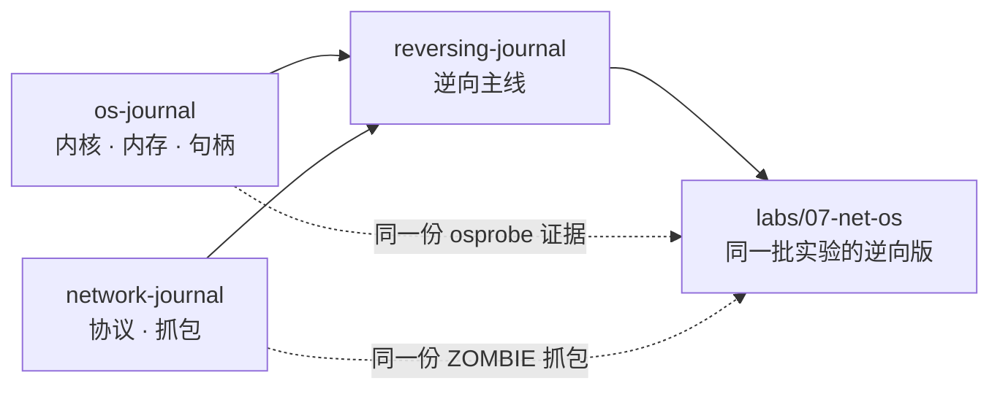

<div align="center">

<picture>
  <source media="(prefers-color-scheme: dark)" srcset="assets/banner-dark.svg">
  <source media="(prefers-color-scheme: light)" srcset="assets/banner-light.svg">
  
</picture>

<strong>二进制之下，没有秘密。</strong><br>
面向 <strong>游戏安全防护</strong> 的逆向工程学习手记 —— 不是教人写外挂，<br>
而是搞懂「作弊器是怎么工作的」，再把它堵死。

<a href="docs/00-roadmap.md"></a>
<a href="docs/03-toolchain.md"></a>
<a href="labs/"></a>
<a href="docs/07-anticheat.md"></a>


<sub><a href="docs/00-roadmap.md">24 周路线</a> · <a href="labs/">实验</a> · <a href="writeups/">题解</a> · <a href="resources.md">资源</a> · <a href="notes/_TEMPLATE.md">记录模板</a><br>姊妹仓库：<a href="https://github.com/WMWWZS/os-journal">os-journal</a> · <a href="https://github.com/WMWWZS/network-journal">network-journal</a></sub>

</div>

## ▍ 这是什么样的仓库

逆向工程有个特点：**看懂了不等于会了**。

所以这里不是教程合集，而是**学习日志**：每学一个概念，就在 [`labs/`](labs/) 里做一个能编译、能复现的实验；每分析一个目标，就在 [`writeups/`](writeups/) 里留下一篇题解；每个结论都必须能指回「地址 → 证据」。

> **看懂 ≠ 会了。** 没有写下来的分析，等于没做过。

约定：不提交编译产物（`*.exe`、`*.o` 等已在 [`.gitignore`](.gitignore) 中忽略）。

## ▍ 目录

| 目录 | 用途 | 现有 |
|:---:|---|---:|
| [`docs/`](docs/) | 系统化知识笔记：内存布局 · 调用约定 · 工具链 · 引擎专项 · 协议 · 反作弊 · Ghidra · PE · 寄存器 · 栈帧 · 操作系统 · 网络 | 15 篇 |
| [`labs/`](labs/) | 可编译、可下断点的实验，一个概念一个实验 | 3 个 |
| [`writeups/`](writeups/) | crackme / CTF / 目标分析的完整题解 | 1 篇 |
| [`notes/`](notes/) | 零散观察与踩坑记录，随手记，不成体系 | 3 条 |
| [`tools/`](tools/) | Ghidra 启动/同步脚本、GhidraScript 与反编译辅助 | 脚本 |
| [`resources.md`](resources.md) | 书单、靶场、社区，以及法律与授权边界 | 清单 |

> **第一次来？** 先读 [`docs/00-roadmap.md`](docs/00-roadmap.md) 看 24 周路线，跑一遍 [`labs/01-struct-layout`](labs/01-struct-layout/)，再用 [`notes/_TEMPLATE.md`](notes/_TEMPLATE.md) 写下第一条记录。
>
> **想知道"网络和操作系统"长什么样？** 直接跑 [`labs/07-net-os`](labs/07-net-os/)：一个真掉血的联机靶场 + 真 socket + 真抓包 + 真反编译。

## ▍ 进度

```text
$ ./status.sh
phase   topic                                state    note
R1      cpp-memory / struct-rebuild          RUNNING  labs/01 done
R2      x86-64-asm / debugger                RUNNING  labs/06 done, docs 10-13 pending
R3      pe-format / injection-surface        DONE     IAT parse -> patch -> inject
R4      external / overlay                   DONE     2D ortho projection + layered window
R5      internal / hook                      DONE     IAT / shared-vtable / inline
R6      engine / unity-il2cpp                DONE     il2cpp metadata v29 end-to-end
R7      network / authority-boundary         TODO
R8      protection / ac-taxonomy             TODO
---------------------------------------------------------------------------------
summary  phases 6/8 started   |   labs 3/5 done   |   writeups 1
```

| 阶段 | 周次 | 主题 | 产出 | 状态 |
|:---:|:---:|---|---|:---:|
| R1 | 1–3 | 内存模型与结构重建 | [`labs/01-struct-layout`](labs/01-struct-layout/) | 🟡 缺一条跨重启指针链 |
| R2 | 4–6 | 汇编与调试器 | [`labs/06-crackme01`](labs/06-crackme01/) + 寄存器级分析 | 🟡 文档 10–13 未过 |
| R3 | 7–9 | PE 与注入面 | 解析导入表 → 覆写 IAT 槽 → 注入 DLL | 🟢 已完成 |
| R4 | 10–12 | external 与覆盖层 | 2D 正交投影 + 分层窗口覆盖层 | 🟢 已完成 |
| R5 | 13–15 | internal 与 hook | 共享 vtable 原位改 + 跨线程死锁定位 | 🟢 已完成 |
| R6 | 16–18 | 引擎专项 | IL2CPP 转储 + 运行时按名解析 + 实体表 | 🟢 Unity / ⬜ UE |
| R7 | 19–21 | 联网：权威边界与改包 | opcode 表 + 一次字段篡改 | ⬜ 未开始 |
| R8 | 22–24 | 保护对抗与综合 | 全链分析报告 | ⬜ 未开始 |

> 阶段划分、判据与三线并行调度以 [`docs/00-roadmap.md`](docs/00-roadmap.md) 为准。

## ▍ 能力模型

四块地基，缺一块都会卡住：

| 模块 | 必须掌握 | 缺了会卡在哪 |
|:---:|---|---|
| **C / C++** | 指针算术、内存布局、结构体对齐、union、虚表、编译成 DLL | 看不懂 `// 0x60` 这种偏移，也不知道指针链为什么加 8 |
| **汇编** | x86-64 为主、ARM64 为辅；调用约定、栈帧、结构体返回 | 断点打下去，不知道哪个寄存器是 `this` |
| **操作系统** | 进程/线程、虚拟内存、PE 格式、句柄、DLL 加载 | 读写自己进程可以，跨进程就被拒 |
| **编译链接** | 导入导出表、重定位、RTTI、异常表 | 定位不到函数，也认不出运行时 |
## ▍ 姊妹仓库

这套东西不放在一个仓库里。**同一批实验，三种视角**：

| 仓库 | 讲什么 | 和这里的关系 |
|---|---|---|
| **reversing-journal**（本仓库） | 逆向主线：内存布局 · 汇编 · 栈帧 · PE · 工具 · 引擎 · 反作弊 | 从**对面**看：别人写的程序怎么被读出来 |
| [os-journal](https://github.com/WMWWZS/os-journal) | 操作系统原理：内核边界 · 调度 · 虚拟内存 · 文件与 I/O · 同步 · 观测 | 逆向的**地基**：进程、地址空间、句柄、syscall 是谁给的 |
| [network-journal](https://github.com/WMWWZS/network-journal) | 网络通信原理：分层 · TCP 状态机 · TLS · DNS · 私有协议 · 抓包 | 逆向的**战场**：联机游戏的分析对象全在这一层 |



这次新增的三份产出，每个主题都有**原理版**和**逆向版**，证据是同一份：

| 实验 | 原理版（专题仓库） | 逆向版（本仓库） |
|---|---|---|
| 进程地址空间 / ASLR / TEB / 句柄 / syscall | `os-journal` → `labs/02-address-space-probe` | [`docs/14`](docs/14-operating-system.md) + [`labs/07-net-os/os`](labs/07-net-os/os/) |
| 自定义二进制协议 / 抓包 / 改包 / 反编译 | `network-journal` → `labs/06-zombie-protocol` | [`docs/15`](docs/15-network.md) + [`labs/07-net-os/net`](labs/07-net-os/net/) |

> 为什么要分仓：**原理课要能测量、逆向课要能还原**。同一份 evidence 在两个仓库里被问的是不同的问题——
> os-journal 问"这个数字为什么是这样"，本仓库问"这段代码为什么长成这样"。
## ▍ 原则

| 原则 | 落地方式 |
|:---:|---|
| **合法边界** | 只分析自己开发的、有书面授权的、CTF 靶场的或单机离线的目标；不制作、不分发任何作弊工具。 |
| **可复现** | 结论必须带「怎么做到的」：目标版本、工具、断点、偏移、截图或日志。 |
| **防守优先** | 学攻击是为了找到设防点：每一类攻击面，对应一层可检测的痕迹。 |
| **写下来** | 没有写下来的分析等于没做过；模板见 [`notes/_TEMPLATE.md`](notes/_TEMPLATE.md) 与 [`writeups/_TEMPLATE.md`](writeups/_TEMPLATE.md)。 |

## ▍ 环境

```text
$ ./env.sh
[ok] windows 11 x64
[ok] mingw-w64      gcc 14.2 / gdb / objdump
[ok] ghidra         12.2   (JDK 25)
[ok] x64dbg
[--] ida free
[--] arm64 toolchain
```

主力工具链是 MinGW-w64。Ghidra 已装好，启动：

```powershell
powershell -ExecutionPolicy Bypass -File .\tools\ghidra.ps1
```

> Ghidra 12.x 要求 **JDK 25+**，本机额外装了 JDK 25；系统里其他项目仍可用 JDK 21。
>
> 上手流程见 [`docs/08-ghidra.md`](docs/08-ghidra.md)，工具全表见 [`docs/03-toolchain.md`](docs/03-toolchain.md)。

---

<div align="center">

<sub><strong>「没有写下来的分析，等于没做过。」</strong></sub><br>
<sub>只分析自己的 · 有书面授权的 · CTF 靶场的 · 单机离线的目标</sub><br>
<sub>不制作、不分发任何作弊工具</sub>

</div>
