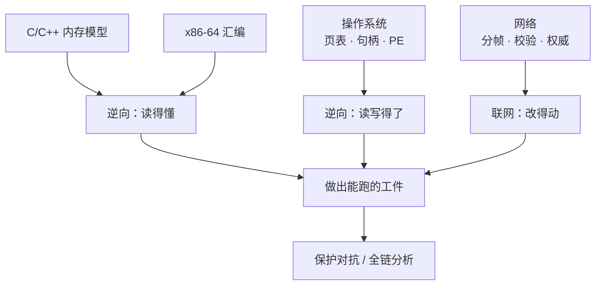

# 学习路线：24 周（主线）

> 从「能读代码」到「能独立把一个游戏客户端拆到能量化的程度，并做出能跑的东西」。

这是三仓库里的**主线**。[`os-journal`](https://github.com/WMWWZS/os-journal) 与 [`network-journal`](https://github.com/WMWWZS/network-journal) 是支撑线：它们提供「跨进程读写安全吗」「服务端信不信客户端」这两类判断所需的底层知识。

## 这份路线和上一版的区别

上一版是 12 周、目标写的是「给出防护方案」——那是防御视角。这一版改成 24 周、目标改成**做出可运行的工件**，理由是：

| 旧 | 新 | 为什么改 |
|:---:|---|---|
| 12 周 | 24 周 | 加了联网协议线；每个阶段要求真产物而不是「读完」 |
| 单线 | 主线 + 两条支撑线 | 逆向的瓶颈常常在 OS（句柄/页表）和网络（权威边界），不在逆向本身 |
| 止于「防护方案」 | 止于「全链分析 + 综合靶场」 | 能打穿才知道防护该放哪；只读防护设计会在第一层就卡住 |
| 以文档周为单位 | 以**阶段产物**为验收单位 | 「读完 3 篇」不可验证，「注入后能画出一个方框」可验证 |

## 能力模型：四块地基

缺一块都会在具体某一步卡死，而且卡的位置是可预测的：

| 模块 | 必须掌握 | 缺了会卡在哪 |
|:---:|---|---|
| **C / C++ 内存模型** | 指针算术、结构体布局与对齐、union、虚表、`extern "C"`、编译成 DLL | 看不懂 `// 0x60` 这种偏移，也不知道指针链为什么加 8 |
| **x86-64 汇编** | 寄存器、调用约定（MS x64 的 4 个整参寄存器 + 结构体返回隐藏指针）、栈帧、跳转与条件 | 断点打下去看到一堆寄存器，不知道哪个是 `this` |
| **操作系统** | 进程/线程、虚拟内存与页表、句柄与权限、DLL 加载、PE 结构 | 能读写自己进程，跨进程就被拒；看不懂反作弊在查什么 |
| **网络** | 分帧、端序、校验和、TLS、权威边界 | 单机能做，一联网全部失效，不知道为什么 |

推荐顺序不是按模块，是按**卡点**：先补让你能「读懂」的（C++ + 汇编），再补让你能「读写」的（OS），最后补让你能「联网」的（net）。

## 你现在在哪（真实锚点）

这份路线不是从第 1 周开始的空表。仓库 `notes/` 与 `labs/` 已经记录了实际进度，其中一次完整的项目覆盖了 R1 / R3 / R4 / R5 / R6 的大部分：

| 阶段 | 状态 | 证据 |
|:---:|---|---|
| R1 内存模型与结构重建 | 🟡 部分 | `labs/01-struct-layout` 已做；但「重启不失效的指针链」还没做过 |
| R2 汇编与调试器 | 🟡 部分 | `labs/06-crackme01` 已做；寄存器/栈帧的 4 篇文档（10–13）还没过 |
| R3 PE 与注入面 | ✅ 已打通 | 走完了「解析 PE 导入表 → 覆写 IAT 槽 → 注入 DLL」全流程 |
| R4 external 读写与覆盖层 | ✅ 已打通 | 2D 正交投影、世界→屏幕、分层窗口 + GDI 覆盖层 |
| R5 internal 与 hook | ✅ 已打通 | IAT hook / 共享 vtable 原位改 / 私有 vtable 三条路都试过，含一次跨线程消息死锁的定位 |
| R6 引擎专项 | ✅ 已打通（Unity） | metadata v29 转储、运行时按名解析 il2cpp API、实体表枚举。UE 未做 |
| R7 联网 | 🔴 未开始 | `labs/07-net-os` 有靶场骨架，但权威边界与改包没做过 |
| R8 保护对抗 | 🔴 未开始 | `docs/07-anticheat.md` 只有框架 |

**结论：起点在 R2 补齐 + R7 从零开始，不是 R1。**

## 分阶段计划（24 周 = 8 阶段 × 3 周）

### R1（第 1–3 周）内存模型与结构重建

- 结构体布局、对齐、填充；`sizeof` 为什么不是字段之和
- 指针链：基址 → 一级偏移 → 二级偏移，以及为什么重启后会变
- CE 的三件套：首次搜索 / 变化后二次搜索 / `Find out what accesses`
- 用 ReClass 把「一堆偏移」还原成有字段名的结构体

**产出**：一个重启不失效的 CE 表 + 一份结构体还原图（含每个字段的用途猜测与证据）
**判据**：给你一个单机游戏的血量，20 分钟内找到一条跨重启有效的指针链

### R2（第 4–6 周）汇编与调试器

- 寄存器与标志位（[10](10-registers.md)、[11](11-flags.md)）
- 栈帧：`push rbp; mov rbp,rsp`、局部变量、返回值（[13](13-stack-frame.md)）
- 调用约定：MS x64 下前四个整参在 RCX/RDX/R8/R9；**结构体返回何时走隐藏指针**
- x64dbg：断点、单步、内存断点、调用栈（[12](12-x64dbg.md)）

**产出**：3 个 crackme 题解 + 一段「扣血指令」的寄存器级分析（哪个寄存器是 this、哪个偏移是血量、谁在写）
**判据**：看到一个函数，能说出它大概在干什么、参数是什么、返回值放哪

### R3（第 7–9 周）PE 与注入面

- PE 头、节表、导入表 / 导出表 / 重定位（[09](09-pe-format.md)、[03](03-toolchain.md)）
- DLL 加载与 IAT 的关系；IAT 槽是**数据**，改它不需要动代码字节
- 注入：`CreateRemoteThread` + `LoadLibraryW`；`DllMain` 的约束（不能拿 loader lock）
- 挂起启动 + 注入 + 恢复的时序

**产出**：一个能注入并在目标日志里写出一行的 DLL + 注入器
**判据**：能说清「为什么在 `DllMain` 里 `LoadLibrary` 会死锁」

### R4（第 10–12 周）external 读写与覆盖层

- `OpenProcess` 权限组合与失败码（`ACCESS_DENIED` 的三种成因）
- `ReadProcessMemory` 的安全读取：空指针、对齐、跨页
- 2D 正交投影：`k = screenH / (2 * orthoSize)`，为什么要用相机 right/up 而不是直接相减
- 覆盖层两条路：分层窗口 + GDI（不碰游戏设备）vs Present hook（快但会与第三方 overlay 冲突）

**产出**：一个**外置进程**版的单机游戏透视（读内存 + 屏幕覆盖，不注入）
**判据**：能解释「为什么 external 版更难被第三方 overlay 带崩」

### R5（第 13–15 周）internal 与 hook

- 三种 hook：IAT 覆写（数据）、vtable 原位改 / 对象 vptr 改（数据）、inline trampoline（改代码字节）
- 共享 vtable vs 对象 vptr：为什么工厂对象会有多个实例但同一个 vtable
- 线程安全：托管方法从非主线程调用的风险、GC 与装箱
- Win32 陷阱：`SetWindowPos` / `UpdateLayeredWindow` 是**同步**的，窗口归属线程必须泵消息
- 渲染线程不能拿 loader lock

**产出**：注入式透视（internal 版）+ 一份「试过但失败的 hook 路线」记录（这部分比成功更值钱）
**判据**：给出一个卡死现象，能判断是死锁、loader lock、还是竞态

### R6（第 16–18 周）引擎专项

- Unity Mono：dnSpy 直读 `Assembly-CSharp.dll`
- Unity IL2CPP：metadata 版本识别（magic `0xFAB11BAF`）、Il2CppDumper 原理、dump.cs 的字段偏移语义
- 运行时解析：`il2cpp_class_from_name` / `field_get_offset` / `runtime_invoke`；**泛型定义查不到字段偏移**这个坑
- ABI：为什么 `Vector3`（12 字节）返回要走隐藏指针，以及为什么改用 `runtime_invoke` 更稳
- UE：UObject / GObjects / UWorld 链（[05](05-engine-unreal.md)）

**产出**：从零 dump 一个 IL2CPP 游戏，定位实体总表并列出前 5 个实体
**判据**：拿到一个 Unity 游戏，30 分钟内说出「Mono 还是 IL2CPP、实体表在哪个静态字段」

> 缺口：R4 与 R5 目前没有对应文档（`docs/` 里 01–15 没有覆盖 external/internal 的实现细节）。这两块要么补两篇文档，要么直接把 `labs/` 当教材。

### R7（第 19–21 周）联网：权威边界与改包

依赖 `network-journal` 阶段 5 已完成的协议分析能力。

- 权威边界三种形态：客户端预测 / 服务端裁定 / 回滚补偿
- **探测方法**：改一个字段，回弹=已复核、静默接受=未复核、踢线=有检测
- 分帧与 opcode 表：定长 / 长度字段 / 分隔符；高频=心跳移动，低频长载荷=背包交易
- 校验和对拍：累加和 / 异或 / CRC16，用真包反推是哪种
- 反重放三件套：`nonce` / `timestamp` / `seq`，以及插入伪造包后要顺延后续 seq
- 打法选择：改结果（多半被打回）vs 改输入（视角、动作、技能选择）

**产出**：自建服务端游戏的 opcode 表 + 一次成功的字段篡改（含改前改后的包与对端反应）
**判据**：给一种作弊手法，能说出它会被服务端哪一层拦下，以及怎么验证

### R8（第 22–24 周）保护对抗与综合

- 壳与虚拟化：UPX / Themida / VMProtect 的识别与拆解路径
- 反调试、反虚拟机、完整性自校验、时间差检测
- 反作弊分类与各自检测面：EAC / BattlEye（内核驱动 + 回调）/ ACE / Vanguard（需 Secure Boot + TPM，实际只剩 DMA）
- 内核层：`ObRegisterCallbacks` 拦句柄、驱动回调
- DMA 硬件路线：为什么不进目标进程就没有句柄可查

**产出**：一份「某款游戏的全链分析报告」——从识别引擎到权威边界到检测面，每一层都有证据
**判据**：给你一个陌生游戏，能画出它的攻防层次图，并标出你最可能卡在哪一层

---

## 三线并行调度表

主线与支撑线的关系是「支撑先于主线」：

| 周次 | reversing（主线） | os-journal（支撑） | network-journal（支撑） |
|:---:|:---|:---|:---|
| 1–3 | R1 内存模型 | 阶段 1 内核边界 | 阶段 1 分层与封装 |
| 4–6 | R2 汇编与调试器 | 阶段 2 进程与线程 | 阶段 2 TCP |
| 7–9 | R3 PE 与注入 | 阶段 3 虚拟内存 | 阶段 3 UDP/DNS/HTTP/TLS |
| 10–12 | R4 external 与覆盖层 | 阶段 4 文件与 I/O | 阶段 4 HTTP/2、HTTP/3 |
| 13–15 | R5 internal 与 hook | 阶段 5 并发与同步 | **阶段 5 自定义协议（R7 的前置）** |
| 16–18 | R6 引擎专项 | 阶段 6 观测与检测面 | 阶段 6 延迟与排障 |
| 19–21 | R7 联网 | —（复习） | —（复习） |
| 22–24 | R8 保护对抗 | — | — |

硬约束只有三条：**R4 之前必须过 os 阶段 3（虚拟内存）**、**R5 之前必须过 os 阶段 2（进程与线程）**、**R7 之前必须过 net 阶段 5（自定义协议）**。其它可以并行乱序，但这三个顺序不能反。

## 怎么和我一起学

一次只走一个推理步，规则固定：

| 环节 | 要求 |
|:---:|---|
| 开场 | 我先问一个问题，测你这一步的真实边界；答不上来就往下退一级，不硬推 |
| 一个推理步 | 一次只讲一个「没有它就无法理解下一步」的点；讲完立刻给一个可跑的验证 |
| 产物 | 每一步都要落到文件：`labs/` 里的代码、`notes/` 里的一条记录、或 `evidence/` 里的一段输出 |
| 判据 | 合上文档，用嘴把这一步讲一遍；讲不顺就是没到 |
| 错的先记下来 | 走错的路径写进笔记，比走对的更值钱（见 `labs/07-net-os` 那类记录） |

如果我认为你的前提假设有问题，我会直接说，不先夸再转折。

## 检验标准（自测 4 题）

| # | 问题 | 对应能力 |
|:---:|---|---|
| 1 | 给你一个没见过的 exe，30 分钟内说出：编译器、是否加壳、什么运行时、有没有反作弊？ | R2 / R3 / R8 |
| 2 | 给你一个游戏里的地址，能说出它属于哪个结构体的哪个字段，并画出从模块基址到它的指针链？ | R1 / R2 |
| 3 | 给你一款 Unity 游戏，30 分钟内定位实体总表并读出实体数量？ | R6 |
| 4 | 给你一种作弊手法，能说出它在客户端留什么痕迹、服务端哪一层会拦、怎么验证？ | R7 / R8 |

四题都能讲清楚，才算真的能独立干活。

## 本机环境（与两支撑仓库共用）

| 工具 | 版本 / 路径 | 用途 |
|:---:|---|---|
| Windows 11 x64 | build 26200 | 唯一平台 |
| MinGW-w64 gcc 14.2.0 | `C:\mingw64`，x86_64-win32-**seh** | 编译 DLL / 靶场 |
| Python 3.11 | 用 `py` 启动（`python` 是 Store stub） | 脚本、pcap、字节处理 |
| Wireshark 4.0.17 | `E:\Wireshark`（不在 PATH） | 抓包与 Lua 解析 |
| Il2CppDumper | `D:\tools\Il2CppDumper` | IL2CPP 转储 |
| Ghidra / IDA Free | 见 [08](08-ghidra.md) | 静态分析 |
| x64dbg | 见 [12](12-x64dbg.md) | 动态调试 |

缺的（文档里会标「需先安装」）：Cheat Engine、ReClass.NET、System Informer（原 Process Hacker）、Wireshark 的 Npcap 若未装。

> **本机有一个必须先知道的环境事实**：机器上装过一个会全局注入的第三方 overlay SDK，它在被挂钩的任意窗口进程里以固定偏移崩溃，连纯 GDI 的独立程序都会被它带崩。做这类实验前先确认它没在跑——这不是自己的代码问题，但会浪费你半天。

## 相关

- 第一阶段先做：[`labs/01-struct-layout`](../labs/01-struct-layout/)
- 已有的完整靶场：[`labs/07-net-os`](../labs/07-net-os/)
- 任务清单：[`TASKS.md`](../TASKS.md)
- 姊妹仓库：[os-journal](https://github.com/WMWWZS/os-journal) · [network-journal](https://github.com/WMWWZS/network-journal)
