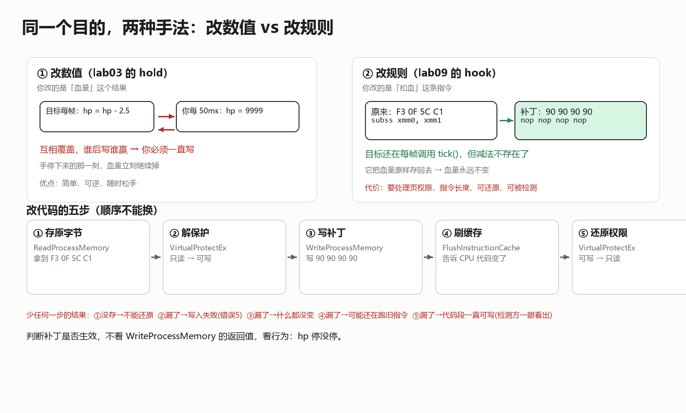

# 实验 09 · 改代码（hook）：让"减血"这条指令消失

> 到 08 为止，你改的都是**数据**——目标下一帧重算，你就得再写一次（`hold` 那个循环）。
> 这一节改的是**指令本身**：把 `hp -= 2.5` 那条指令换成 `NOP`，
> 血量不是"被你按住"，而是**目标自己算不出来了**。
>
> 这就是"改数据"和"改逻辑"的分界线。


## 0. 前置知识（缺哪块先回去补，别硬撑）

| 需要会 | 来自 | 用在本节哪一步 |
|---|---|---|
| 跨进程读 8 字节、走指针链 | [labs/04-pointer-chain](../04-pointer-chain) | 找到 hp 地址；验证补丁是否生效 |
| 特征扫描 + 候选验证 | [labs/05-aob-scan](../05-aob-scan) | 扫 `F3 0F 5C C1` 找到"减血"那条指令 |
| 跨进程写 + 权限三件套 | [labs/03-write-memory](../03-write-memory) | 把 4 个 NOP 写进去 |
| 页保护 / 线程 / 指令缓存（概念） | [docs/14-operating-system.md](../../docs/14-operating-system.md) | 理解五步为什么不能少 |

**不需要**：注入（06）、引擎知识、目标游戏本身。

## 0.5 游戏里这对应什么

| 你玩的时候看到 | 进程里是什么 | 具体到字节 |
|---|---|---|
| 我的角色 | Entity 结构 | 每个 0x28 字节 |
| 我的血量 | Entity 的 hp 字段 | 实体 +0x10，float 4 字节 |
| 掉血这件事 | `tick()` 每帧执行 `hp -= 2.5` | 代码段 4 字节：`F3 0F 5C C1` |
| 你平时"改血量" | 改 hp 那 4 个字节 | 下一帧被重算 → 只能循环写 |
| 本节"改规则" | 改 `hp -= 2.5` 这条指令 | 一劳永逸，不用循环 |

一句话：**你不是在改血量，你是在改"扣血"这条规则本身。**

---

## 1. 目标指令长什么样

靶子用 `-O0 -fno-inline` 编译，`tick()` 里那三行是：

```asm
1400014a8: f3 0f 10 0d 40 2c 00 00   movss xmm1, [rip+0x2c40]   ; 常量 2.5
1400014b0: f3 0f 5c c1               subss xmm0, xmm1            ; ← 要干掉的就是它
1400014b4: f3 0f 11 40 10            movss [rax+0x10], xmm0      ; 存回 hp
```

把 `subss` 换成 4 个 `90`（NOP）之后，`xmm0` 里还是原来的血量，下一步原样存回去——
**血量从此不再变化**，也不需要任何循环。

**注意它是 4 个字节**：`F3`（前缀）`0F 5C`（opcode）`C1`（操作数）。这一点下面会讲到我怎么栽的。

---

## 2. 五步，一步都不能少

```c
// 1. 存原字节（为了能还原）
ReadProcessMemory(h, insn, original, 4, NULL);

// 2. 解保护：代码段默认 PAGE_EXECUTE_READ，不可写
VirtualProtectEx(h, insn, 4, PAGE_EXECUTE_READWRITE, &old);

// 3. 写补丁
WriteProcessMemory(h, insn, nops, 4, NULL);

// 4. 告诉 CPU：代码变了
FlushInstructionCache(h, insn, 4);

// 5. 还原页权限
VirtualProtectEx(h, insn, 4, old, &old);
```



对应关系（你之前问过那三个英文）：

| 步骤 | 干什么 | 漏了会怎样 |
|---|---|---|
| `VirtualProtectEx` | 把"只读可执行"临时改成"可写" | 写入失败，`GetLastError = 5` |
| `WriteProcessMemory` | 真正写 4 个 NOP | 什么都没发生 |
| `FlushInstructionCache` | 让 CPU 丢掉旧的指令解码结果 | 多数情况仍会生效，但 Intel 手册要求必须刷；跨核 / JIT / 大页场景会翻车 |

---

## 3. 怎么找到那条指令：扫特征 + 行为验证

不写死地址（版本一变就废），而是扫 `F3 0F 5C C1`（`subss xmm0,xmm1`），
然后**用行为验证**：打完补丁看 hp 停不停。

```
[*] 候选 #1：base + 0x14B0 处的字节 = F3 0F 5C C1 F3 0F 11 40
    写入后回读 = 90 90 90 90 (已生效)
    观察：82.50 -> 82.50  停住了
    [+] hp 停止下降 —— 就是这条
```

关键词是**回读**：写完必须读回来确认字节真的变了。光看 `WriteProcessMemory` 返回成功不算数。

---

## 4. 真实故障记录：指令长度算错，hp 变成 573.17

第一版我把 `subss` 当成 3 字节（`F3 0F 5C`），补丁写成 `90 90 90`，把 `C1` 留在了原地。
结果不是"没生效"，而是**指令流错位**——CPU 把 `C1 F3 0F` 当成另一条指令执行，
血量被写成了垃圾值：

```
[*] 候选 #1：base + 0x14B0 处的 %02X %02X %02X
    写入后回读 = 90 90 90 (已生效)
    观察：82.50 -> 573.17  还在变
```

教训：**补丁长度必须和原指令严格相等**，多留一个字节就是把后面的指令撕开。
判断长度不能靠目测，要用反汇编器（`objdump -d`）或者调试器读指令长度。

---

## 5. 还原：改完能退回去，才算工具

工具跑完会把原字节 `F3 0F 5C C1` 写回去，实测立即恢复掉血：

```
=== 补丁生效后（每 300ms 读一次）===
    hp = 82.5   × 6 次
=== 还原原字节之后 ===
    hp = 82.5 → 75.0 → 67.5 → 60.0 → 52.5 → 45.0
```

这一步不是"顺手做的"，而是硬要求：没有还原能力的补丁，等于一次性炸掉别人的进程。

---

## 6. 这一节也第一次真正碰到"检测面"

| 你做的动作 | 防守方能观测到什么 |
|---|---|
| `VirtualProtectEx` 改页权限 | 代码段页属性变成可写（正常程序不会这样） |
| 写入 4 个 NOP | 代码段哈希 / CRC 与发布版本不一致 |
| `FlushInstructionCache` | 本身不可见，但补丁后行为异常会被统计发现 |

lab05 学的"特征码会被扫"，和这里是同一件事的两面：**你能改，别人就能查。**

---

## 7. 常见坑

- **长度算错**（见 §4）：多留/少写一个字节 → 指令错位 → 崩溃或写成垃圾值。
- **忘了 `FlushInstructionCache`**：多数情况仍生效，但别指望；手册要求就照做。
- **不还原页权限**：代码段一直可写，等于给检测方留了个大横幅。
- **改到被多处共用的指令**：一个函数被内联或被多处调用时，只改一处可能只影响一条路径。
- **多线程竞争**：写补丁时目标可能正在执行这段代码，极端情况下会崩。工业级做法是挂起线程或用事务式补丁。
- **忘了留原字节**：出问题没法退，只能重启目标（如果它还活着）。

---

## 8. 判定标准

> 给一个陌生命令（比如 `addss` / `mulss`），能：
> ① 用反汇编确认它的**准确长度**；② 写出等长 NOP 补丁；③ 用行为验证生效；
> ④ 一键还原并验证恢复。四条都做到才算过。

---

## 9. 下一节

`labs/10-overlay`（或先做 AssaultCube 实战）：把"改数值""改指令"这两件事
放到真实目标上跑一遍，然后再往"看见敌人"（坐标 → 屏幕）走。
