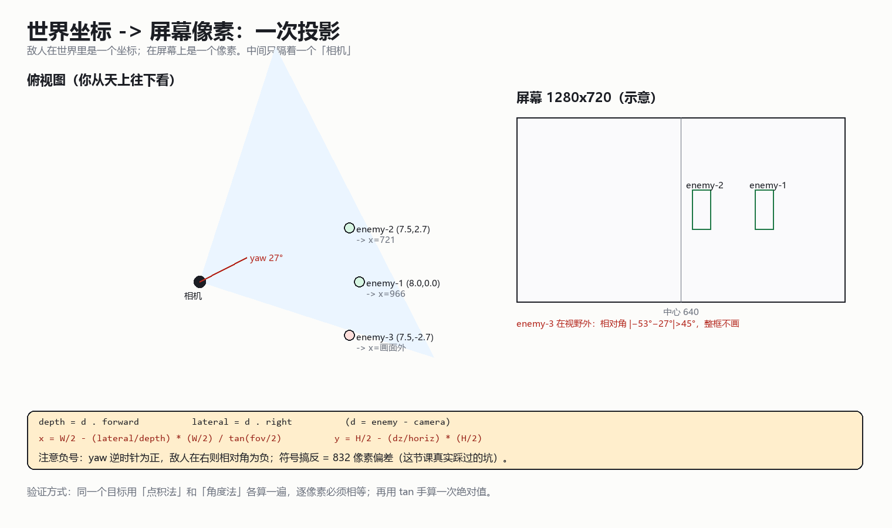

# 实验 10 · 叠加层的第一步：世界坐标 → 屏幕像素

> 自瞄和透视的数学内核只有一句话：**把"敌人在世界哪里"算成"他在我屏幕上哪个像素"。**
> 这一节不做渲染、不画框，只把这套投影算对、并且**用两种独立算法互相验证**。
>
> 11 才是把框真正画到游戏窗口上（叠加层 / D3D 呈现链）。



## 0. 前置知识

| 需要会 | 来自 | 用在哪一步 |
|---|---|---|
| 走指针链拿字段 | [../04-pointer-chain](../04-pointer-chain) | 读 World → units → 每个敌人的坐标 |
| 配置驱动（slot / hops / stride） | [../08-config-tool](../08-config-tool) | 这一节的 `config.txt` 和它同源 |
| 三角函数：`cos/sin/atan2/tan` | 高中数学，够用 | 投影公式本体 |
| float 是 4 字节 | [../00-memory-model](../00-memory-model) step4 | 每个坐标分量读 4 字节 |

**不需要**：矩阵库、四元数、图形学教材。这一节刻意只用一维角度和点积。

## 0.5 游戏里这对应什么

| 你在游戏里看到 | 进程里是什么 | 具体字段 |
|---|---|---|
| 自己的视角朝向 | 相机的 yaw（度） | World.cam + 0x0C |
| 视野有多宽 | 相机的 fov（度） | World.cam + 0x14 |
| 敌人的位置 | 每个 Unit 的世界坐标 | Unit + 0x00（x,y,z 各 4 字节） |
| 敌人在我屏幕右边 | 结果是像素 x > 640 | 本节算出来的 |
| 敌人不在画面里 | 相对角超过 fov/2 | 直接不画 |

**为什么你转身，敌人在屏幕上会动？** 因为代码里减的是相机的 yaw，不是敌人的坐标。

## 1. 公式（两条，都是初中几何）

```
d = 敌人位置 − 相机位置
depth   = d · 前方向          # 沿视线多远
lateral = d · 右方向          # 偏左还是偏右

x = W/2 − (lateral / depth) × (W/2) / tan(fov/2)
y = H/2 − (dz / horiz)      × (H/2)
```

- `lateral/depth` 是"横向偏移 ÷ 纵向距离"，就是视角正切值；
- 除以 `tan(fov/2)` 是把"角度"换算成"像素比例"；
- `y` 这里用的是简化版（只按高度差和水平距离算），真实引擎会带 pitch 和投影矩阵——**但原理相同**。

## 2. 实测：两种算法必须逐像素相等

同一个目标，用**点积法**（上面那套）和**角度法**（`atan2` 求方位角再减 yaw）各算一遍：

```
[+] 相机：pos(0.0,0.0,0.0)  yaw=27.0  pitch=0.0  fov=90  屏幕 1280x720

    单位          世界坐标                角度法        点积法       差
    enemy-1      (  8.0,  0.0, 0.0)   ( 966, 360)   ( 966, 360)   0
    enemy-2      (  7.5,  2.7, 0.0)   ( 721, 360)   ( 721, 360)   0
    enemy-3      (  7.5, -2.7, 0.0)     画面外        画面外       -

[+] 两种算法最大差异 = 0 像素：一致（这就是验证）
```

再手算一次绝对值：`yaw=27°`，敌人在 `(8,0)` → 相对角 `−27°`，`tan27° = 0.5095`，
`x = 640 + 0.5095 × 640 = 966` ✓。

## 3. 踩过的坑：符号反了 832 像素

第一版我写的是 `x = W/2 + (lateral/depth) × …`，结果两种算法差了整整 832 像素：

```
enemy-1   (  8.0,  0.0, 0.0)   ( 224, 360)   (1056, 360)   832
```

`224` 和 `1056` 正好对称于中心 640 —— 典型的**左右反了**。

原因：yaw 逆时针为正，敌人在相机右侧时相对角是**负**的，所以横向项前面必须是**减号**。
另外点积法当时漏了"出界判定"，导致 `enemy-3` 一边说可见、一边说不可见。

两条教训：
1. **符号不能靠感觉**，用对称性自检（算出来左右互为镜像，就是符号错）；
2. **两条独立算法必须都做同一件事**——包括"出界就不画"这种判定。

## 4. 自己动手

- **A**：把 fov 从 90 改成 60，观察同一个敌人 x 怎么变（视野变窄 = 同样的偏移被放大）。
- **B**：给靶子加第四个敌人放在相机**背后**（y 为负很大），确认它被判为画面外（`depth <= 0`）。
- **C**：把 `y` 的算法换成带 pitch 的版本（`y` 用垂直角度），看数值怎么变——这就是真实引擎干的事。

## 5. 判定标准

> 给一组相机参数和敌人坐标，能手算出屏幕 x；程序算的结果与你手算一致（±1 像素）；
> 并且能解释"为什么敌人越靠近画面边缘，x 变化越快"。

## 6. 常见坑

- **符号**：见 §3。先看左右是否对称，再查公式。
- **fov 是水平还是垂直**：不同引擎不一样，弄错会让框整体偏大或偏小。
- **aspect ratio**：`y` 的缩放要用 `半高/tan(垂直fov/2)`，这里简化成和 x 同尺度。
- **坐标系朝向**：有的引擎 Z 是高度，有的是 Y；枪口朝向也不一定是 +X。**先确认轴，再写公式。**
- **单位**：厘米还是米、弧度还是角度，混一次就全错。

## 7. 下一节

`labs/11-overlay`：把这一节算出的 `(x, y)` 真正画到屏幕上——
透明、鼠标穿透、永远置顶的窗口，以及为什么真实外挂更愿意注入游戏进程去 hook D3D 的呈现函数。
