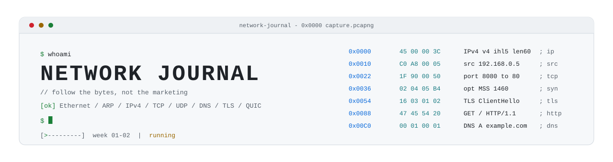
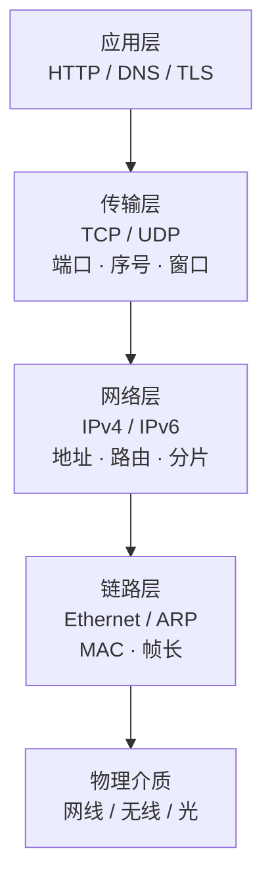

<div align="center">

<picture>
  <source media="(prefers-color-scheme: dark)" srcset="assets/banner-dark.svg">
  <source media="(prefers-color-scheme: light)" srcset="assets/banner-light.svg">
  
</picture>

<strong>线路上的每一个字节，都有来源。</strong><br>
网络通信学习手记 —— 不满足于「能 ping 通」，<br>
而是能说清一个请求从应用层到网线、再回来的每一步。

<a href="docs/00-roadmap.md"></a>
<a href="docs/01-layers-and-encapsulation.md"></a>
<a href="labs/"></a>
<a href="docs/08-capture-and-analysis.md"></a>


<sub><a href="docs/00-roadmap.md">12 周路线</a> · <a href="labs/">实验</a> · <a href="TASKS.md">任务清单</a> · <a href="resources.md">资源</a> · <a href="notes/_TEMPLATE.md">记录模板</a></sub>

</div>

## ▍ 这是什么样的仓库

网络和逆向有个一样的陷阱：**看得懂格式，不等于能定位问题。**

TCP 三次握手谁都背得出。可线上「偶发慢 200 毫秒」的时候，你能把这段延迟拆到 DNS、握手、TLS、TTFB、传输里的哪一段吗？拆不出来，背得再熟也没用。

所以这里不是教程合集，而是**学习日志**：每学一个协议，就在 [`labs/`](labs/) 里做一个能跑、能自测的实验；每分析一次流量，就在 [`notes/`](notes/) 里留一条带证据的记录；每个结论都必须能指回「**包序号 → 字段值 → 结论**」。

> **没有抓包的结论，只是猜测。**

约定：实验零第三方依赖（纯标准库，装好 Python 就能跑）；不提交编译产物与抓包文件（已在 [`.gitignore`](.gitignore) 中忽略）。

## ▍ 目录

| 目录 | 用途 | 现有 |
|:---:|---|---:|
| [`docs/`](docs/) | 系统化知识笔记：分层封装 · 链路/IP · TCP 状态机 · 可靠传输 · UDP/DNS · HTTP/TLS · HTTP/2·3 · 抓包 · 私有协议 · 排障 | 11 篇 |
| [`labs/`](labs/) | 能跑、能自测的实验，一个概念一个实验 | 2 个 |
| [`notes/`](notes/) | 抓包与排障的随手记录，不成体系 | 模板 |
| [`TASKS.md`](TASKS.md) | 12 周任务清单，勾掉一个才算学完一个 | — |
| [`tools/`](tools/) | 进度脚本 + 造包 / 组帧练习 | 3 个 |
| [`resources.md`](resources.md) | 书单、工具、公开数据集，以及合法与授权边界 | 清单 |

> **第一次来？** 先读 [`docs/00-roadmap.md`](docs/00-roadmap.md) 看 12 周路线，跑一遍 [`labs/01-packet-craft`](labs/01-packet-craft/) 建立「字节 → 字段」的手感，再到 [`labs/06-zombie-protocol`](labs/06-zombie-protocol/) 看一个真 TCP 靶场的协议逆向闭环，最后用 [`notes/_TEMPLATE.md`](notes/_TEMPLATE.md) 写下第一条抓包记录。

## ▍ 一个请求的分层视图

抓包的时候看到的不是「一个请求」，是几层封装叠在一起的一串字节。**定位问题就是先找到那一层。**



| 层 | 头部长度 | 先看哪个字段 | 常见故障落点 |
|---|---|:---:|---|
| 链路层 | 14 B 起（以太网） | `EtherType` | MTU 不匹配、VLAN 丢失 |
| 网络层 | 20 B 起（IPv4） | `TTL`、`Total Length`、`Flags` | 分片、路由环路、MTU 黑洞 |
| 传输层 | 20 B 起（TCP） | `Seq/Ack`、`Window`、`Flags` | 重传、乱序、零窗口 |
| 应用层 | 不定 | 首行的方法与路径 | 慢查询、大响应、TLS 握手 |

## ▍ 进度

当前快照（由 [`tools/status.ps1`](tools/status.ps1) 真实输出，可复现）：

```text
$ powershell -ExecutionPolicy Bypass -File tools/status.ps1
phase   topic                               deliverable       state
01-02   layers / link / ip                  01-packet-craft   done
03-04   tcp-fsm / reliability               -                 todo
05-06   udp-dns / http-tls                  -                 todo
07-08   http2 / http3-quic                  -                 todo
09-10   capture / custom-proto              06-zombie-protocol done
11-12   latency / troubleshoot              -                 todo
------------------------------------------------------------------------------
summary  docs 11/11   labs 2/2   notes 0
```

| 周次 | 主题 | 产出 | 状态 |
|:---:|---|---|:---:|
| 1–2 | 分层模型与封装 + 链路/IP | [`labs/01-packet-craft`](labs/01-packet-craft/) ✅ | 🟡 进行中 |
| 3–4 | TCP 状态机 + 可靠传输 | 手绘状态转移图并与抓包逐条对照 | ⬜ 未开始 |
| 5–6 | UDP/DNS + HTTP/TLS | 一次 HTTPS 请求的完整字段拆解 | ⬜ 未开始 |
| 7–8 | HTTP/2 与 HTTP/3 | 同一站点的 h1 / h2 / h3 对比抓包 | ⬜ 未开始 |
| 9–10 | 抓包分析 + 私有协议 | 还原一个自定义二进制协议的字段：[`labs/06-zombie-protocol`](labs/06-zombie-protocol/) ✅ | 🟡 实验完成 |
| 11–12 | 延迟分解 + 排障 | 一份线上卡顿的延迟分解报告 | ⬜ 未开始 |

> 详细拆解见 [`docs/00-roadmap.md`](docs/00-roadmap.md)。

## ▍ 能力模型

四块地基，缺一块都会卡住：

| 模块 | 必须掌握 | 为什么分析需要 |
|:---:|---|---|
| **分层与封装** | TCP/IP 四层、每层头部长什么样、封装与解封装 | 出问题先判断故障在哪一层 |
| **传输层** | TCP 状态机、序号/ACK、滑动窗口、拥塞控制、UDP 语义 | 大部分「时快时慢」在这里能解释 |
| **应用层** | HTTP/1.1、HTTP/2、HTTP/3、TLS 1.3、DNS | 性能分析与抓包的主战场 |
| **抓包与逆向** | Wireshark 过滤器、跟随 TCP 流、自定义二进制协议 | 没有抓包就没有证据 |

## ▍ 姊妹仓库

同一个「按证据学习」的路子，分三块：网络、逆向、操作系统。lab06 的 ZOMBIE 靶场就是三个仓库的交汇点——网络字节、反编译、进程/句柄各占一角。

| 仓库 | 一句话 | 入口 |
|:---:|---|---|
| **network-journal**（本仓库） | 从网线到应用层：封装、TCP、DNS/HTTP、抓包与私有协议 | <https://github.com/WMWWZS/network-journal> |
| **reversing-journal** | 会读字节，也要会读代码：PE/ELF、动态调试、反编译、协议逆向 | <https://github.com/WMWWZS/reversing-journal> |
| **os-journal** | 每条 API 背后都有一个内核故事：进程、线程、句柄、内存 | <https://github.com/WMWWZS/os-journal> |

> lab06 的源程序最初长在 `reversing-journal/labs/07-net-os/net`，那一课从 `.exe` 讲到 `send()` 的四个寄存器；
> 本仓库这一课从「线上字节」往回走，同一份靶场、同一组证据，讲的是网络这一侧的读法。

## ▍ 原则

| 原则 | 落地方式 |
|:---:|---|
| **抓包为准** | 结论必须能指回包序号、字段值与过滤器；没有抓包就写「未验证」，不写「应该是」。 |
| **最小复现** | 每个概念都要有一个能本地跑的实验，或者一条能重复执行的命令。 |
| **合法边界** | 只分析自己的网络、自己搭的服务、公开靶场；不在未授权的网络上做嗅探或攻击性测试。 |
| **写下来** | 没有写下来的分析等于没做过；模板见 [`notes/_TEMPLATE.md`](notes/_TEMPLATE.md)。 |

## ▍ 环境

```text
[ok] windows 11 x64
[ok] python        3.11      （用 py，本机 python 是 Store 占位程序）
[ok] gcc           mingw-w64 14.2   （lab06 编译靶场用）
[ok] objdump       2.44      （MinGW binutils，lab06 反编译那步用）
[ok] curl.exe      Windows 内置
[ok] wireshark     4.0.17    （E:\Wireshark；Npcap 已装，dumpcap / tshark / text2pcap / capinfos 都在）
[--] nmap / ncat / openssl
```

lab01 只依赖 Python 标准库（`struct` / `ipaddress` / `socket`）；lab06 需要一个 C 编译器和抓包工具（本机都有）。两条命令就能各自跑起来：

```powershell
cd labs\01-packet-craft
powershell -ExecutionPolicy Bypass -File .\run.ps1

cd labs\06-zombie-protocol\src
powershell -ExecutionPolicy Bypass -File .\run.ps1
```

Wireshark 4.0.17 已装在 `E:\Wireshark`，过滤器速查见 [`docs/08-capture-and-analysis.md`](docs/08-capture-and-analysis.md)。lab06 的 `capture.ps1` 抓的是本机回环：**本机实测普通（非管理员）窗口也能抓 loopback**（`Medium Mandatory Level` 下抓到 62 个包），最稳仍是管理员窗口；详见 [lab06 的「坑」](labs/06-zombie-protocol/README.md#坑)。

---

<div align="center">

<sub><strong>「没有抓包的结论，只是猜测。」</strong></sub><br>
<sub>只分析自己的 · 有授权的 · 公开靶场的网络</sub><br>
<sub>不做未授权的嗅探与攻击性测试</sub>

</div>
