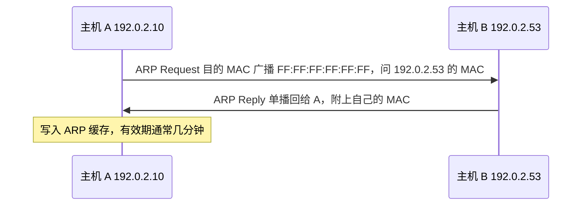

# 02 · 以太网 / ARP / IPv4

> 一句话：同一根线（同一个广播域）里靠 MAC 找到下一跳，跨网段靠 IP 找路由；ARP 就是「我知道你的 IP，但请把 MAC 告诉我」的那句问话。

## 是什么 / 为什么重要

一台主机要把数据发出去，必须先回答一个问题：**这个包交给谁？**

- 如果目的 IP 和自己**在同一网段**，下一跳就是目的主机本身，需要它的 MAC；
- 如果**不在同一网段**，下一跳是默认网关，需要网关的 MAC。

MAC 地址只在同一个广播域内有效，出了路由器就换了一对新的源/目的 MAC，而 IP 地址端到端不变。理解这一点，才能解释「为什么 ping 得通但服务连不上」「为什么换了网关就断」。

## 机制与结构

### 1. Ethernet II 帧

```text
 前导码    SFD   目的 MAC   源 MAC   EtherType   载荷(46–1500)   FCS
 7 字节   1 字节   6 字节    6 字节    2 字节        变长         4 字节
 |<---------- 不属于帧，由网卡处理 ---------->|
            |<---------------- 帧，最小 64 字节（不含前导码） -------------->|
```

| 字段 | 长度 | 说明 |
|:---:|---:|---|
| 前导码 Preamble | 7 B | 7 个 `0xAA`，让接收方时钟同步 |
| SFD | 1 B | `0xAB`，标志帧开始 |
| 目的 MAC | 6 B | 单播、组播（首字节最低位为 1）或广播 `FF:FF:FF:FF:FF:FF` |
| 源 MAC | 6 B | 发送接口的 MAC |
| EtherType | 2 B | ≥ `0x0600` 表示上层协议类型；≤ 1500 表示 802.3 长度字段 |
| 载荷 | 46–1500 B | 不足 46 字节要补齐，否则接收方丢弃（runt） |
| FCS | 4 B | CRC-32，网卡计算并校验，通常不交给操作系统 |

常见 EtherType：

| 值 | 上层协议 |
|:---:|---|
| `0x0800` | IPv4 |
| `0x0806` | ARP |
| `0x86DD` | IPv6 |
| `0x8100` | 802.1Q VLAN 标签（后面再跟真正的 EtherType） |

### 2. ARP：IP 到 MAC 的翻译

ARP 报文直接封装在以太网帧里（EtherType `0x0806`），没有 IP 头。固定 28 字节：

| 字段 | 偏移 | 长度 | 含义 | 请求里的值 |
|:---:|---:|---:|---|---|
| Hardware type | 0 | 2 | 链路类型，Ethernet = 1 | 1 |
| Protocol type | 2 | 2 | 上层地址类型，IPv4 = `0x0800` | `0x0800` |
| HLEN | 4 | 1 | MAC 长度 | 6 |
| PLEN | 5 | 1 | IP 长度 | 4 |
| Operation | 6 | 2 | 1 = 请求，2 = 应答 | 1 |
| Sender MAC | 8 | 6 | 发送方 MAC | A 的 MAC |
| Sender IP | 14 | 4 | 发送方 IP | `192.0.2.10` |
| Target MAC | 18 | 6 | 目标 MAC | 全 0（还不知道） |
| Target IP | 24 | 4 | 目标 IP | `192.0.2.53` |



三个容易忽略的细节：

- **请求是广播，应答是单播**。广播会打扰同一广播域内所有主机，所以 ARP 缓存很重要。
- **跨网段时 ARP 问的是网关**。A 要给 `203.0.113.7` 发包，发现不在同网段，于是 ARP 请求里 Target IP 填的是网关 `192.0.2.1`，不是最终目的地址。
- **免费 ARP（Gratuitous ARP）**：主机主动广播「我的 IP 对应我的 MAC」，用于 IP 冲突检测和切换后刷新缓存。

### 3. IPv4 头：20 字节起步

```text
 0                   1                   2                   3
 0 1 2 3 4 5 6 7 8 9 0 1 2 3 4 5 6 7 8 9 0 1 2 3 4 5 6 7 8 9 0 1
+-+-+-+-+-+-+-+-+-+-+-+-+-+-+-+-+-+-+-+-+-+-+-+-+-+-+-+-+-+-+-+-+
|Version|  IHL  |Type of Service|          Total Length         |
+-+-+-+-+-+-+-+-+-+-+-+-+-+-+-+-+-+-+-+-+-+-+-+-+-+-+-+-+-+-+-+-+
|         Identification        |Flags|      Fragment Offset    |
+-+-+-+-+-+-+-+-+-+-+-+-+-+-+-+-+-+-+-+-+-+-+-+-+-+-+-+-+-+-+-+-+
|  Time to Live |    Protocol   |         Header Checksum       |
+-+-+-+-+-+-+-+-+-+-+-+-+-+-+-+-+-+-+-+-+-+-+-+-+-+-+-+-+-+-+-+-+
|                       Source Address                          |
+-+-+-+-+-+-+-+-+-+-+-+-+-+-+-+-+-+-+-+-+-+-+-+-+-+-+-+-+-+-+-+-+
|                    Destination Address                        |
+-+-+-+-+-+-+-+-+-+-+-+-+-+-+-+-+-+-+-+-+-+-+-+-+-+-+-+-+-+-+-+-+
```

| 字段 | 偏移 | 长度 | 本 lab 里的值 | 说明 |
|:---:|---:|---:|---|---|
| Version + IHL | 0 | 1 | `0x45` | 版本 4，头长 5 × 4 = 20 字节 |
| TOS / DSCP | 1 | 1 | `0x00` | 服务类型，QoS 标记 |
| Total Length | 2 | 2 | `0x0028` = 40 | 头 + 载荷，**不含链路层** |
| Identification | 4 | 2 | `0x1b2d` | 分片时同属一个包的分片共用 |
| Flags + Frag Offset | 6 | 2 | `0x4000` | DF = 1，offset = 0 |
| TTL | 8 | 1 | `0x40` = 64 | 每过一个路由器减 1，减到 0 丢弃 |
| Protocol | 9 | 1 | `0x06` | 6 = TCP，17 = UDP，1 = ICMP |
| Header Checksum | 10 | 2 | `0x9b63` | 只校验 IP 头，逐跳重算 |
| Source | 12 | 4 | `192.0.2.10` | 源 IP |
| Destination | 16 | 4 | `192.0.2.53` | 目的 IP |
| Options | 20 | 0–40 | 无 | 有选项时 IHL > 5 |

**校验和只覆盖 IP 头**，所以每个路由器改完 TTL 都要重算；传输层的正确性由 TCP/UDP 自己的校验和负责（UDP 校验和还借用 IP 伪首部）。

### 4. CIDR：在不在同一网段，只做一次与运算

把 IP 和掩码都看成 32 位整数，`IP & Mask` 相同就在同一网段：

```text
192.0.2.130  = 11000000 00000000 00000010 10000010
/25 掩码     = 11111111 11111111 11111111 10000000
与运算结果    = 11000000 00000000 00000010 10000000 = 192.0.2.128
```

| 前缀 | 掩码 | 地址总数 | 可用主机数 | 备注 |
|:---:|---|---:|---:|---|
| /24 | 255.255.255.0 | 256 | 254 | 最常见的局域网 |
| /25 | 255.255.255.128 | 128 | 126 | 两个 /25 可切分一个 /24 |
| /26 | 255.255.255.192 | 64 | 62 | |
| /30 | 255.255.255.252 | 4 | 2 | 点对点链路常用 |
| /31 | 255.255.255.254 | 2 | 2 | RFC 3021，点对点可省掉广播地址 |
| /32 | 255.255.255.255 | 1 | 1 | 单主机路由 |

特殊地址段：

| 网段 | 用途 |
|:---:|---|
| `10.0.0.0/8`、`172.16.0.0/12`、`192.168.0.0/16` | RFC 1918 私有地址，不能在公网路由 |
| `127.0.0.0/8` | 环回，`127.0.0.1` 是本机 |
| `169.254.0.0/16` | 链路本地，DHCP 失败时自动配置（APIPA） |
| `192.0.2.0/24`、`198.51.100.0/24`、`203.0.113.0/24` | RFC 5737 文档专用，lab 用的就是它 |
| `224.0.0.0/4` | 组播 |

**最长前缀匹配**：路由表里同时有 `192.0.2.0/24` 和 `192.0.2.128/25` 时，去 `192.0.2.200` 的包走 /25，因为它更具体。

### 5. 分片：MTU 装不下时怎么办

IPv4 包超过出接口 MTU 时会被分片。三个字段配合工作：`Identification` 相同、`MF`（More Fragments）标记后面还有没有、`Fragment Offset` 指出本片数据在原包中的位置（**单位是 8 字节**）。

以载荷 4000 字节、MTU 1500（每片最多 1480 字节数据）为例：

| 分片 | 数据长度 | Total Length | MF | Offset 值 | 实际字节偏移 |
|:---:|---:|---:|:---:|---:|---:|
| 1 | 1480 | 1500 | 1 | 0 | 0 |
| 2 | 1480 | 1500 | 1 | 185 | 1480 |
| 3 | 1040 | 1060 | 0 | 370 | 2960 |

偏移必须是 8 的倍数，所以除最后一片外，每片数据长度都应是 8 的倍数。**重组只发生在目的主机**，中间路由器只负责分片或丢弃，不重组。

## 动手验证

### 验证 1：读一遍真 IPv4 头

```powershell
cd labs\01-packet-craft
py craft.py
```

【4】IPv4 头一节的本机实测输出（节选）：

```text
0000  45 00 00 28 1b 2d 40 00 40 06 9b 63 c0 00 02 0a  |E..(.-@.@..c....|
0010  c0 00 02 35                                      |...5|
```

`00 28` 是 40；`40 00` 里 `0x4000` 表示 DF=1、offset=0；`c0 00 02 35` 是 `192.0.2.53`。

### 验证 2：看本机的 ARP 缓存与网卡配置

```powershell
arp -a
ipconfig
```

预期：`arp -a` 按接口列出 `Internet Address / Physical Address / Type`，`dynamic` 条目就是最近通信过的邻居；`ipconfig` 里能看到 IPv4 地址、子网掩码和默认网关。**用掩码和网关判断「目标在不在直连网段」，就是上面那条与运算。**

### 验证 3：用 Python 算一遍子网

```python
import ipaddress

net = ipaddress.IPv4Network("192.0.2.130/25", strict=False)
print(net.network_address, net.broadcast_address, net.num_addresses - 2)
```

本机实测输出：

```text
192.0.2.128 192.0.2.255 126
```

同一段代码换 `/26` 会得到 `192.0.2.128 192.0.2.191 62`。**不要背表，跑一遍。**

### 验证 4：用 DF 位探测路径 MTU

```powershell
ping -f -l 1472 example.com
```

`-l 1472` + ICMP 头 8 + IP 头 20 = 1500，`-f` 置 DF 位。通了说明路径 MTU ≥ 1500；返回「需要分片但设置了 DF」说明路径上有更小的 MTU。

> 注意：ICMP 经常被防火墙或云厂商安全组丢弃，**超时不一定代表 MTU 有问题**，也可能只是 ICMP 被禁。这一点在第 10 篇会展开。

## 常见误区

1. **很多人以为「跨网段也会 ARP 目的主机」，实际 ARP 只问网关**，因为 MAC 只在本地广播域有意义，目的主机的 MAC 在远端网络里根本不可达。
2. **很多人以为 MAC 地址永远不变、全球唯一，实际虚拟化、Wi-Fi 随机 MAC、MAC 伪装都能改**，因为 MAC 只是链路层标识，软件可以随时设置。
3. **很多人以为 MTU 1500 包含以太网头，实际它只是 IP 层（含 IP 头）的上限**，因为 MTU 的定义是「IP 包最大长度」，链路层另有 14 字节头和 4 字节 FCS。
4. **很多人以为分片在路由器上重组，实际 IPv4 只在目的主机重组**，因为不同分片可能走不同路径，中间节点无法保证看到全部分片。
5. **很多人以为分片偏移字段就是字节偏移，实际它的单位是 8 字节**，因为 IPv4 头里 offset 只有 13 位，必须用 8 字节为单位才能覆盖 65535 字节的包。

## 自测

**1. `192.0.2.130/25` 的网络地址、广播地址、可用主机数分别是多少？**

- **考点**：CIDR 与与运算
- **应明白**：/25 把最后一个字节切成两半，128 是边界
- **算会**：网络 `192.0.2.128`、广播 `192.0.2.255`、可用 126 个

**2. 主机 `192.0.2.10/25` 要给 `192.0.2.200` 发包，ARP 请求里的 Target IP 填谁？**

- **考点**：同网段判断与下一跳
- **应明白**：`.10` 在 `192.0.2.0/25`，`.200` 在 `192.0.2.128/25`，不在同一网段
- **算会**：Target IP 填默认网关，以太网目的 MAC 填网关的 MAC，而不是 `.200` 的

**3. 一个 4000 字节的 IPv4 载荷在 MTU 1500 的链路上分成几片？第二片的 Offset 字段是多少？**

- **考点**：分片字段
- **应明白**：每片数据最多 1480 字节，offset 以 8 字节为单位
- **算会**：3 片（1480 + 1480 + 1040），第二片 Offset = 1480 / 8 = 185，Total Length = 1500

## 关联

- 上一篇：[01 · 分层与封装](01-layers-and-encapsulation.md)
- 下一篇：[03 · TCP 三次握手](03-tcp-handshake.md)
- 实验：[`labs/01-packet-craft`](../labs/01-packet-craft/)
- MTU 与黑洞：[10 · 延迟分解与故障排查](10-latency-and-troubleshooting.md)
