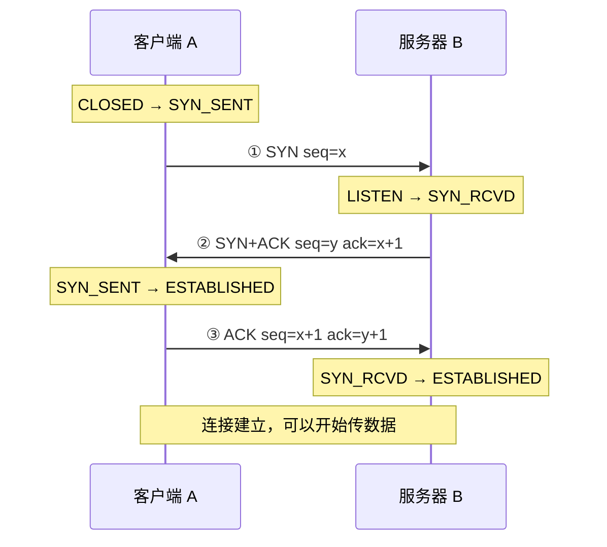
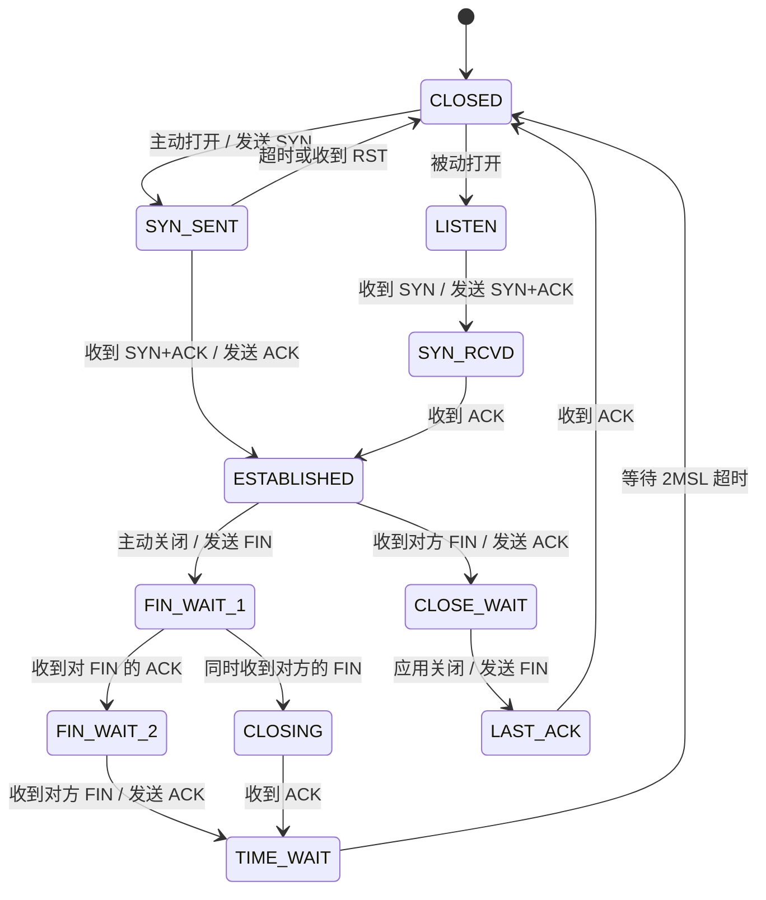

# 03 · TCP 三次握手

> 一句话：三次握手不是「打个招呼」，而是双方各自确认「我能发、你能收」并交换初始序列号；少一次会有历史连接的风险，多一次纯属浪费。

## 是什么 / 为什么重要

TCP 提供的是**面向连接的可靠字节流**。所谓「连接」，在内核里就是双方各维护一套状态：序列号、接收窗口、发送/接收缓冲区、重传定时器。握手做的事只有三件：

1. 双方都确认对方**可达**（能收到对方的报文）；
2. 双方交换**初始序列号 ISN**，后续所有数据的编号从这里开始；
3. 双方进入 `ESTABLISHED`，开始传数据。

排障时，`netstat` 里那一列状态就是「连接现在走到哪一步」。看到 `SYN_SENT` 堆积，说明包发出去了但没收到回应；看到 `CLOSE_WAIT` 堆积，说明对端关了、本端应用没关。**状态机不是背给考试用的，是读故障现场的地图。**

## 机制与结构

### 1. TCP 头：20 字节起步

```text
 0                   1                   2                   3
 0 1 2 3 4 5 6 7 8 9 0 1 2 3 4 5 6 7 8 9 0 1 2 3 4 5 6 7 8 9 0 1
+-+-+-+-+-+-+-+-+-+-+-+-+-+-+-+-+-+-+-+-+-+-+-+-+-+-+-+-+-+-+-+-+
|          Source Port          |       Destination Port        |
+-+-+-+-+-+-+-+-+-+-+-+-+-+-+-+-+-+-+-+-+-+-+-+-+-+-+-+-+-+-+-+-+
|                        Sequence Number                        |
+-+-+-+-+-+-+-+-+-+-+-+-+-+-+-+-+-+-+-+-+-+-+-+-+-+-+-+-+-+-+-+-+
|                    Acknowledgment Number                      |
+-+-+-+-+-+-+-+-+-+-+-+-+-+-+-+-+-+-+-+-+-+-+-+-+-+-+-+-+-+-+-+-+
|  Data |       |C|E|U|A|P|R|S|F|                               |
| Offset| Rsrvd |W|C|R|C|S|S|Y|I|            Window             |
|       |       |R|E|G|K|H|T|N|N|                               |
+-+-+-+-+-+-+-+-+-+-+-+-+-+-+-+-+-+-+-+-+-+-+-+-+-+-+-+-+-+-+-+-+
|           Checksum            |         Urgent Pointer        |
+-+-+-+-+-+-+-+-+-+-+-+-+-+-+-+-+-+-+-+-+-+-+-+-+-+-+-+-+-+-+-+-+
|                    Options (0–40 字节)                        |
+-+-+-+-+-+-+-+-+-+-+-+-+-+-+-+-+-+-+-+-+-+-+-+-+-+-+-+-+-+-+-+-+
```

| 字段 | 偏移 | 长度 | 作用 |
|:---:|---:|---:|---|
| 源端口 / 目的端口 | 0 / 2 | 2 + 2 | 和 IP 一起构成四元组，标识一条连接 |
| Sequence Number | 4 | 4 | 本段第一个数据字节的编号；SYN 和 FIN 各占 1 个编号 |
| Acknowledgment Number | 8 | 4 | 期望收到的下一个字节编号；ACK 置位时才有效 |
| Data Offset | 12 | 1（高 4 位） | 头长度 = 值 × 4，最小 5（20 字节） |
| Flags | 13 | 1 | `URG ACK PSH RST SYN FIN` 六位有用 |
| Window | 14 | 2 | 接收窗口，告诉对方「我还能收多少字节」 |
| Checksum | 16 | 2 | 覆盖伪首部 + TCP 头 + 载荷 |
| Urgent Pointer | 18 | 2 | 紧急数据位置，几乎不用 |
| Options | 20 | 0–40 | MSS、窗口缩放、SACK、时间戳 |

### 2. 三次握手



用具体数字走一遍（`x = 1000`，`y = 5000`）：

| 步 | 方向 | 标志 | seq | ack | 说明 |
|:---:|:---:|:---:|---:|---:|---|
| ① | A → B | SYN | 1000 | — | 我起始编号 1000，SYN 占 1000 这一个编号 |
| ② | B → A | SYN+ACK | 5000 | 1001 | 我起始编号 5000，同时确认你的 SYN（1000 + 1） |
| ③ | A → B | ACK | 1001 | 5001 | 确认你的 SYN（5000 + 1），之后数据从 1001 开始 |

**SYN 和 FIN 各消耗一个序列号**。这一点解释了两个常见困惑：为什么第三个 ACK 的 seq 是 `x+1`，以及为什么第一个数据字节的编号是 `x+1` 而不是 `x`。

### 3. 为什么是三次，不是两次或四次

| 方案 | 会发生什么 | 结论 |
|:---:|---|---|
| 两次 | A 的 SYN 到达 B，B 回 SYN+ACK 后就认为连接建立。但 A 还没确认 B 的 SYN：B 无法确认 A 收到自己的 ISN，A 也无法确认 B 收到了自己的 SYN | 不能保证双向可达 |
| 三次 | 双方各发一次、各确认一次，A 确认 B 的 SYN，B 也确认 A 的 SYN | 刚好够，**标准做法** |
| 四次 | 第二个报文的 ACK 和 SYN 可以合并成一个 SYN+ACK | 没必要 |

**历史重复连接问题**：网络里滞留的旧 SYN 在连接关闭后到达，两次握手会让 B 单方面建立一个「幽灵连接」并占用资源；三次握手时 A 会 RST 掉这个过期的 SYN-ACK。这也是「三次握手不只是为了可达性」的原因。

### 4. ISN 为什么必须随机

初始序列号若可预测，攻击者不需要看到报文就能伪造合法段。现代实现按 **RFC 6528** 用四元组 + 时间相关量做哈希生成 ISN，使相邻连接、相同四元组重连的 ISN 都不可预测。这也解释了为什么同一个目标连续握手，两次的 `seq` 完全不同。

**SYN flood** 利用的就是握手的第一个状态：大量 SYN 让服务器把半连接放进 `SYN queue`，耗尽后无法接受新连接。常见缓解是 **SYN cookies**（不存半连接状态，把信息编码进 ISN），但会牺牲部分 TCP 选项。

### 5. 状态机：连接从生到死



排障时最常见的四个状态：

| 状态 | 出现在哪一方 | 意味着什么 |
|:---:|---|---|
| `SYN_SENT` | 主动连接方 | SYN 发出，等 SYN+ACK；堆积说明对端不可达或被防火墙丢 |
| `ESTABLISHED` | 双方 | 正常传输 |
| `CLOSE_WAIT` | 收到 FIN 的一方 | 对端已关，本端应用**还没调用 close**；堆积是代码 bug |
| `TIME_WAIT` | 主动关闭方 | 等 2MSL，保证最后的 ACK 能重发、旧报文过期 |

### 6. 四次挥手与 TIME_WAIT

关闭要两个方向各来一次，因为 TCP 支持**半关闭**：A 说「我没数据要发了」（FIN），但 A 仍然可以收 B 的数据，直到 B 也发 FIN。

```text
A: FIN  ───────────────►  B      A 进入 FIN_WAIT_1
A: ◄────────────── ACK    B      A 进入 FIN_WAIT_2，B 进入 CLOSE_WAIT
   （B 应用继续发完剩余数据……）
A: ◄────────────── FIN    B      B 进入 LAST_ACK
A: ACK  ───────────────►  B      A 进入 TIME_WAIT，B 关闭
A: 等待 2MSL 后关闭               TIME_WAIT → CLOSED
```

TIME_WAIT 的两个作用：

1. **最后一个 ACK 丢了，对方会重发 FIN，本端还能再 ACK 一次**；如果立刻关闭，对方会收到 RST，看到「连接被重置」。
2. **让本连接的四元组在网络上彻底过期**，防止旧连接的迟到报文被新连接误收。

代价是主动关闭方在 2MSL（Linux 默认 60 秒，Windows 由 `TcpTimedWaitDelay` 控制）内占用一个临时端口。短连接密集的客户端会看到大量 `TIME_WAIT`，这是**正常现象**，不是内核 bug。

## 动手验证

### 验证 1：读一个真实的 SYN 段

```powershell
cd labs\01-packet-craft
py craft.py
```

【3】TCP SYN 段的本机实测输出：

```text
0000  cf 08 00 50 1a 2b 3c 4d 00 00 00 00 50 02 fa f0  |...P.+<M....P...|
0010  0a e1 00 00                                      |....|
```

逐字段：源端口 `0xcf08` = 53000，目的端口 `0x0050` = 80，`seq = 0x1a2b3c4d`，`data offset = 5`（20 字节头），`flags = 0x02`（只有 SYN），窗口 `0xfaf0` = 64240，校验和 `0x0ae1`（含伪首部）。

### 验证 2：在本机观察状态迁移

开两个 PowerShell 窗口。窗口 A 运行一个只监听、accept 之后不关闭的服务器（故意制造 `CLOSE_WAIT`）：

```python
# listen.py —— accept 后不做 close，模拟「应用忘了关连接」
import socket, time

srv = socket.socket(socket.AF_INET, socket.SOCK_STREAM)
srv.bind(("127.0.0.1", 54321))
srv.listen(1)
print("listening on 54321", flush=True)
conn, addr = srv.accept()
print("accepted", addr, flush=True)
time.sleep(30)
```

```powershell
py listen.py
```

窗口 B 连接并在连接期间观察：

```powershell
py -c "import socket; s=socket.create_connection(('127.0.0.1',54321)); print('connected')"
netstat -ano | Select-String ":54321"
```

连接建立时预期看到（临时端口每次不同）：

```text
  TCP    127.0.0.1:54321        0.0.0.0:0              LISTENING       <服务器 PID>
  TCP    127.0.0.1:54321        127.0.0.1:<临时端口>    ESTABLISHED     <服务器 PID>
  TCP    127.0.0.1:<临时端口>    127.0.0.1:54321        ESTABLISHED     <客户端 PID>
```

`py -c` 进程退出后，客户端主动关闭。本机实测再执行一次 `netstat -ano | Select-String ":54321"`，看到：

```text
  TCP    127.0.0.1:54321        0.0.0.0:0              LISTENING       <服务器 PID>
  TCP    127.0.0.1:54321        127.0.0.1:<临时端口>    CLOSE_WAIT      <服务器 PID>
  TCP    127.0.0.1:<临时端口>    127.0.0.1:54321        FIN_WAIT_2      <客户端 PID>
```

这一屏同时演示了两个状态：服务器收到了 FIN、发了 ACK，但应用没有 close，所以停在 `CLOSE_WAIT`；客户端发了 FIN、收到了 ACK，停在 `FIN_WAIT_2`，等服务器发 FIN。**服务器进程退出后，这对连接才彻底消失。**

> 本机实测 `TIME_WAIT` 数量常年不为零（浏览器、Steam、各类客户端都在频繁建短连接），这是正常的；真正要警惕的是 `CLOSE_WAIT` 长期堆积。另外本机的 `Get-NetTCPConnection` 在当前会话里返回「拒绝访问」（CIM 权限限制），所以本文统一用 `netstat -ano`。

### 验证 3：用 Wireshark / tshark 验证

> Wireshark 4.0.17 已装在 `E:\Wireshark`（`tshark` 同目录，不在 PATH），下面命令可以直接跑；抓包与 Lua 解析的完整真实输出见 [lab06](../labs/06-zombie-protocol/README.md)。

```text
tcp.flags.syn == 1 && tcp.flags.ack == 0     # 只看 SYN
tcp.flags.syn == 1 && tcp.flags.ack == 1     # 只看 SYN+ACK
tcp.flags.reset == 1                          # 只看 RST
tcp.time_delta > 1                            # 握手间隔异常
```

在 `Statistics → Flow Graph` 里能直接看到三次握手的箭头和耗时。

## 常见误区

1. **很多人以为三次握手是为了「保证数据可靠」，实际可靠传输由 ACK、重传、校验和保证**，握手只负责同步状态与 ISN，因为连接建立之后双方才需要可靠的机制。
2. **很多人以为 SYN 不占序列号，实际 SYN 和 FIN 各消耗一个序列号**，所以第三个 ACK 的 `seq` 是 `x+1`，因为序列号编号的是「字节流里的位置」，控制标志也要占位。
3. **很多人以为 TIME_WAIT 是内核 bug、等 60 秒纯属浪费，实际它是 2MSL 的保护窗口**，因为要留出时间重发最后 ACK 并让旧报文过期。
4. **很多人以为关连接一定是四次挥手，实际半关闭场景下可能同时 FIN、也可能合并**，因为 TCP 允许一个方向先关，另一个方向继续传数据。
5. **很多人以为 CLOSE_WAIT 多就是「服务器扛不住」，实际是本端应用没有 close**，因为收到 FIN 只是内核把状态改成 CLOSE_WAIT，真正的关闭动作要应用发起。

## 自测

**1. 客户端 SYN 的 `seq = 1000`，服务器 SYN+ACK 的 `seq = 5000`。第三个 ACK 的 seq 和 ack 分别是多少？**

- **考点**：序列号与 SYN 占位
- **应明白**：SYN 消耗 1000 这个编号，所以确认号是 1001
- **算会**：`seq = 1001`、`ack = 5001`；并说出第一个数据字节的编号是 1001

**2. TIME_WAIT 存在的两个理由是什么？为什么它只出现在主动关闭方？**

- **考点**：2MSL 的作用
- **应明白**：最后 ACK 可能丢失需要重发；旧报文需要过期
- **算会**：能说清「被动关闭方不需要发最后 ACK，所以不需要这个等待」

**3. 客户端主动关闭后停在 `FIN_WAIT_2`，服务端停在 `CLOSE_WAIT`。这说明什么？**

- **考点**：半关闭与状态归属
- **应明白**：客户端发了 FIN 并收到 ACK；服务端还没发自己的 FIN
- **算会**：指出服务端应用没有 close（代码路径漏了），而不是网络问题；并知道 `FIN_WAIT_2` 有超时（Linux `tcp_fin_timeout`）

## 关联

- 上一篇：[02 · 以太网 / ARP / IPv4](02-ethernet-arp-ip.md)
- 下一篇：[04 · TCP 可靠传输](04-tcp-reliability.md)
- 实验：[`labs/01-packet-craft`](../labs/01-packet-craft/)
- 用状态排障：[08 · 抓包与协议分析](08-capture-and-analysis.md)
