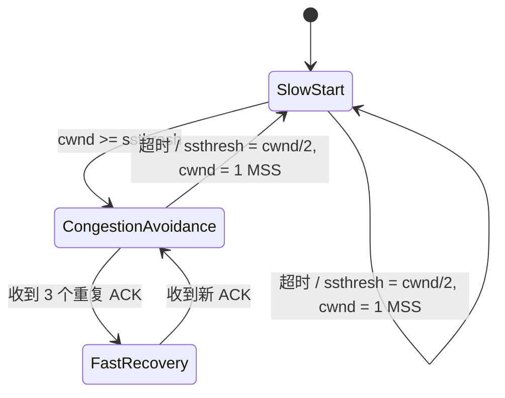

# 04 · TCP 可靠传输

> 一句话：TCP 的「可靠」不是保证不丢，而是保证**丢了能发现、能重发，而且不会因为重发把网络压垮**——发现靠序列号与 ACK，重发靠 RTO 与快速重传，不压垮靠滑动窗口与拥塞控制。

## 是什么 / 为什么重要

IP 层只尽力而为：包可能丢、可能乱序、可能重复。TCP 在不可靠的 IP 之上造出一条「看起来可靠」的字节流，靠的是三套机制：

| 机制 | 解决的问题 | 关键状态 |
|:---:|---|---|
| 序列号 + ACK + 重传 | 丢包与乱序 | `seq`、`ack`、RTO |
| 滑动窗口 | 发送方别把接收方灌爆 | `rwnd`（接收窗口） |
| 拥塞控制 | 发送方别把网络灌爆 | `cwnd`（拥塞窗口）、`ssthresh` |

绝大多数「时快时慢」「下载一开始快后来慢」「偶发卡顿」都能落到这三套机制上。**看到重传先别下结论**：重传只是症状，原因可能是真丢包、可能是乱序、也可能是接收窗口为零。

## 机制与结构

### 1. 序列号与累计 ACK

TCP 的 ACK 是**累计确认**：`ack = n` 表示「n 之前的所有字节我都收到了，请从 n 开始发」。

```text
发送方发出： [1 .. 1000] [1001 .. 2000] [2001 .. 3000]
接收方收到： [1 .. 1000] ✅   [1001 .. 2000] ❌ 丢失   [2001 .. 3000] ✅
接收方回复： ack = 1001   ← 只认到 1000，后面到了也不能算「连续收到」
```

这会带来一个问题：丢了中间一段，后面全收到了也只能一直 ACK 同一个号，发送方只能等超时。**SACK（RFC 2018）**就是补丁：在 TCP 选项里告诉对方「我额外收到了哪些区间」，发送方可以只重传缺的那段。

| 概念 | 含义 | 用途 |
|:---:|---|---|
| 累计 ACK | `ack` 之前全部收到 | 基础确认 |
| 重复 ACK（dup ACK） | 连续收到相同 `ack` | 提示「后面到了、中间缺了」 |
| SACK | 额外收到的不连续区间 | 精确重传，不用整段重发 |
| RACK（Linux） | 按时间而非 ACK 数判断丢失 | 更快的丢失检测 |

### 2. RTT 与 RTO：等多久才算丢

发送方不能无限等。RTO（Retransmission Timeout）由 RTT 的平滑估计动态算出，**RFC 6298** 的公式：

```text
第一次测量： SRTT = R,  RTTVAR = R / 2
之后每次：   RTTVAR = (1 - β) × RTTVAR + β × |SRTT - R|
             SRTT   = (1 - α) × SRTT   + α × R
             RTO    = SRTT + 4 × RTTVAR
```

其中 `α = 1/8`、`β = 1/4`，并设下限（RFC 6298 要求 ≥ 1 秒，Linux 实际用 200 ms）。用本机脚本跑一遍 5 个 RTT 样本：

| 样本 R (ms) | SRTT (ms) | RTTVAR (ms) | RTO 原始值 (ms) | 生效 RTO (ms) |
|---:|---:|---:|---:|---:|
| 100 | 100.00 | 50.00 | 300.00 | 1000 |
| 120 | 102.50 | 42.50 | 272.50 | 1000 |
| 140 | 107.19 | 41.25 | 272.19 | 1000 |
| 300 | 131.29 | 79.14 | 447.85 | 1000 |
| 130 | 131.13 | 59.68 | 369.84 | 1000 |

（`RTO 原始值` 全部低于下限，所以生效值都是 1000 ms。）

两个必须知道的细节：

- **Karn 算法**：重传过的段不参与 RTT 采样，因为无法确定 ACK 对应的是哪一次发送。
- **指数退避**：同一段连续超时，RTO 翻倍（1s → 2s → 4s …），直到上限（Linux 约 120 秒）。所以「一直重传」的连接会越等越久，不会一秒一次猛冲。

### 3. 重传的四种触发方式

| 触发 | 条件 | 反应 | 代价 |
|:---:|---|---|---|
| 超时重传 | RTO 到期仍未 ACK | `ssthresh = cwnd/2`，`cwnd` 回到 1 MSS，慢启动 | 最慢，通常等数百 ms |
| 快速重传 | 收到 3 个重复 ACK | 不等待超时，立即重传缺失段 | 快，但依赖后续包到达 |
| SACK 重传 | SACK 报告的空洞 | 只补空洞 | 精准 |
| RACK 重传 | 后发段已被 ACK、先发段超时未 ACK | 判定先发段丢失 | Linux 默认，快 |

**Spurious retransmission（伪重传）**：其实没丢，只是 ACK 回来慢或乱序，发送方误判后重发。抓包里表现为「重传了，但原包其实也到了」。它不一定是故障，但比例高说明 RTO 估计偏激进或链路抖动。

### 4. 滑动窗口：三个窗口取最小

```text
发送方实际能发多少 = min(cwnd, rwnd, 发送缓冲区剩余)
                     cwnd：拥塞窗口，发送方自己估的网络容量
                     rwnd：接收窗口，接收方在 TCP 头里通告的剩余空间
```

- `rwnd` 由接收方维护，字段只有 16 位（最大 65535），现代网络靠 **窗口缩放选项（RFC 7323）**扩展到 2³⁰ 量级。
- `rwnd = 0` 时发送方停止发送，启动**零窗口探测**（zero window probe），定期发 1 字节探问「你腾出空间了吗」。
- **Nagle 算法**会把小包攒起来再发，**延迟 ACK** 会等 200 ms 左右再确认，两者叠加会造成「40 ms / 200 ms 级」的诡异延迟——这也是很多游戏和交易系统禁用 Nagle 的原因。

### 5. 拥塞控制：从慢启动到拥塞避免



| 阶段 | cwnd 怎么变 | 触发条件 |
|:---:|---|---|
| 慢启动（Slow Start） | 每收到一个 ACK 加 1 MSS，约等于**每 RTT 翻倍** | `cwnd < ssthresh` |
| 拥塞避免（Congestion Avoidance） | 每 RTT 加约 1 MSS（加法增） | `cwnd ≥ ssthresh` |
| 快速重传 + 快速恢复 | `ssthresh = cwnd/2`，`cwnd = ssthresh + 3 MSS` | 3 个重复 ACK |
| 超时 | `ssthresh = cwnd/2`，`cwnd = 1 MSS`，重新慢启动 | RTO 到期 |

现代实现早已不是纯 RFC 5681：Linux 默认 **CUBIC**，Google 推 **BBR**（基于带宽与 RTT 建模，不把丢包当唯一拥塞信号），初始窗口按 **RFC 6928** 是 10 MSS 而不是 1 MSS。**「慢启动」其实不慢**：10 MSS 起步，3 个 RTT 就能到 80 MSS。

### 6. 本机的 TCP 全局参数

`netsh` 的输出可以直接对应上面的概念：

| 参数 | 本机值 | 对应哪个机制 |
|:---:|---|---|
| Receive Window Auto-Tuning Level | normal | `rwnd` 自动调整 |
| Add-On Congestion Control Provider | default | 拥塞控制算法（Windows 默认 CUBIC 系） |
| ECN Capability | disabled | 显式拥塞通知，未启用 |
| RFC 1323 Timestamps | allowed | RTT 测量更准（时间戳选项） |
| Initial RTO | 1000 | 初始重传超时 1 秒 |
| Max SYN Retransmissions | 4 | 握手阶段 SYN 最多重发 4 次 |
| Fast Open | enabled | TFO，握手时携带数据 |
| HyStart | enabled | 慢启动退出优化 |
| Proportional Rate Reduction | enabled | 丢包恢复期间的发送速率控制 |
| Pacing Profile | off | 发送 pacing 未启用 |

## 动手验证

### 验证 1：看本机的 TCP 参数

```powershell
netsh interface tcp show global
```

本机实测（节选，完整输出见命令本身）：

```text
TCP Global Parameters
----------------------------------------------
Receive-Side Scaling State          : enabled
Receive Window Auto-Tuning Level    : normal
Add-On Congestion Control Provider  : default
ECN Capability                      : disabled
RFC 1323 Timestamps                 : allowed
Initial RTO                         : 1000
Max SYN Retransmissions             : 4
Fast Open                           : enabled
HyStart                             : enabled
Proportional Rate Reduction         : enabled
Pacing Profile                      : off
```

### 验证 2：看累计重传比例

```powershell
netstat -s -p tcp
```

本机实测的几个关键计数器：

```text
  Segments Received                   = 54474348
  Segments Sent                       = 41517421
  Segments Retransmitted              = 309049
```

`309049 / 41517421 ≈ 0.74%`。这个比例是**开机以来的累计值**，不是当前值：它会随着使用慢慢上升，也可能因为一次大故障跳变。判断「现在是否在丢包」要看**增量**：间隔 5 秒读两次，算差值。

### 验证 3：亲手跑一遍 RTO 估计

```python
def rto_trace(samples, min_rto=1000.0):
    srtt = rttvar = None
    for r in samples:
        if srtt is None:
            srtt, rttvar = r, r / 2
        else:
            rttvar = 0.75 * rttvar + 0.25 * abs(srtt - r)
            srtt = 0.875 * srtt + 0.125 * r
        raw = srtt + 4 * rttvar
        print(f"R={r:6.1f}  SRTT={srtt:7.2f}  RTTVAR={rttvar:7.2f}  "
              f"RTO_raw={raw:7.2f}  RTO={max(raw, min_rto):7.1f}")

rto_trace([100, 120, 140, 300, 130])
```

预期输出与上表一致。把 `min_rto` 改成 200（Linux 的量级）再跑，前四行的 RTO 会从 1000 变成 300、272.5、272.19、447.85 —— 这就是「为什么 Linux 的重传反应比 Windows 更激进」。

### 验证 4：用 Wireshark / tshark 验证

> Wireshark 4.0.17 已装在 `E:\Wireshark`（`tshark` 同目录，不在 PATH），下面命令可以直接跑；抓包与 Lua 解析的完整真实输出见 [lab06](../labs/06-zombie-protocol/README.md)。

```text
tcp.analysis.retransmission            # 所有重传
tcp.analysis.fast_retransmission       # 快速重传
tcp.analysis.spurious_retransmission   # 伪重传
tcp.analysis.zero_window               # 接收窗口为零
tcp.analysis.window_update             # 窗口变化
tcp.options.sack                      # 带 SACK 的段
```

在 `Statistics → TCP Stream Graphs → Time Sequence (tcptrace)` 里能直接看到「锯齿状」的 cwnd 曲线：上升是拥塞避免，掉下来是丢包。

## 常见误区

1. **很多人以为「看到重传就是丢包了」，实际乱序、ACK 丢失、伪重传都会触发重传**，因为发送方只能根据 ACK 与时间推断，推断可能出错。
2. **很多人把 `cwnd` 和 `rwnd` 混为一谈，实际前者是发送方估计的网络容量、后者是接收方通告的缓冲空间**，因为一个防网络拥塞、一个防接收方溢出，取两者最小值才是实际可发量。
3. **很多人以为窗口越大越快，实际窗口过大会造成 bufferbloat 和更长的恢复时间**，因为排队延迟随窗口增长，丢包后要重传的数据也更多。
4. **很多人以为丢包必然导致降速，实际 ECN、BBR、局部快速恢复都能在不明显降速的情况下处理**，因为「丢包等于拥塞」只是传统 Reno/CUBIC 的假设。
5. **很多人以为「慢启动」要很久，实际初始窗口 10 MSS、每 RTT 翻倍，几个往返就能跑满**，因为它是指数增长，慢只是相对拥塞避免的线性增长而言。

## 自测

**1. 接收方收到了 `1–1000` 和 `2001–3000`，中间 `1001–2000` 丢了。它的 ACK 号是多少？**

- **考点**：累计 ACK
- **应明白**：ACK 只表示「这个号之前全收到」
- **算会**：`ack = 1001`，并且能说出「即使 2001–3000 到了也不能 ACK 3001」

**2. `ssthresh = 64 MSS`、`cwnd = 10 MSS`，没有丢包，大约几个 RTT 后进入拥塞避免？**

- **考点**：慢启动的指数增长
- **应明白**：10 → 20 → 40 → 80，第三轮跨过 64
- **算会**：约 3 个 RTT；并知道跨过后 `cwnd` 按每 RTT +1 MSS 线性增长

**3. 超时重传和快速重传对 `cwnd` 的处理有什么不同？为什么？**

- **考点**：两种丢包信号的严重程度
- **应明白**：超时说明「连后续 ACK 都没回来」，更严重；3 个重复 ACK 说明「后续还在到，只是中间缺了一段」
- **算会**：超时把 `cwnd` 打回 1 MSS 重走慢启动；快速重传把 `cwnd` 设为 `ssthresh + 3 MSS` 进入快速恢复

## 关联

- 上一篇：[03 · TCP 三次握手](03-tcp-handshake.md)
- 下一篇：[05 · UDP 与 DNS](05-udp-and-dns.md)
- 丢包定位实战：[10 · 延迟分解与故障排查](10-latency-and-troubleshooting.md)
- 实验：[`labs/01-packet-craft`](../labs/01-packet-craft/)
