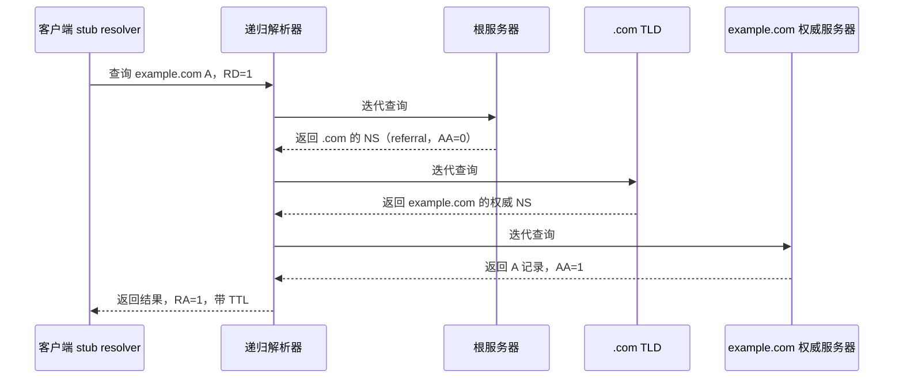

# 05 · UDP 与 DNS

> 一句话：UDP 只负责把数据报丢出去，不保证顺序也不保证到达；DNS 就用这个最便宜的传输，把「域名 → 地址」这件事问清楚，并且靠 TTL 决定答案能缓存多久。

## 是什么 / 为什么重要

UDP 是**无连接、不可靠、保留报文边界**的传输层协议。它只做两件事：加 8 字节头、算校验和（可选）。可靠性、顺序、重传全部交给应用自己处理。

DNS 是 UDP 最典型的用户：一次查询就一个往返，丢了就重问一遍，不值得为它建立 TCP 连接。但 DNS 又几乎是所有网络请求的**第一跳**——DNS 慢 700 ms，用户感知到的就是「网站打开慢 0.7 秒」，哪怕后面 TCP、TLS、HTTP 全都很快。

## 机制与结构

### 1. UDP 头只有 8 字节

```text
 0                   1                   2                   3
 0 1 2 3 4 5 6 7 8 9 0 1 2 3 4 5 6 7 8 9 0 1 2 3 4 5 6 7 8 9 0 1
+-+-+-+-+-+-+-+-+-+-+-+-+-+-+-+-+-+-+-+-+-+-+-+-+-+-+-+-+-+-+-+-+
|          Source Port          |       Destination Port        |
+-+-+-+-+-+-+-+-+-+-+-+-+-+-+-+-+-+-+-+-+-+-+-+-+-+-+-+-+-+-+-+-+
|            Length             |           Checksum            |
+-+-+-+-+-+-+-+-+-+-+-+-+-+-+-+-+-+-+-+-+-+-+-+-+-+-+-+-+-+-+-+-+
|                          Data ...                             |
+-+-+-+-+-+-+-+-+-+-+-+-+-+-+-+-+-+-+-+-+-+-+-+-+-+-+-+-+-+-+-+-+
```

| 字段 | 长度 | 含义 |
|:---:|---:|---|
| 源端口 | 2 | 可选，不需要回复时可填 0 |
| 目的端口 | 2 | 交付给哪个应用 |
| Length | 2 | **UDP 头 + 数据**，最小 8，最大 65535 |
| Checksum | 2 | 覆盖伪首部 + UDP 头 + 数据；IPv4 下填 0 表示「未计算」 |

三条必须记住的规则：

1. **IPv4 下 UDP 校验和是可选的**，填 `0x0000` 表示不校验；IPv6 下强制计算。
2. 如果算出来的校验和恰好是 `0x0000`，**必须发送 `0xFFFF`**（RFC 768），因为 0 有特殊含义。
3. UDP 最大载荷 = `65535 − 20（IPv4 头）− 8（UDP 头）= 65507` 字节。超过就要靠 IP 分片，而分片会放大丢包代价。

UDP 不提供的能力，一张表说清：

| 能力 | TCP | UDP |
|:---:|---|---|
| 连接建立 | 三次握手 | 无 |
| 有序交付 | 是 | 否 |
| 重传 | 是 | 否 |
| 流量/拥塞控制 | 是 | 否（QUIC 在应用层自己实现） |
| 保留报文边界 | 否（字节流） | 是（一个数据报一个边界） |
| 头部开销 | 20–60 字节 | 8 字节 |

### 2. DNS 报文结构

DNS 报文 = 12 字节头 + 问题区 + 回答区 + 权威区 + 附加区。

```text
+-------------------+
| Header (12 B)     |  ID / Flags / QDCOUNT / ANCOUNT / NSCOUNT / ARCOUNT
+-------------------+
| Question          |  QNAME + QTYPE + QCLASS
+-------------------+
| Answer            |  资源记录 RR × ANCOUNT
+-------------------+
| Authority         |  RR × NSCOUNT（权威 NS、SOA，负缓存用）
+-------------------+
| Additional        |  RR × ARCOUNT（EDNS0 OPT 记录在这里）
+-------------------+
```

**QNAME 的编码**：每段前加 1 字节长度，最后以 0 结束。

```text
www.example.com
→ 03 77 77 77  07 65 78 61 6d 70 6c 65  03 63 6f 6d  00
   └ www ┘     └────── example ──────┘    └ com ┘   结束
```

**压缩指针**：报文中重复出现的域名可以用 2 字节指针（高两位 `11`）指回前面的位置，`0xC0 0x0C` 表示「从偏移 12 开始的那个名字」。所以 QNAME 解码器必须支持指针，否则解析真实响应会失败。

**Flags 字段的 16 位**：

| 位 | 名称 | 含义 |
|:---:|:---:|---|
| 15 | QR | 0 = 查询，1 = 响应 |
| 14–11 | Opcode | 0 = 标准查询 |
| 10 | AA | 权威回答 |
| 9 | TC | 截断，响应太大放不下，客户端应改用 TCP |
| 8 | RD | 期望递归（客户端置位） |
| 7 | RA | 递归可用（服务器置位） |
| 5 / 4 | AD / CD | DNSSEC 相关：已认证 / 不检查 |
| 3–0 | RCODE | 0 = NOERROR，2 = SERVFAIL，3 = NXDOMAIN |

**资源记录（RR）的通用格式**：`NAME + TYPE(2) + CLASS(2) + TTL(4) + RDLENGTH(2) + RDATA`。

| 类型 | 值 | 作用 |
|:---:|---:|---|
| A | 1 | IPv4 地址 |
| NS | 2 | 该域的权威服务器 |
| CNAME | 5 | 别名，指向另一个名字 |
| SOA | 6 | 区域起始授权，负缓存用它的 MINIMUM |
| PTR | 12 | 反向解析 |
| MX | 15 | 邮件服务器 |
| TXT | 16 | 任意文本，SPF/DKIM/验证常用 |
| AAAA | 28 | IPv6 地址 |
| OPT | 41 | EDNS0 伪记录，声明 UDP 大小等 |

### 3. 递归查询与迭代查询



- **客户端做的是递归查询**：只问一次，要求对方给最终答案（`RD=1`）。
- **递归解析器做的是迭代查询**：从根开始一层层问，自己拼出答案，然后缓存。
- `AA=1` 表示「我就是这个域的权威」，`RA=1` 表示「我支持递归」。

### 4. 缓存与 TTL

TTL 是**权威服务器允许缓存多久（秒）**。递归解析器返回给你的，通常是「剩余 TTL」而不是原始 TTL；剩余值归零后必须重新回源。

| 观察到的 TTL | 含义 |
|:---:|---|
| 等于权威值 | 没有命中缓存，刚回源拿到 |
| 小于权威值 | 命中缓存，返回剩余生存时间 |
| 0 | 只能用于当前事务，不应缓存 |

还有**负缓存**：NXDOMAIN 或空回答也会被缓存，时长取 SOA 记录的 MINIMUM 与 TTL 的较小值。所以「刚配置的域名解析不到」可能要等负缓存过期，而不是立刻生效。

### 5. DNS 什么时候走 TCP

| 场景 | 原因 |
|:---:|---|
| 响应超过 512 字节（无 EDNS0） | UDP 传统上限，`TC=1` 后客户端改用 TCP 重问 |
| 响应超过 EDNS0 声明的缓冲区（常见 1232–4096） | 同上 |
| 区域传送（AXFR/IXFR） | 数据量大且要求可靠 |
| DoT（DNS over TLS，853） | 加密传输 |
| DoH（DNS over HTTPS，443） | 走 HTTPS，本质还是 TCP（或 HTTP/3 的 UDP） |

## 动手验证

### 验证 1：看一个 DNS 查询的字节

```powershell
cd labs\01-packet-craft
py craft.py
```

【1】DNS 查询报文的本机实测输出：

```text
  0000  7a 69 01 00 00 01 00 00 00 00 00 00 03 77 77 77  |zi...........www|
  0010  07 65 78 61 6d 70 6c 65 03 63 6f 6d 00 00 01 00  |.example.com....|
  0020  01                                               |.|
```

`7a 69` 是 ID，`01 00` 是 flags（RD=1），`00 01 00 00 00 00 00 00` 是四个计数，`03 77 77 77 ...` 是 QNAME，最后 `00 01 00 01` 是 QTYPE=A、QCLASS=IN。

### 验证 2：用系统解析器查真实记录

```powershell
Resolve-DnsName example.com -Type A
Resolve-DnsName example.com -Type NS
```

本机实测输出（A 记录）：

```text
Name        Type TTL IPAddress
----        ---- --- ---------
example.com    A  60 172.66.147.243
example.com    A  60 104.20.23.154
```

NS 记录（TTL 明显更长，因为权威服务器列表变化不频繁）：

```text
Name        Type  TTL NameHost
----        ----  --- --------
example.com   NS 3600 elliott.ns.cloudflare.com
example.com   NS 3600 hera.ns.cloudflare.com
```

同一个域名返回两个 A 记录，客户端通常按顺序尝试或轮询，这就是最朴素的负载分担。

### 验证 3：确认本机的解析路径

```powershell
nslookup example.com
```

本机实测：`nslookup` 直连配置里的 DNS 服务器（`119.29.29.29`）时出现 `DNS request timed out`，而 `Resolve-DnsName` 正常返回。原因是**两者走的路径不同**：`nslookup` 自己构造 DNS 包直接发给配置的服务器，`Resolve-DnsName` 走系统解析栈（本机可能经由代理/DoH）。排障时第一步永远是确认「流量实际问的是谁」，而不是假设配置里写的服务器就在生效。

### 验证 4：用 Wireshark / tshark 验证

> Wireshark 4.0.17 已装在 `E:\Wireshark`（`tshark` 同目录，不在 PATH），下面命令可以直接跑；抓包与 Lua 解析的完整真实输出见 [lab06](../labs/06-zombie-protocol/README.md)。

```text
dns.qry.name == "example.com"
dns.flags.rcode != 0
dns.flags.truncated == 1
dns.time > 0.5
udp.port == 53
```

看 `dns.time` 就能知道一次查询花了多久；看 `dns.flags.truncated` 就知道是否被迫改用 TCP。

## 常见误区

1. **很多人以为 DNS 只用 UDP，实际区域传送、大响应、DoT 都走 TCP**，因为 UDP 有 512 字节的传统上限，超出后靠 `TC=1` 回退。
2. **很多人以为 TTL 是「从查询时刻开始计时」，实际它是「允许缓存的总时长」，你看到的是剩余值**，因为递归解析器会随时间递减后返回。
3. **很多人以为客户端自己从根服务器开始迭代查询，实际客户端只发递归查询，迭代是解析器干的**，因为 stub resolver 没有完整根区数据，也不该承担这个成本。
4. **很多人以为 CNAME 可以随便和别的记录共存，实际 CNAME 不能与同名的其他记录共存**（DNSSEC 等少数例外），因为它表示「这个名字整体指向别处」。
5. **很多人以为改了 DNS 记录立刻生效，实际要等旧 TTL 过期，还可能被负缓存拖住**，因为解析器只按 TTL 行事。

## 自测

**1. 一个 DNS 查询的 QNAME 是 `api.example.com`，它编码后的字节序列是什么？**

- **考点**：QNAME 编码
- **应明白**：每个标签前加长度字节，结尾补 0
- **算会**：`03 61 70 69 07 65 78 61 6d 70 6c 65 03 63 6f 6d 00`，并能说出总长 17 字节

**2. DNS 响应的 `TC=1` 意味着什么？客户端下一步做什么？**

- **考点**：UDP 截断与 TCP 回退
- **应明白**：响应放不下被截断，UDP 上无法完整返回
- **算会**：改用 TCP 53 重新查询；并能说出 EDNS0 能把 UDP 缓冲区扩大到 1232 以上，减少这种情况

**3. TTL 60 的 A 记录，同一解析器在 30 秒后再次被查询，返回的 TTL 大约是多少？为什么？**

- **考点**：缓存与 TTL 递减
- **应明白**：命中缓存时返回剩余时间
- **算会**：约 30；如果解析器没缓存或强制回源，则仍是 60，所以**看到 60 不能证明没有缓存**

## 关联

- 上一篇：[04 · TCP 可靠传输](04-tcp-reliability.md)
- 下一篇：[06 · HTTP 与 TLS](06-http-and-tls.md)
- 把 DNS 延迟算进总账：[10 · 延迟分解与故障排查](10-latency-and-troubleshooting.md)
- 实验：[`labs/01-packet-craft`](../labs/01-packet-craft/)
