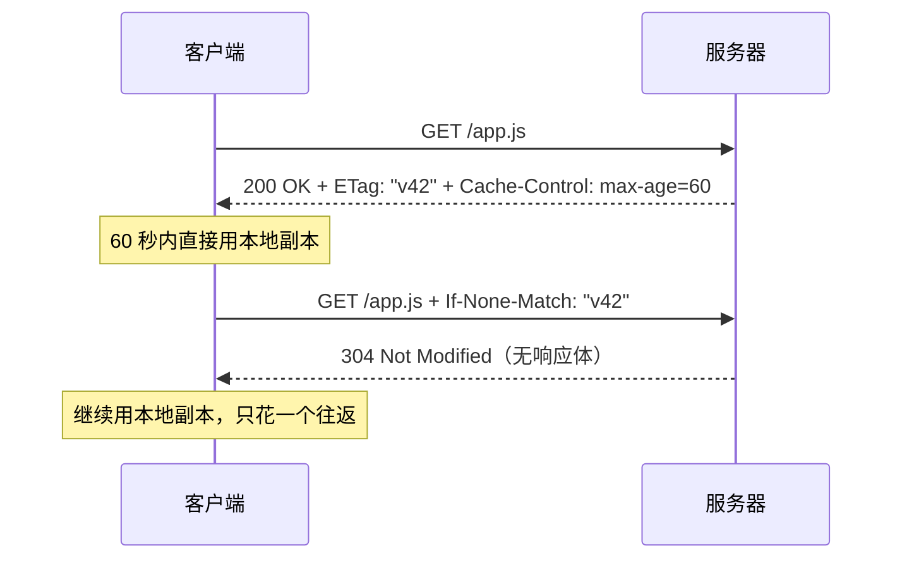
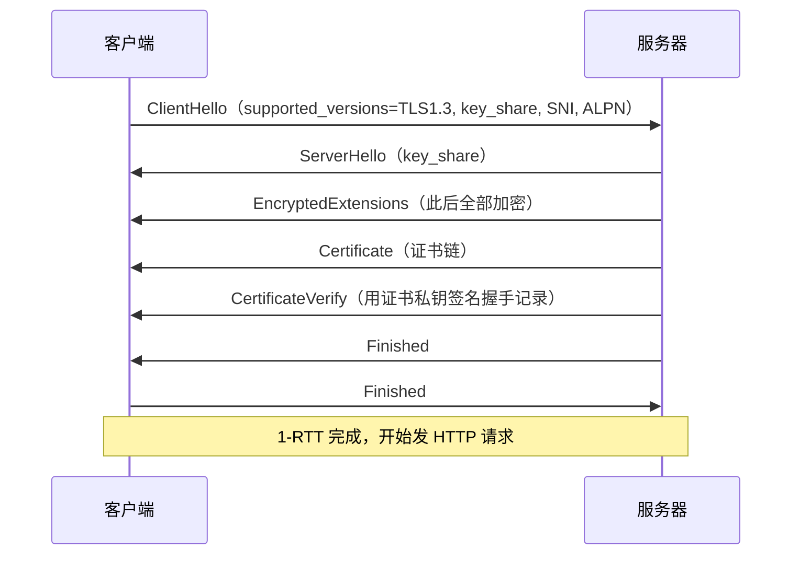

# 06 · HTTP 与 TLS

> 一句话：HTTP/1.1 把请求写成「起始行 + 头 + 空行 + 体」的文本，TLS 1.3 用一次往返就谈完密钥，证书链则负责回答「这个公钥真的属于这个域名吗」。

## 是什么 / 为什么重要

HTTP 是应用层协议，负责「要什么、给什么、能不能缓存」。TLS 夹在 HTTP 与 TCP 之间，负责机密性（别人看不懂）、完整性（改不了）、身份认证（对面真的是它）。

排障时这三层经常被混在一起说「接口慢」：

| 现象 | 可能出在 |
|:---:|---|
| 首字节很慢，但连接很快 | 服务器处理 / 后端依赖（TTFB） |
| 建连慢、TLS 握手慢 | 网络 RTT、证书链过大、OCSP |
| 偶发 304 / 200 混乱 | 缓存头配置错误 |
| 证书报错 | 链不完整、过期、域名不匹配 |

把每一层的时间分开量，才有资格说「慢在哪」。

## 机制与结构

### 1. HTTP/1.1 报文格式

```text
请求：                          响应：
GET /index.html HTTP/1.1        HTTP/1.1 200 OK
Host: example.com               Date: Sun, 22 Nov 2026 15:57:32 GMT
User-Agent: curl/8.22.0         Content-Type: text/html; charset=utf-8
Accept: */*                     Content-Length: 1256
                                ETag: "abc123"
<空行>                          <空行>
<请求体，GET 通常没有>          <响应体>
```

- 每行以 `\r\n` 结束，**头和体之间是一个空行**（`\r\n\r\n`）。
- 没有 `Content-Length` 也没有 `Transfer-Encoding` 时，响应体以连接关闭为结束——这是 HTTP/1.0 的行为，现代服务端应显式给出长度。

常见头一张表：

| 头 | 方向 | 作用 |
|:---:|:---:|---|
| `Host` | 请求 | 同一 IP 上区分虚拟主机，**HTTP/1.1 必填** |
| `Content-Length` | 双向 | 体的精确字节数 |
| `Transfer-Encoding: chunked` | 响应 | 边生成边发，长度未知时用 |
| `Connection: keep-alive` | 双向 | 复用连接（HTTP/1.1 默认复用） |
| `Cache-Control: max-age=60` | 响应 | 相对过期时间 |
| `ETag` / `If-None-Match` | 响应 / 请求 | 内容指纹，命中返回 304 |
| `Last-Modified` / `If-Modified-Since` | 响应 / 请求 | 按时间判断缓存 |
| `Vary` | 响应 | 缓存键还要包含哪些请求头（如 `Accept-Encoding`） |

**chunked 编码**的格式（每块前面是十六进制长度）：

```text
1a\r\n                       ← 26 字节
<26 字节数据>\r\n
0\r\n                        ← 最后一块长度为 0
\r\n
```

### 2. 缓存：304 是省流量的关键



304 没有响应体，所以它省的是**带宽**不是**往返**。要省往返，得靠 `max-age` 在有效期内完全不发请求。

### 3. TLS 1.3 握手：1-RTT



为什么能压到 1-RTT：**客户端在 ClientHello 里就带上 `key_share`**（猜一个组，把自己的临时公钥直接发过去）。服务器选中的组如果对得上，立刻就能算出共享密钥，不必再多一个往返协商。TLS 1.2 需要 2-RTT，就是因为密钥交换参数要多走一轮。

TLS 1.3 相对 1.2 的关键变化：

| 变化 | 影响 |
|:---:|---|
| 删除 RSA 密钥交换 | 只保留 (EC)DHE，**前向安全**成为强制项 |
| 删除压缩、重协商、静态 DH | 攻击面变小 |
| 握手后全部加密 | 证书也不再明文可见 |
| 只允许 AEAD 套件 | 如 `TLS_AES_128_GCM_SHA256`、`TLS_AES_256_GCM_SHA384`、`TLS_CHACHA20_POLY1305_SHA256` |
| 支持 0-RTT（PSK 恢复） | 重连可省掉握手，但有重放风险 |

**0-RTT 的代价**：早期数据在服务器确认身份之前就发出去了，攻击者可以截获并重放。所以只有幂等请求（如 GET 静态资源）适合，支付、下单这类绝不能开。

### 4. 证书链：三个角色

```text
[根证书 Root CA]  ← 预装在操作系统/浏览器的信任库里，自签名
        │ 签发
[中间证书 Intermediate]  ← 服务器随握手一起发给你
        │ 签发
[叶子证书 Leaf]  ← 服务器自己的证书，绑定域名与公钥
```

客户端验证一条链至少要做：

1. **链能连到信任根**（签名逐级验证）；
2. **叶子证书的 SAN 包含访问的域名**（通配符只能匹配一级，`*.example.com` 不匹配 `a.b.example.com`）；
3. **有效期覆盖当前时间**；
4. **用途正确**（`extendedKeyUsage` 含 `serverAuth`）；
5. **未被吊销**（OCSP / CRL / OCSP stapling，实践中常被软失败绕过）。

握手时客户端通过 **SNI** 告诉服务器要访问哪个域名（明文，除非部署 ECH），服务器据此选证书；通过 **ALPN** 协商上层协议（`h2`、`http/1.1`、`h3`）。

## 动手验证

### 验证 1：看真实的 HTTP/1.1 请求与响应

```powershell
curl.exe -v --max-time 8 -o NUL http://example.com/
```

本机实测关键行：

```text
> GET / HTTP/1.1
> Host: example.com
> User-Agent: curl/8.22.0
> Accept: */*
<
< HTTP/1.1 200 OK
< Date: Sun, 22 Nov 2026 15:57:32 GMT
< Content-Type: text/html; charset=utf-8
< Transfer-Encoding: chunked
```

`>` 是发出的请求头，`<` 是收到的响应头。注意 `Transfer-Encoding: chunked`：这个响应没有 `Content-Length`，体是分块发送的。

### 验证 2：用 Python 探测 TLS 参数（先看默认行为）

```python
import socket, ssl

ctx = ssl.create_default_context()          # 默认会校验证书链与主机名
s = socket.create_connection(("example.com", 443), timeout=8)
t = ctx.wrap_socket(s, server_hostname="example.com")
print(t.version(), t.cipher()[0])
```

本机实测：**这一步就失败了**，报 `ssl.SSLCertVerificationError: certificate verify failed: unable to get local issuer certificate`。这不是 bug，而是**默认行为正确的证明**：当前环境无法把服务器证书链构建到受信根（缺少可用信任锚，或有代理中间人证书），Python 拒绝连接。

为了只看握手参数，明确地临时关闭校验（**只用于诊断，生产代码禁止**）：

```python
import socket, ssl

ctx = ssl._create_unverified_context()
ctx.set_alpn_protocols(["h2", "http/1.1"])
s = socket.create_connection(("example.com", 443), timeout=8)
t = ctx.wrap_socket(s, server_hostname="example.com")
print("version =", t.version())
print("cipher  =", t.cipher()[0])
print("alpn    =", t.selected_alpn_protocol())
t.close()
```

本机实测输出：

```text
version = TLSv1.3
cipher  = TLS_AES_256_GCM_SHA384
alpn    = h2
```

三行信息量很大：协商到了 **TLS 1.3**、选了 **AES-256-GCM**、ALPN 选中 **h2**（服务器支持 HTTP/2）。ALPN 这一行是下一篇的入口。

### 验证 3：看本机信任库

```powershell
(Get-ChildItem Cert:\LocalMachine\Root | Measure-Object).Count
```

本机实测为 **81**。这 81 张根证书就是「信任锚」的集合：链的顶端必须落在这里面，否则浏览器/系统就会报警。

### 验证 4：为什么本机的 curl 连 HTTPS 会失败

```powershell
curl.exe -v --max-time 8 https://example.com/
```

本机实测报错：

```text
* schannel: AcquireCredentialsHandle failed: SEC_E_NO_CREDENTIALS (0x8009030e)
curl: (35) schannel: AcquireCredentialsHandle failed
```

这是 **Schannel 凭据在当前会话不可用**导致的，不是网络问题（HTTP 访问同一域名正常）。所以本仓库的 HTTPS 验证用 Python `ssl` 或装好 Wireshark 后抓包，不贴未经验证的握手截图。

### 验证 5：用 Wireshark / tshark 验证

> Wireshark 4.0.17 已装在 `E:\Wireshark`（`tshark` 同目录，不在 PATH），下面命令可以直接跑；抓包与 Lua 解析的完整真实输出见 [lab06](../labs/06-zombie-protocol/README.md)。

```text
tls.handshake.type == 1                                  # ClientHello
tls.handshake.type == 2                                  # ServerHello
tls.handshake.extensions_server_name                     # SNI
tls.handshake.extensions_alpn_str                        # ALPN
tls.record.content_type == 23                            # 应用数据
http.request.method == "GET"
http.response.code == 304
```

TLS 1.3 的证书是加密的，需要在 Wireshark 里配置 `SSLKEYLOGFILE` 才能解密——这本身就说明了「握手之后全加密」不是口号。

## 常见误区

1. **很多人以为 TLS 1.3 还支持 RSA 密钥交换，实际只剩 (EC)DHE，RSA 只用于签名**，因为 RSA 密钥交换没有前向安全：私钥泄露后历史流量全可解。
2. **很多人以为 HTTPS 把域名也加密了，实际 SNI 在明文里**（除非 ECH），因为服务器要先知道域名才能选证书；抓包里能直接看到 `tls.handshake.extensions_server_name`。
3. **很多人以为地址栏有锁就等于网站可信，实际锁只证明「链有效、域名匹配」**，不证明站点善意，DV 证书几美元就能签。
4. **很多人以为 304 是一种错误或重定向，实际它是「缓存仍然有效」**，因为客户端发了条件请求，服务器确认没变化。
5. **很多人以为 HTTP/2 一定跑在 TLS 上，实际存在 h2c（明文 HTTP/2）**，只是浏览器不支持；HTTP/3 则强制基于 QUIC + TLS 1.3。

## 自测

**1. TLS 1.3 为什么能做到 1-RTT？TLS 1.2 多出来的那一次往返在干什么？**

- **考点**：密钥交换的时机
- **应明白**：1.3 的客户端在 ClientHello 里就发 `key_share`；1.2 要等 ServerHello 选定参数后再发密钥交换
- **算会**：能指出「1.3 是把猜测和参数一起发出去，猜对就省一轮」

**2. 一个响应带 `ETag: "v42"` 和 `Cache-Control: max-age=60`。第 30 秒和第 90 秒各会发生什么？**

- **考点**：强缓存与协商缓存
- **应明白**：`max-age` 内直接用本地副本；过期后发条件请求
- **算会**：30 秒时零请求；90 秒时发 `If-None-Match: "v42"`，命中返回 304（无体），未命中返回 200 新体

**3. 证书链验证至少要检查哪几件事？如果服务器只发了叶子证书会怎样？**

- **考点**：链构建
- **应明白**：签名链、域名 SAN、有效期、用途、吊销
- **算会**：缺少中间证书时客户端可能无法构建到根（除非能通过 AIA 补链），表现为 `unable to get local issuer certificate`

## 关联

- 上一篇：[05 · UDP 与 DNS](05-udp-and-dns.md)
- 下一篇：[07 · HTTP/2 与 HTTP/3](07-http2-http3-quic.md)
- TLS 握手耗时怎么量：[10 · 延迟分解与故障排查](10-latency-and-troubleshooting.md)
- 实验：[`labs/01-packet-craft`](../labs/01-packet-craft/)
