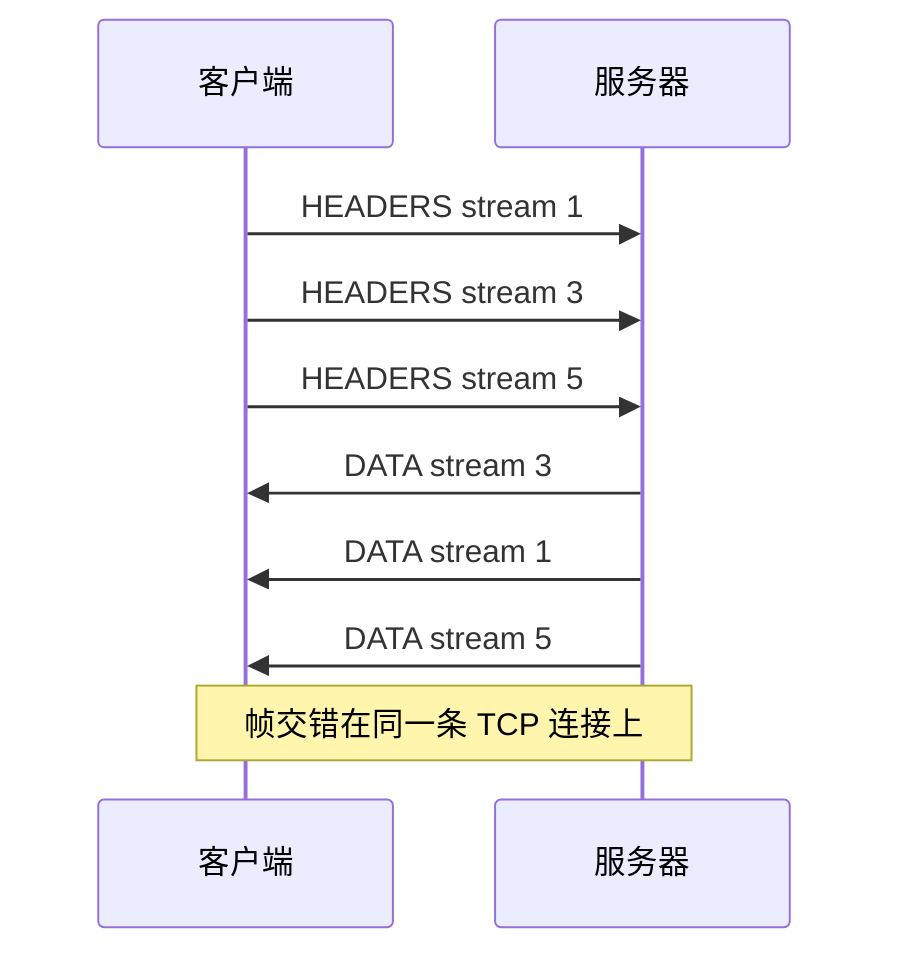
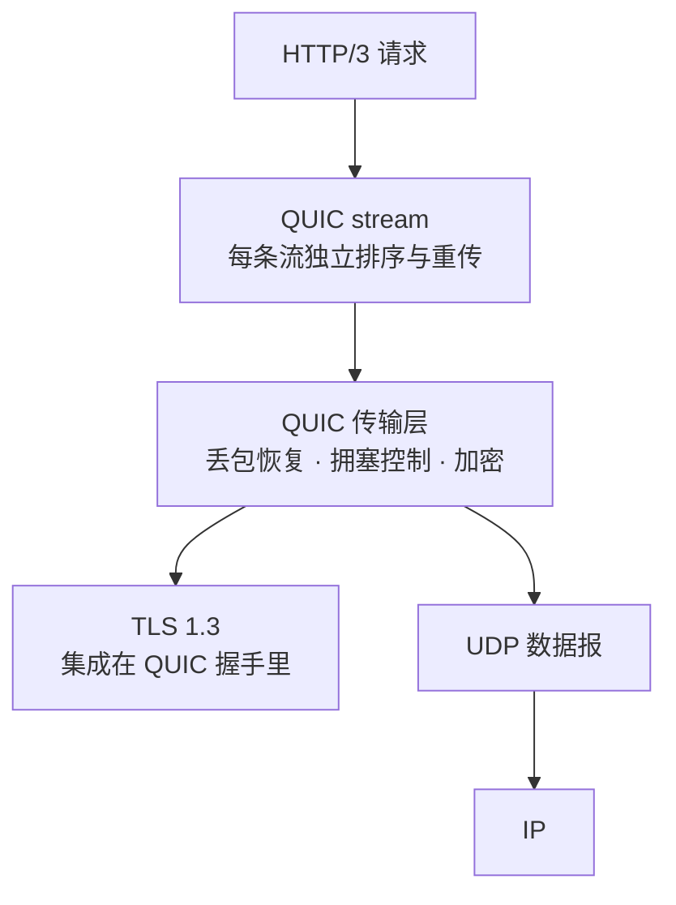

# 07 · HTTP/2、HTTP/3 与 QUIC

> 一句话：HTTP/2 用二进制分帧和一条 TCP 连接解决应用层队头阻塞，HTTP/3 干脆把传输层换成基于 UDP 的 QUIC，让每条流真正互不阻塞。

## 是什么 / 为什么重要

HTTP/1.1 的瓶颈不在协议文本本身，而在**一条连接同一时刻只能有一个请求在途**：浏览器为了并发只能对同一域名开 6 条左右的连接，每条都要独立握手、独立慢启动。HTTP/2 把「请求」拆成帧，交错复用到一条连接上；HTTP/3 进一步换掉 TCP，把「流」的概念下沉到传输层。

理解这两代协议，才能解释「为什么静态资源多的页面在 HTTP/1.1 下要域名分片、为什么弱网时 HTTP/2 可能更慢、为什么 QUIC 用 UDP 却敢说自己可靠」。

## 机制与结构

### 1. HTTP/2 的二进制分帧

HTTP/2 不再发送文本行，而是把一切拆成帧。每个帧有固定的 **9 字节头**：24 位长度 + 8 位类型 + 8 位标志 + 1 位保留 + 31 位流 ID。

| 字段 | 长度 | 说明 |
|:---:|---:|---|
| Length | 3 B | 载荷长度，**不含 9 字节头**，最大 2²⁴−1 |
| Type | 1 B | 帧类型 |
| Flags | 1 B | 类型相关标志，如 END_STREAM、END_HEADERS |
| R | 1 bit | 保留位 |
| Stream Identifier | 31 bit | 属于哪条流；**0 表示连接级帧** |

常用帧类型（HTTP/2 共 10 种，这里列最常用的 5 种）：

| 类型 | 值 | 作用 |
|:---:|---:|---|
| DATA | `0x0` | 响应/请求体 |
| HEADERS | `0x1` | 压缩后的头部块 |
| SETTINGS | `0x4` | 连接参数协商 |
| GOAWAY | `0x7` | 优雅关闭连接 |
| WINDOW_UPDATE | `0x8` | 增加流控窗口 |

用 Python 拼一个「空 HEADERS 帧，流 1，END_STREAM + END_HEADERS」：

```python
import struct

frame = struct.pack("!I", 10)[1:] + bytes([0x01, 0x05]) + struct.pack("!I", 1)
print(frame.hex(" "), len(frame))
```

本机实测输出：

```text
00 00 0a 01 05 00 00 00 01 9
```

读法：长度 `00 00 0a` = 10，类型 `01` = HEADERS，标志 `05` = END_STREAM | END_HEADERS，流 ID `00 00 00 01` = 1。

### 2. 多路复用与流



- 客户端发起的流 ID 是**奇数**，服务器发起的是**偶数**；流 ID 单调递增，不能复用。
- 每条流有自己的流控窗口，也可以被 `RST_STREAM` 单独取消，不影响其他流。
- 连接建立后客户端先发连接前言 `PRI * HTTP/2.0\r\n\r\nSM\r\n\r\n`，然后双方交换 `SETTINGS`。

### 3. HPACK：只压缩头部

HTTP/1.1 的头部在长连接里被反复发送（`User-Agent`、Cookie 动辄几百字节），HTTP/2 用 **HPACK（RFC 7541）**压缩：

- **静态表**：61 个常见头/值预定义，比如索引 2 = `:method: GET`、4 = `:path: /`、7 = `:scheme: https`；
- **动态表**：连接期间双方共同维护，新增的头部后续用索引引用；
- **Huffman 编码**：字面量按静态 Huffman 表压缩。

所以一个最小请求的头部块可以只有 3 字节：

```text
82 87 84   →   :method: GET  ·  :scheme: https  ·  :path: /
```

（`0x82` = 索引 2，`0x87` = 索引 7，`0x84` = 索引 4；实际还会带一个 `:authority` 字面量。）

**HPACK 压缩的是头部，不是 body。** body 压缩靠 `Content-Encoding: gzip` / `br`，完全另一套东西。

### 4. 流控：连接级 + 流级

HTTP/2 的流控是**两级**的：连接窗口和每条流的窗口，初始都是 65535 字节，接收方通过 `WINDOW_UPDATE` 补充；它和 TCP 的 `rwnd` 不冲突——一个管内核缓冲、一个管应用消费。

### 5. TCP 层的队头阻塞仍然存在

HTTP/2 解决了**应用层**队头阻塞（一个慢响应不再挡住其他响应），但所有流共享**一条 TCP 字节流**。一旦某个 TCP 段丢失，内核会等它重传成功才把后续字节交给 HTTP/2 层——**所有流一起等**。

```text
HTTP/1.1：6 条连接，丢 1 条只影响 1/6 的请求
HTTP/2  ：1 条连接，丢 1 个段，所有流一起卡（弱网下可能更慢）
```

这就是 HTTP/3 存在的根本原因。

### 6. QUIC 与 HTTP/3

QUIC（RFC 9000）把「可靠、有序、拥塞控制、加密」全部搬到**用户态、基于 UDP**。HTTP/3（RFC 9114）是跑在 QUIC 上的 HTTP。



QUIC 长包头的结构：

| 字段 | 长度 | 说明 |
|:---:|---:|---|
| Header Form | 1 bit | 1 = 长包头 |
| Fixed Bit | 1 bit | 必须为 1，用于区分 QUIC 流量 |
| Long Packet Type | 2 bit | Initial / 0-RTT / Handshake / Retry |
| Reserved | 2 bit | 受头部保护 |
| Packet Number Length | 2 bit | 包号占 1–4 字节 |
| Version | 4 B | 如 `0x00000001` |
| DCID Length + DCID | 1 + 0–20 B | 目的连接 ID |
| SCID Length + SCID | 1 + 0–20 B | 源连接 ID |
| Token Length + Token | varint + n | 仅 Initial 包使用 |
| Length | varint | 剩余部分长度 |
| Packet Number | 1–4 B | 单调递增，重传换新包号 |
| Payload | … | 加密后的帧 |

QUIC 的关键设计：

| 设计 | 解决的问题 |
|:---:|---|
| **流是传输层概念** | 一条流丢包只阻塞自己，不阻塞其他流 |
| **连接 ID** | 手机从 Wi-Fi 切到 5G，IP 变了连接不断（连接迁移） |
| **包号单调递增** | 不用像 TCP 那样猜「这个 ACK 对应哪次重传」，RTT 测量更准 |
| **TLS 1.3 集成** | 没有 TLS record 层，握手与传输合一，1-RTT（恢复 0-RTT） |
| **UDP 之上的可靠性** | 自己实现 ACK、重传、拥塞控制（RFC 9002） |

QUIC 帧类型（部分，完整列表见 RFC 9000）：

| 帧 | 值 | 用途 |
|:---:|---:|---|
| PADDING | `0x00` | 填充，防流量分析 / 满足最小包长 |
| ACK | `0x02` / `0x03` | 确认（带/不带 ECN） |
| CRYPTO | `0x06` | 承载 TLS 握手消息 |
| STREAM | `0x08`–`0x0f` | 应用数据（位标志含 FIN、OFFSET、LEN） |
| MAX_DATA | `0x10` | 连接级流控 |
| CONNECTION_CLOSE | `0x1c` / `0x1d` | 关闭连接 |

HTTP/3 的单向流用类型前缀区分：`0x00` 控制流、`0x01` 推送流、`0x02` QPACK 编码器、`0x03` QPACK 解码器。

**QPACK** 是为 QUIC 重写的头部压缩：HPACK 的动态表更新有严格顺序依赖，在 QUIC 上会造成跨流阻塞；QPACK 把编码器和解码器拆到独立单向流，并允许有限阻塞。

### 7. 三代协议对比

| 维度 | HTTP/1.1 | HTTP/2 | HTTP/3 |
|:---:|---|---|---|
| 传输层 | TCP | TCP | QUIC（UDP） |
| 数据格式 | 文本 | 二进制分帧 | 二进制分帧 |
| 多路复用 | 无（靠多连接） | 一条连接多流 | 一条连接多流 |
| 应用层队头阻塞 | 有 | 消除 | 消除 |
| 传输层队头阻塞 | 有 | 有（TCP） | 无（流独立） |
| 头部压缩 | 无 | HPACK | QPACK |
| 加密 | 可选（HTTPS） | 事实必需 | 强制（TLS 1.3 内置） |
| 建连 RTT | TCP 1 + TLS 2 | 同左 | 1（恢复 0） |
| 连接迁移 | 不支持 | 不支持 | 支持（连接 ID） |

## 动手验证

### 验证 1：用 ALPN 看服务器支持哪一代

```python
import socket, ssl

ctx = ssl._create_unverified_context()   # 仅诊断用，生产环境必须校验证书
ctx.set_alpn_protocols(["h2", "http/1.1"])
s = socket.create_connection(("example.com", 443), timeout=8)
t = ctx.wrap_socket(s, server_hostname="example.com")
print("version =", t.version())
print("alpn    =", t.selected_alpn_protocol())
t.close()
```

本机实测：

```text
version = TLSv1.3
alpn    = h2
```

服务器在 ALPN 里选了 `h2`，说明它支持 HTTP/2。**协议能力是服务器和客户端共同决定的**，下一步就看客户端支不支持。

### 验证 2：确认本机 curl 的能力边界

```powershell
curl.exe --http2 -s -o NUL https://example.com/
curl.exe --http3 -s -o NUL https://example.com/
```

本机实测（curl 8.22.0，Schannel 后端）：

```text
curl: option --http2: the installed libcurl version does not support this
curl: option --http3: the installed libcurl version does not support this
```

这不是网络问题，是**构建选项问题**：`curl --version` 的 `Features` 一行里没有 `HTTP2` 和 `HTTP3`。所以本机无法用 curl 直接验证 h2/h3，只能用 Python 的 ALPN 探测 + 手工拆帧。**「工具不支持」和「协议不支持」是两件完全不同的判断。**

### 验证 3：手工读一个 h2 帧头

```python
import struct

frame = struct.pack("!I", 10)[1:] + bytes([0x01, 0x05]) + struct.pack("!I", 1)
print(frame.hex(" "), len(frame))
# 输出：00 00 0a 01 05 00 00 00 01 9
```

拿到抓包文件后，任意一个 h2 帧都能用这 9 个字节定位：长度 3 字节 + 类型 1 字节 + 标志 1 字节 + 流 ID 4 字节。装好 Wireshark 后还可以用 `http2.type == 0x1`、`http2.streamid == 1` 这类过滤器直接筛帧（本机 4.0.17 已装）。

## 常见误区

1. **很多人以为 HTTP/2 解决了所有队头阻塞，实际 TCP 层的阻塞仍然存在**，因为所有流共享一条有序字节流，丢一个段所有流一起等。
2. **很多人以为 HTTP/2 必须加密，实际存在明文 h2c（HTTP/2 over cleartext）**，只是浏览器只在 TLS 上协商 h2。
3. **很多人以为 HPACK 会压缩响应体，实际它只压缩头部**，因为 body 由 `Content-Encoding` 那套机制处理。
4. **很多人以为 QUIC 因为基于 UDP 所以不可靠，实际 QUIC 在 UDP 之上自己实现了 ACK、重传、流控和拥塞控制**，UDP 只是它绕开内核 TCP 的实现手段。
5. **很多人以为 0-RTT 没有风险，实际早期数据可能被重放**，因为服务器在确认客户端身份之前就已经接受数据了。

## 自测

**1. HTTP/2 帧头 9 字节里，Length 字段为什么只有 24 位？Stream ID 为什么是 31 位？**

- **考点**：帧头布局
- **应明白**：Length 上限 2²⁴−1 = 16777215 字节；Stream ID 留 1 位保留位
- **算会**：能说出「长度不含 9 字节头」「Stream 0 只用于连接级帧」

**2. 为什么 HTTP/2 在丢包时可能比 HTTP/1.1 更慢？**

- **考点**：TCP 层队头阻塞
- **应明白**：h2 的所有流共享一条 TCP 连接；HTTP/1.1 可以开多条连接分散风险
- **算会**：能解释「应用层多路复用无法绕过内核的按序交付」

**3. QUIC 为什么需要连接 ID？它和 TCP 的四元组有什么不同？**

- **考点**：连接迁移
- **应明白**：QUIC 用 DCID/SCID 标识连接，IP/端口变了也能续上；TCP 四元组一变连接就断
- **算会**：能说出「手机 Wi-Fi 切 5G 时，QUIC 连接可以保持，TCP 必须重连」

## 关联

- 上一篇：[06 · HTTP 与 TLS](06-http-and-tls.md)
- 下一篇：[08 · 抓包与协议分析](08-capture-and-analysis.md)
- 应用层延迟怎么拆：[10 · 延迟分解与故障排查](10-latency-and-troubleshooting.md)
- 实验：[`labs/01-packet-craft`](../labs/01-packet-craft/)
