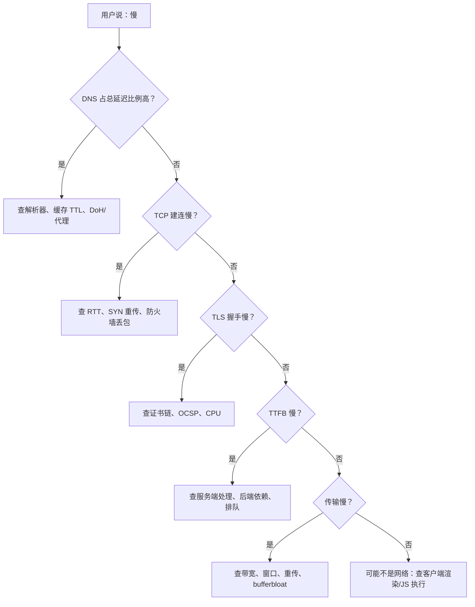

# 10 · 延迟分解与故障排查

> 一句话：把「慢」拆成 DNS、TCP、TLS、TTFB、传输五段，每一段都有可测的数字和可验证的抓包证据；拆不开，就只能靠猜。

## 是什么 / 为什么重要

用户说「卡」，这句话里至少有五种完全不同的故障：

- DNS 解析慢 → 请求还没发出去；
- TCP 建连慢 → 握手丢包或对端过载；
- TLS 握手慢 → RTT 高、证书链大、OCSP 超时；
- TTFB 慢 → 服务器处理或后端依赖慢；
- 传输慢 → 带宽不足、窗口太小、重传太多。

**五段的处理方式完全不同**。不分解就优化，等于蒙眼改代码。这一篇把前面九篇的知识串成一条可执行的排查链。

## 机制与结构

### 1. 延迟的五个阶段

```text
客户端                                                   服务器
  │  ① DNS：把域名换成 IP                                  │
  │ ─────────────────────────────────────────────────────► │
  │  ② TCP：三次握手，1 RTT                                 │
  │ ◄─────────────────────────────────────────────────────► │
  │  ③ TLS：TLS 1.3 握手，1 RTT（恢复可 0-RTT）             │
  │ ◄─────────────────────────────────────────────────────► │
  │  ④ 请求 + 服务器处理（TTFB）：请求到达 + 处理 + 首字节回 │
  │ ◄─────────────────────────────────────────────────────► │
  │  ⑤ 传输：剩余响应体下载                                │
  │ ◄─────────────────────────────────────────────────────► │
```

| 阶段 | 在量什么 | 正常量级（参考） | 异常信号 |
|:---:|---|---|---|
| ① DNS | 域名 → IP | 命中缓存 < 1 ms；回源 10–100 ms | 占比超过总延迟 30% |
| ② TCP | 一次往返 | 同城 1–10 ms，跨省 10–40 ms | 远大于物理 RTT，或重试 |
| ③ TLS | TLS 1.3 1 RTT | ≈ 1 个 TCP RTT | 远超 1 RTT，证书链/OCSP 问题 |
| ④ TTFB | 服务器处理 | 10–200 ms | 数百 ms 到数秒 |
| ⑤ 传输 | 剩余字节 | 取决于带宽与窗口 | 下载曲线抖、重传多 |

**RTT 有物理下限**：光纤中光速约 20 万 km/s，1000 km 距离单程至少 5 ms，往返至少 10 ms。任何「跨省 1 ms」的测量都值得怀疑（大概率命中了就近的 CDN 或代理）。

### 2. 用 curl 量出每一段

`curl -w` 支持直接输出各阶段耗时：

| 变量 | 含义 | 与前一阶段的差 |
|:---:|---|---|
| `time_namelookup` | DNS 解析完成 | ① |
| `time_connect` | TCP 建连完成 | `connect − namelookup` = ② |
| `time_appconnect` | TLS 握手完成 | `appconnect − connect` = ③ |
| `time_starttransfer` | 收到第一个响应字节 | `starttransfer − appconnect` = ④ |
| `time_total` | 全部完成 | `total − starttransfer` = ⑤ |

本机实测两条（一次采样，数值会波动）：

```text
# 回环地址，全部在本机
dns=0.000043 connect=0.000663 tls=0.000000 ttfb=0.006961 total=0.007068 code=401 ver=1.1

# 公网 HTTP（无 TLS）
dns=0.707232 connect=0.740400 tls=0.000000 ttfb=1.005156 total=1.005239 code=200
```

回环那条的 `code=401` 是因为本机这个服务需要鉴权，不影响计时；这里只关心五个时间字段。`tls=0.000000` 表示没有 TLS 阶段（HTTP 80 端口），不是「TLS 很快」。

第二条把 1.005 秒拆开：**DNS 0.707 s（70%）**，TCP `0.740 − 0.707 = 0.033 s`，服务器/TTFB `1.005 − 0.740 = 0.265 s`。如果只看「total 1 秒」就去加带宽，方向完全错了——瓶颈在解析。

### 3. MTU 与 PMTUD

IPv4 的 MSS = MTU − IP 头 − TCP 头：

| 链路 | MTU | IPv4 MSS | IPv6 MSS |
|:---:|---:|---:|---:|
| 以太网 | 1500 | 1460 | 1440（IPv6 头 40） |
| PPPoE | 1492 | 1452 | — |
| 隧道 / VPN | 1400 左右 | 1360 | 1340 |

**PMTUD（路径 MTU 发现）**：发送方把 DF 置 1，遇到链路 MTU 更小时，路由器回 ICMP「Fragmentation Needed」（type 3 code 4），发送方据此调小 MSS。

**黑洞（PMTU black hole）**：ICMP 被防火墙丢弃，发送方永远收不到「需要分片」的通知，大包一直发不出去、小包正常——典型症状是「能打开网页但传不了大文件」「SSH 能连但一传数据就卡」。

对策：

- 减少 MTU/MSS（`netsh interface ipv4 set subinterface "以太网" mtu=1400 store=persistent`，需管理员）；
- 或在路由器上做 **MSS clamping**（把 TCP SYN 里的 MSS 改小）；
- 或使用 **PLPMTUD（RFC 8899）**，靠探测包自己找路径 MTU，不依赖 ICMP。

### 4. 丢包、乱序、零窗口：三种「重传」的区分

| 现象 | 抓包证据 | 结论 |
|:---:|---|---|
| 真丢包 | 原包之后有重传，且原包确实没到接收方 | 链路/中间设备丢包 |
| 乱序 | 后发的包先到，触发 dup ACK，随后原包到达 | 多路径/负载均衡，不一定是故障 |
| 零窗口 | `tcp.analysis.zero_window`，`win=0` | 接收方应用读得太慢 |
| 伪重传 | `tcp.analysis.spurious_retransmission` | RTO 估计偏激进，包其实到了 |

**判断顺序**：先看有没有零窗口（排除接收方）→ 再看重复 ACK/SACK（区分丢包与乱序）→ 最后看 RTO 与 RTT 是否异常（判断是否伪重传）。

### 5. 决策树



## 动手验证

### 验证 1：给一次请求做五段计时

```powershell
curl.exe -s -o NUL --max-time 8 -w "dns=%{time_namelookup} connect=%{time_connect} tls=%{time_appconnect} ttfb=%{time_starttransfer} total=%{time_total} code=%{http_code}`n" http://example.com/
```

本机实测输出：

```text
dns=0.707232 connect=0.740400 tls=0.000000 ttfb=1.005156 total=1.005239 code=200
```

把五个数字填进上面的表，就能算出每一段。**注意 `tls=0` 是因为这是 HTTP（80 端口），不是 TLS 很快。**

### 验证 2：看本机接口的 MTU

```powershell
netsh interface ipv4 show subinterfaces
```

本机实测（节选）：

```text
       MTU  MediaSenseState      Bytes In     Bytes Out  Interface
----------  ---------------  ------------  ------------  -------------
4294967295                1             0       2720431  Loopback Pseudo-Interface 1
      1500                1   85265175473   30122228462  以太网
      1500                5             0             0  WLAN
```

环回接口的 MTU 是 `4294967295`（不经过真实链路），物理以太网是标准的 1500。**如果实际出口是 VPN 或 PPPoE，这里会显示更小的值**，MSS 也要跟着算。

### 验证 3：看累计重传与连接状态

```powershell
netstat -s -p tcp | Select-String "Segments"
netstat -ano | Select-String "CLOSE_WAIT" | Measure-Object
```

本机实测 `Segments Retransmitted = 309049`，除以 `Segments Sent = 41517421` 约 0.74%。**累计值要看增量**：隔 5 秒读两次，差值才是「现在是否在丢包」。

### 验证 4：连通性与路径

```powershell
Test-NetConnection example.com -Port 80
tracert example.com
pathping example.com
```

- `Test-NetConnection` 的 `TcpTestSucceeded` 直接告诉你 TCP 层通不通；
- `tracert` 逐跳显示 RTT，能看出延迟在哪个网段跳升；
- `pathping` 统计每跳丢包率（耗时较长）。

### 验证 5：用 Wireshark / tshark 看五段

> Wireshark 4.0.17 已装在 `E:\Wireshark`（`tshark` 同目录，不在 PATH），下面命令可以直接跑；抓包与 Lua 解析的完整真实输出见 [lab06](../labs/06-zombie-protocol/README.md)。

```text
dns.time > 0.2
tcp.flags.syn == 1
tls.handshake.type == 1
http.time > 0.5
tcp.analysis.retransmission
tcp.analysis.zero_window
```

在 Wireshark 里把时间列设为「相对第一个包」，每一段的起止包号就是最硬的证据：**「DNS 从第 1 个包到第 2 个包用了 707 ms」比任何日志都直接**。

## 常见误区

1. **很多人以为 ping 快就代表服务快，实际 ICMP 和 TCP 可能走不同队列/策略，甚至被限速**，因为很多网络对 ICMP 单独处理，ping 只能证明「ICMP 可达」。
2. **很多人以为丢包一定是网络故障，实际乱序、伪重传、接收窗口为零都会表现为「像丢包」**，因为发送方只能根据 ACK 推断，推断会出错。
3. **很多人以为加带宽就能降延迟，实际延迟主要由 RTT、排队和重传决定**，因为带宽只影响「下载多久」，不影响「第一个字节多久」。
4. **很多人以为 TLS 握手总是最慢的一段，实际在 RTT 正常的链路上 TLS 1.3 只多 1 个 RTT**，因为真正的瓶颈常是 DNS 或服务端处理。
5. **很多人以为 MTU 永远是 1500，实际 VPN、PPPoE、隧道都会更小**，因为封装会占用额外字节，MSS 必须跟着调整。

## 自测

**1. 一次请求 `total = 1.2 s`，其中 `time_namelookup = 0.9 s`。你的第一反应是什么？接下来查什么？**

- **考点**：延迟分解与归因
- **应明白**：DNS 占 75%，问题在解析，不在传输
- **算会**：先查解析器配置/缓存（`Resolve-DnsName` 对比直连）、再查是否有代理/DoH、最后看权威服务器响应时间

**2. MTU 1400 的 VPN 链路上，IPv4 TCP 的 MSS 是多少？如果不变会怎样？**

- **考点**：MSS 计算与 PMTUD
- **应明白**：MSS = 1400 − 20 − 20 = 1360
- **算会**：若仍按 1460 发，大包会被丢且可能收不到 ICMP（黑洞），表现为「小请求正常、大响应卡死」

**3. 抓包里看到重传，但没有零窗口，重复 ACK 很少，RTT 还很稳定。最可能是什么？**

- **考点**：重传归因
- **应明白**：没有零窗口排除接收方，dup ACK 少排除明显乱序
- **算会**：怀疑伪重传（RTO 偏激进）或单包丢失，进一步看 `tcp.analysis.spurious_retransmission` 与两次发送的时间差

## 关联

- 上一篇：[09 · 自定义二进制协议](09-custom-binary-protocol.md)
- 回到路线图：[00 · 学习路线](00-roadmap.md)
- 抓包方法：[08 · 抓包与协议分析](08-capture-and-analysis.md)
- 实验：[`labs/01-packet-craft`](../labs/01-packet-craft/)
- 记录模板：[`notes/_TEMPLATE.md`](../notes/_TEMPLATE.md)
