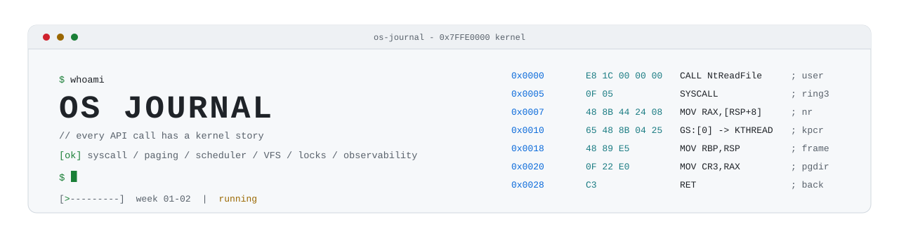
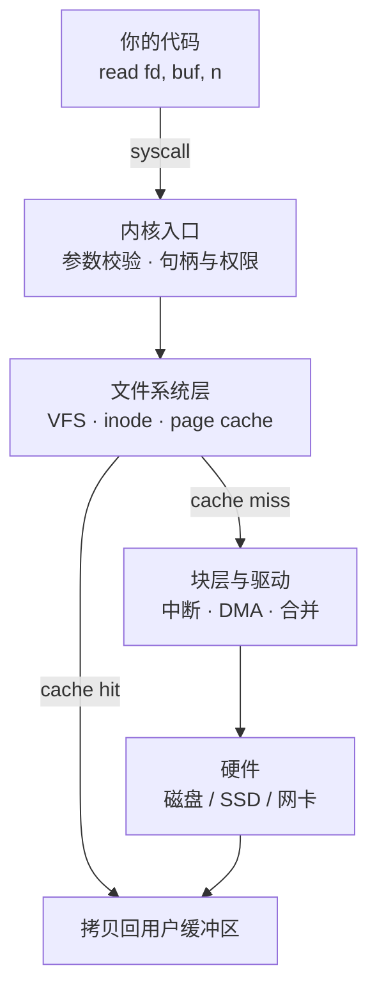
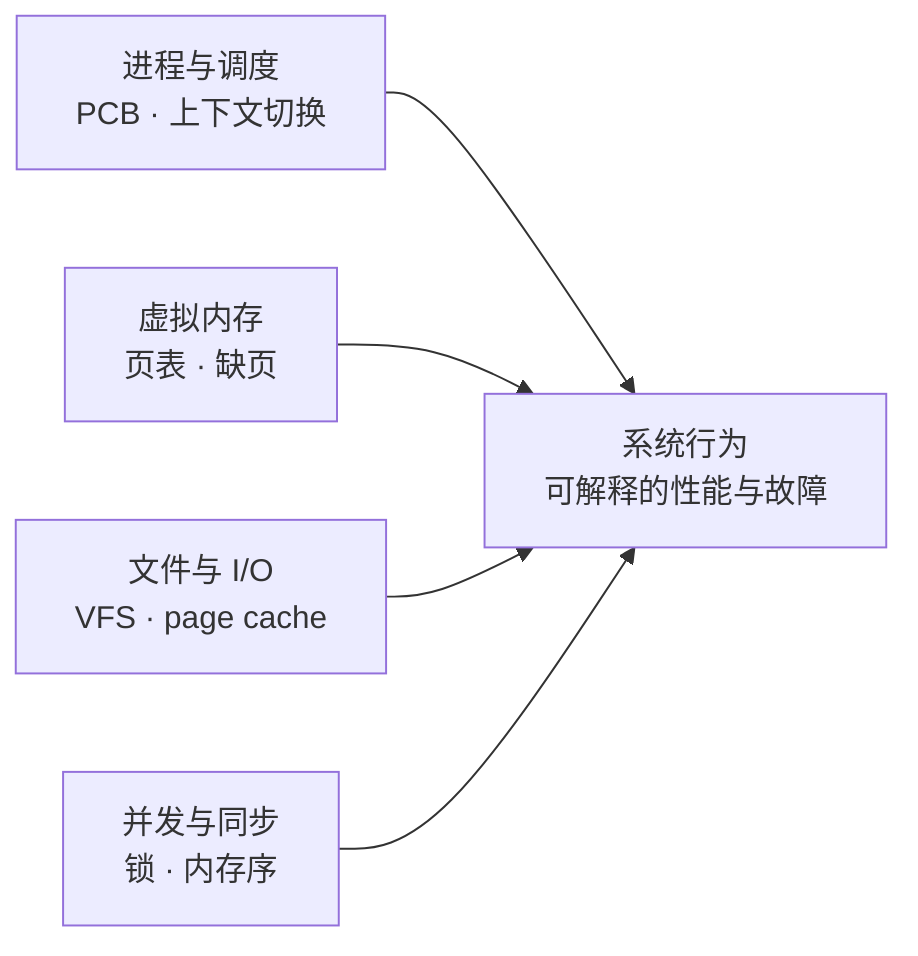
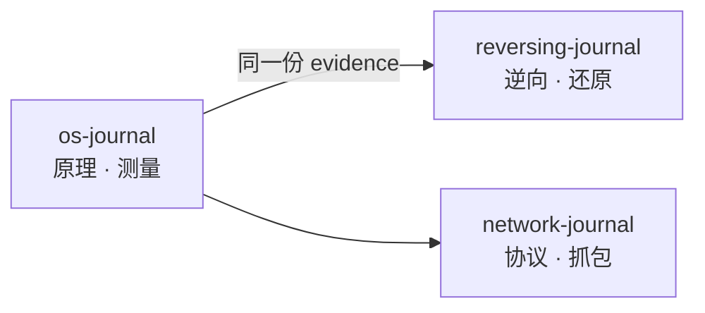

<div align="center">

<picture>
  <source media="(prefers-color-scheme: dark)" srcset="assets/banner-dark.svg">
  <source media="(prefers-color-scheme: light)" srcset="assets/banner-light.svg">
  
</picture>

<strong>每一次系统调用，都是一次跨界。</strong><br>
操作系统学习手记 —— 不停留在「会调 API」，<br>
而是能说清一次 <code>read</code> 从你的代码到磁盘，中间经过了几层、被谁改写过。

<a href="docs/00-roadmap.md"></a>
<a href="docs/01-kernel-boundary.md"></a>
<a href="labs/"></a>
<a href="docs/10-kernel-observability.md"></a>


<sub><a href="docs/00-roadmap.md">12 周路线</a> · <a href="labs/">实验</a> · <a href="TASKS.md">任务清单</a> · <a href="resources.md">资源</a> · <a href="notes/_TEMPLATE.md">记录模板</a></sub>

</div>

## ▍ 这是什么样的仓库

操作系统有一类典型的错觉：**会用 API，就以为懂了内核。**

`malloc` 不是系统调用，`read` 返回之前可能一次磁盘都没碰，`GetTickCount` 的精度取决于时钟中断，一次「卡顿」可能是缺页、可能是等锁、也可能是被换出。这些差别不动手测是看不出来的。

所以这里不是教程合集，而是**学习日志**：每学一个机制，就在 [`labs/`](labs/) 里写一个能编译、能测出数字的实验；每做一次排查，就在 [`notes/`](notes/) 里留一条带证据的记录；每个结论都必须能指回「**计数器 → 数值 → 结论**」。

> **没有观测到的行为，只是推测。**

约定：实验只用 Windows API 与 MinGW-w64 标准工具链，不依赖第三方库；不提交编译产物（已在 [`.gitignore`](.gitignore) 中忽略）。

## ▍ 目录

| 目录 | 用途 | 现有 |
|:---:|---|---:|
| [`docs/`](docs/) | 系统化知识笔记：内核边界 · 进程线程 · 调度 · 虚拟内存 · 物理内存 · 文件系统 · 同步 · IPC · I/O · 观测 | 11 篇 |
| [`labs/`](labs/) | 能编译、能测出数字的实验，一个机制一个实验 | 2 个 |
| [`notes/`](notes/) | 观测与排查的随手记录，不成体系 | 模板 |
| [`TASKS.md`](TASKS.md) | 12 周任务清单，勾掉一个才算学完一个 | — |
| [`tools/`](tools/) | 进度脚本 + 环境检查 | 2 个 |
| [`resources.md`](resources.md) | 书单、工具、公开课程，以及安全与授权边界 | 清单 |

> **第一次来？** 先读 [`docs/00-roadmap.md`](docs/00-roadmap.md) 看 12 周路线，跑一遍 [`labs/01-syscall-cost`](labs/01-syscall-cost/) 和 [`labs/02-address-space-probe`](labs/02-address-space-probe/)，再用 [`notes/_TEMPLATE.md`](notes/_TEMPLATE.md) 写下第一条观测记录。

## ▍ 一次 read 的路径

「读一个文件」在代码里是一行，在内核里是一条链。**排查性能问题，就是沿着这条链找到时间花在哪一段。**



| 层级 | 关键对象 | 观测点 | 典型代价 |
|---|---|:---:|---|
| 用户 / 内核边界 | `SSDT`、系统调用号 | 上下文切换计数 | 数百 ns 起（一次模式切换） |
| 文件系统 | `inode`、`dentry`、page cache | 缓存命中率 | 命中是内存拷贝，未命中要等块设备 |
| 块层与驱动 | I/O 请求队列 | 队列深度、中断次数 | 队列深时排队时间占主导 |
| 内存 | 页表、`TLB`、工作集 | 缺页次数 | 首次触碰一页就是一次缺页 |

## ▍ 进度

当前快照（由 [`tools/status.ps1`](tools/status.ps1) 真实输出，可复现）：

```text
$ powershell -ExecutionPolicy Bypass -File tools/status.ps1
phase   topic                               deliverable            state
01-02   kernel-boundary / syscall           01-syscall-cost        done
03-04   process-thread / sched              02-address-space-probe done
05-06   virt-mem / phys-mem                 -                      todo
07-08   fs / io                             -                      todo
09-10   sync / ipc                          -                      todo
11-12   observability / lab                 -                      todo
------------------------------------------------------------------------------
summary  docs 11/11   labs 2/2   notes 1
```

| 周次 | 主题 | 产出 | 状态 |
|:---:|---|---|:---:|
| 1–2 | 内核边界与系统调用 | [`labs/01-syscall-cost`](labs/01-syscall-cost/) ✅ | 🟡 进行中 |
| 3–4 | 进程、线程与调度 | [`labs/02-address-space-probe`](labs/02-address-space-probe/) ✅ · 一次上下文切换的实测与归因 | 🟡 进行中 |
| 5–6 | 虚拟内存与物理内存 | 页表走查 + 缺页开销实测 | ⬜ 未开始 |
| 7–8 | 文件系统与 I/O | 读放大与 page cache 命中率实测 | ⬜ 未开始 |
| 9–10 | 并发、同步与 IPC | 一把锁的争用曲线 | ⬜ 未开始 |
| 11–12 | 内核观测与综合 | 一次卡顿的三层归因报告 | ⬜ 未开始 |

> 详细拆解见 [`docs/00-roadmap.md`](docs/00-roadmap.md)。

## ▍ 能力模型

四块地基，缺一块都会卡住：

| 模块 | 必须掌握 | 为什么分析需要 |
|:---:|---|---|
| **边界与系统调用** | 用户态/内核态切换、syscall 表、参数与返回值传递 | 性能与故障分析的起点 |
| **进程与内存** | PCB/EPROCESS、上下文切换、四级页表、缺页异常 | 解释卡顿、崩溃与内存增长 |
| **文件与 I/O** | VFS/inode/page cache、中断与 DMA、I/O 模型 | 解释读写放大与阻塞 |
| **并发与同步** | 原子操作、锁、内存序、死锁四条件 | 解释竞态与性能抖动 |



## ▍ 姊妹仓库

同一批实验，三种视角，证据是同一份：

| 仓库 | 讲什么 | 和这里的关系 |
|---|---|---|
| **os-journal**（本仓库） | 操作系统原理：内核边界 · 调度 · 虚拟内存 · 文件与 I/O · 同步 · 观测 | 从**原理**看：这个数字为什么是这样 |
| [reversing-journal](https://github.com/WMWWZS/reversing-journal) | 逆向主线：内存布局 · 汇编 · 栈帧 · PE · 工具 · 引擎 · 反作弊 | 从**对面**看：同一份证据反过来读别人的程序 |
| [network-journal](https://github.com/WMWWZS/network-journal) | 网络通信原理：分层 · TCP 状态机 · TLS · DNS · 私有协议 · 抓包 | 往**上一层**看：syscall 发出去的字节到了网上是什么样 |



OS 这一块的逆向版在 `reversing-journal` 的 `docs/14-operating-system.md` + `labs/07-net-os/os/`：
它和本仓库 [`labs/02-address-space-probe`](labs/02-address-space-probe/) 用的是**同一份 evidence**（同一台机器、同一次开机录的）。
同一个问题两边问法不同——这里问「这个数字为什么是这样」，那边问「这段代码为什么会长成这样」。

## ▍ 原则

| 原则 | 落地方式 |
|:---:|---|
| **可观测优先** | 每个结论都要有计数器、日志或实验数据；没有数据的解释不算解释。 |
| **边界意识** | 分清哪些是内核做的、哪些是库或运行时做的，别把 `malloc` 当系统调用。 |
| **合法边界** | 只在自己的机器与授权环境做内核级观测与实验；不注入、不绕过安全机制。 |
| **写下来** | 没有写下来的分析等于没做过；模板见 [`notes/_TEMPLATE.md`](notes/_TEMPLATE.md)。 |

## ▍ 环境

```text
[ok] windows 11 x64
[ok] gcc           mingw-w64 14.2
[ok] python        3.11      （用 py，本机 python 是 Store 占位程序）
[ok] ETW           wpr.exe / typeperf.exe / Get-Counter
[ok] WPT           wpa.exe / xperf.exe    （Windows Kits\10\Windows Performance Toolkit）
[--] procmon
[--] wsl 发行版 / strace / perf / ebpf    （Linux 对照示例，本机不可执行）
```

实验只用 Windows API 与 MinGW-w64，**不需要装任何第三方库**：

```powershell
cd labs\01-syscall-cost
powershell -ExecutionPolicy Bypass -File .\build.ps1
.\syscall_cost.exe
```

> 文档里以 Windows 为主、Linux 作对照；凡 Linux 专用命令都会明确标注「Linux 示例，本机不可执行」，不假装跑过。
> 本机 `wsl.exe` 存在但没有可用发行版（`wsl --list` 返回 `E_ACCESSDENIED`），所以 Linux 侧一律只作对照讲解。

---

<div align="center">

<sub><strong>「没有观测到的行为，只是推测。」</strong></sub><br>
<sub>只在自己的机器与授权环境做内核级实验</sub><br>
<sub>不注入、不绕过安全机制、不做未授权的系统级操作</sub>

</div>
