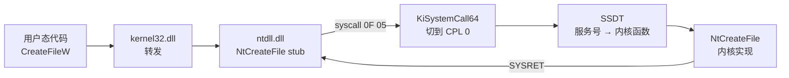

# 01 · 内核边界：用户态、内核态与系统调用

> 一句话：程序想碰硬件，只有一条合法通道——先把自己交给内核；这一交一还的成本，就是后面所有性能问题的最小单位。

## 是什么 / 为什么重要

CPU 把特权分成几级（x86-64 上叫 ring 0–3），Windows 和 Linux 都只用两级：

| 级别 | 谁在跑 | 能干什么 |
|:---:|---|---|
| ring 3（用户态） | 你的程序、浏览器、`powershell.exe` | 只能碰自己的虚拟地址空间；碰硬件指令直接 fault |
| ring 0（内核态） | `ntoskrnl.exe`、驱动 | 能改页表、读写 I/O 端口、关中断、访问任意物理内存 |

用户态程序要读文件、要内存、要发包，只能**请求**内核替它做。这个请求就是**系统调用（system call）**。它是一条「受控的、有检查的、可被审计的」边界，不是一堵墙——这也意味着它天然是性能分析的第一站：

- 一次 `ReadFile` 慢，是 syscall 本身慢，还是它后面等磁盘？
- 一个程序内核态时间高，是在做 syscall，还是在处理中断？
- 一次看似「纯计算」的循环，为什么会悄悄触发几千次 syscall？

**不知道边界在哪，就分不清「程序慢」和「系统慢」。**

## 机制与结构

### 一次 `CreateFile` 的完整路径



关键点：**用户态代码几乎从不直接写 `syscall` 指令**。它调 `kernel32!CreateFileW`，后者转到 `ntdll!NtCreateFile`，真正执行 `syscall` 的是 ntdll 里那段十几字节的 stub。所以你在导入表里看到的永远是 `kernel32`/`ntdll`，不是「内核」。

### 机器码级的 stub

本机 `ntdll!NtQueryInformationProcess` 的头 24 字节（由 `labs/01-syscall-cost` 打印）：

```text
4c 8b d1              mov    r10, rcx
b8 19 00 00 00        mov    eax, 0x19          ; 服务号：NtQueryInformationProcess
f6 04 25 08 03 fe 7f 01   test  byte ptr [0x7FFE0308], 1
75 03                 jne    +3                 ; 非 0 → 走 int 2eh（老式兼容路径）
0f 05                 syscall
c3                    ret
cd 2e                 int    2eh
c3                    ret
```

逐条拆开：

| 字节 / 指令 | 作用 |
|:---:|---|
| `mov r10, rcx` | `syscall` 指令会把 `rcx` 覆盖成返回地址，所以第一个参数先搬到 `r10` |
| `mov eax, imm32` | 把**服务号**放进 `eax`；内核靠它索引 SSDT |
| `test [0x7FFE0308], 1` | 读 `KUSER_SHARED_DATA.SystemCall`，这个页面用户态可读 |
| `jne` / `syscall` / `int 2eh` | 根据该标志选择 `syscall` 或旧的 `int 2eh` 陷入 |
| `ret` | 从内核返回后，`rcx`/`r11` 已被恢复成用户态现场 |

`syscall` 进入内核时：`RCX` = 返回地址、`R11` = `RFLAGS`、`RSP` 仍是用户栈（内核通过 TSS 里的 `RSP0` 换栈）。内核在 `KiSystemCall64` 里保存这些寄存器、切到内核栈、再按 `eax` 查表。

### SSDT：服务号背后的表

| 结构 | 存在哪 | 说明 |
|:---:|---|---|
| `KeServiceDescriptorTable` | `ntoskrnl.exe` 导出 | 主表，`nt`/`Nt*` 服务的入口 |
| `KiServiceTable` | 主表内部 | 条目数组，按下标对应 stub 里的 `eax` |
| `KeServiceDescriptorTableShadow` | 未导出 | 第二张表，`win32k` 的 `NtGdi*`/`NtUser*` 在这里 |
| 条目编码 | 视 build 而定 | Windows 10 之后是 4 字节相对偏移，不再是 8 字节绝对地址 |

> **不要硬编码服务号。** 它随 Windows build 变化：本机 `NtQueryInformationProcess` 是 `0x19`、`NtQuerySystemInformation` 是 `0x36`，换个 build 就可能变。Linux 的 syscall 号是稳定 ABI（`write` 在 x86-64 上永远是 1），Windows 不是。

### 中断、异常、系统调用不是一回事

| 概念 | 谁触发 | 典型入口 | Windows IRQL |
|:---:|---|---|:---:|
| 系统调用 | 程序主动执行 `syscall` | `KiSystemCall64` → SSDT | `PASSIVE_LEVEL`（0） |
| 异常 | CPU 检测到错误（除零、缺页、断点） | IDT 向量 → `KiDispatchException` | 0 或 2 |
| 硬件中断 | 设备经 APIC 发来的信号 | IDT 向量 → ISR → DPC | DIRQL（3–11）→ 2 |

Windows 的 IRQL 层级（简化）：

| IRQL | 名字 | 约束 |
|:---:|---|---|
| 0 | `PASSIVE_LEVEL` | 可以阻塞、可以等锁、可以访问分页内存 |
| 1 | `APC_LEVEL` | 不能等普通对象 |
| 2 | `DISPATCH_LEVEL` | **不能访问分页内存**、不能阻塞，自旋锁在此运行 |
| 3–11 | `DIRQL` | 设备中断服务例程，屏蔽同级及更低中断 |
| 15 | `HIGH_LEVEL` | 只用于极短的临界区 |

> 这三个概念混在一起讲，是初学者最常见的混乱来源。记住：**syscall 是主动请求，异常是被动出错，中断是别人打断你**。

### Linux 对照

| 项 | Windows | Linux（x86-64） |
|:---:|---|---|
| 用户态入口 | `ntdll` 里的 stub | glibc wrapper → `syscall` 指令 |
| 内核入口 | `KiSystemCall64` | `entry_SYSCALL_64` |
| 入口地址存哪 | `LSTAR` MSR | `LSTAR` MSR（同名） |
| 服务号 | 随 build 变，`eax` 传 | 稳定编号，`rax` 传 |
| 返回值 | `NTSTATUS`（`0` 成功，负值错误） | 负数 `errno`，glibc 再转 `-1` |
| 老式兼容 | `int 2eh` | `int 0x80`（32 位） |

## 动手验证

### 1. 在 PE 导入表里找到「用户态 → ntdll」这一跳

```powershell
objdump -p C:\Windows\System32\kernel32.dll | Select-String 'NtCreateFile'
```

本机输出（节选）：

```text
	0008cb38  <none>  0120  NtCreateFile
```

`kernel32.dll` 的导入表里有 `NtCreateFile`，说明 `CreateFileW` 的下一跳就是 ntdll。再看 ntdll 的导出表：

```powershell
objdump -p C:\Windows\System32\ntdll.dll | Select-String 'NtCreateFile$'
```

```text
	[ 289] +base[ 297]  0120 NtCreateFile
```

`[ 289]` 是导出表下标，`0120` 是 RVA。**真正的实现层在 ntdll，`kernel32` 只是转发壳。**

### 2. 量一次「过边界」的真实成本

跑 [`labs/01-syscall-cost`](../labs/01-syscall-cost/)，本机实测：

```text
  function                       first 6 bytes classification
  ------------------------------------------------------------------
  NtQuerySystemTime              e9 9b 4a f8 ff 66   jmp rel32 -> NOT a syscall
  NtQuerySystemInformation       4c 8b d1 b8 36 00   contains 0f 05 -> real syscall
  GetSystemTimeAsFileTime        48 ff 25 a9 b2 05   jmp [rip+..] thunk, user-mode

  operation                        batches   best ns/call    median ns
  ------------------------------------------------------------------
  NtQuerySystemInformation             100           70.4         77.8
  NtQuerySystemTime                    100            1.8          2.0
  GetSystemTimeAsFileTime              100            1.6          1.7
```

两个结论：

1. 真正跨边界的调用约 **70 ns**（本机，20 逻辑核，空闲时）。
2. `NtQuerySystemTime` 只有 2 ns——因为它的 stub **不是** `syscall` 而是 `jmp rel32`，被转发到用户态实现。**名字带 `Nt` 不等于会进内核。**

### 3. 看整机每秒发生多少次系统调用

```powershell
Get-Counter '\System\System Calls/sec' -MaxSamples 3
```

本机不同时刻读数从 **26 万/秒** 到 **357 万/秒** 都出现过（机器越忙越高）。所以这个计数器只能看趋势，不能当固定基准。

### 4. Linux 对照（本机不可执行）

```text
# Linux 示例：本机不可执行，原因见 docs/00 的环境一节
strace -c ls          # 按 syscall 聚合计次与耗时
strace -T -e trace=read ls   # 单次调用耗时
```

## 常见误区

1. **以为系统调用就是「函数调用加一层」**。实际是一次特权级切换：要换栈、保存现场、查 SSDT、做参数校验（`ProbeForRead`/`ProbeForWrite`），回来还要恢复。70 ns 是「便宜」的结果，不是「免费」。
2. **以为 `Nt*` 开头的一定是系统调用**。`NtQuerySystemTime` 在本机是用户态转发；`Zw*` 是同一函数的另一种调用约定，只在驱动里用。判断依据是 stub 字节里有没有 `0f 05`，不是名字。
3. **以为服务号可以记下来复用**。Windows 的服务号随 build 变，写死 `0x19` 的程序换个系统就崩；要用 `GetProcAddress` 或符号解析。
4. **以为中断和异常只是「两种叫法」**。中断来自外部设备、可屏蔽、在 DIRQL 跑；异常由当前指令触发、不可屏蔽、走异常分发；syscall 是主动请求。三者的处理路径和能用什么 API 完全不同。
5. **以为「内核态时间高」就是系统调用太多**。也可能是缺页、DPC、中断处理。需要 `Get-Counter` 或者 ETW 分项看，不能只看 `% Privileged Time`。

## 自测

**1. 为什么 `syscall` 指令执行前要把第一个参数从 `rcx` 搬到 `r10`？**

- **考点**：`syscall` 对寄存器的副作用
- **应明白**：`syscall` 会把**下一条指令的地址**存进 `rcx`（返回时用），把 `rflags` 存进 `r11`；如果第一个参数留在 `rcx` 里就会被覆盖
- **算会**：能说出「`rcx`/`r11` 是 CPU 占用的，所以 ABI 规定参数用 `r10` 起步」

**2. 本机 `NtQuerySystemInformation` 是 70 ns，`GetSystemTimeAsFileTime` 是 1.6 ns。这个 44 倍差距在物理上对应什么？**

- **考点**：一次特权级切换的成本构成
- **应明白**：`syscall`/`sysret` 本身要几十个周期，加上保存现场、换栈、查表、参数校验；用户态调用只是几次内存读和算术
- **算会**：能解释「为什么再快的 syscall 也不该放进内层循环」，并能举出批量/共享内存等规避手段

**3. 一个程序 `% Privileged Time` 很高，但 `System Calls/sec` 不高。可能是什么原因？**

- **考点**：内核态时间 ≠ 系统调用次数
- **应明白**：可能是缺页（`Page Faults/sec`）、DPC/中断、驱动里的自旋，或者线程切换
- **算会**：能列出至少两个计数器来区分，而不是只盯着 syscall 数

## 相关

- 下一步：[`02 · 进程与线程`](./02-process-and-thread.md)
- 内存侧：[`04 · 虚拟内存与分页`](./04-virtual-memory.md)
- 实验：[`labs/01-syscall-cost`](../labs/01-syscall-cost/)
- 观测工具：[`10 · 内核观测`](./10-kernel-observability.md)
