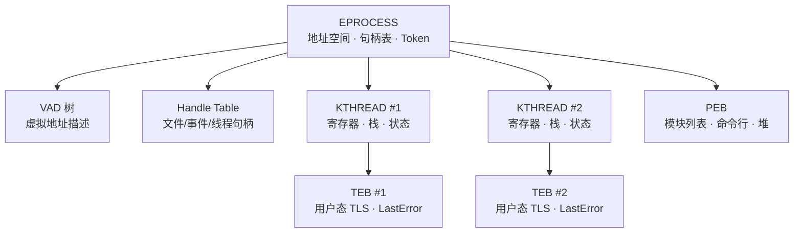

# 02 · 进程与线程：资源容器与调度单位

> 一句话：进程是「分到多少东西」的单位，线程是「被调度多少次」的单位——把这两件事分开，进程、线程、协程的账才算得清。

## 是什么 / 为什么重要

任务管理器里一个进程有 CPU、内存、句柄、线程。这些数字来自两类完全不同的内核对象：

| 概念 | 装什么 | Windows 对象 | Linux 对应 |
|:---:|---|---|---|
| **进程** | 地址空间、句柄表、安全令牌、加载的 DLL、配额 | `EPROCESS`（内核）+ `PEB`（用户态） | `task_struct` + `mm_struct` |
| **线程** | 寄存器现场、两个栈、调度状态、优先级、TLS | `KTHREAD`（内核）+ `TEB`（用户态） | `task_struct`（共享 `mm`） |

为什么重要：

- 「进程吃内存」和「线程吃 CPU」不是同一张表上的数——working set 属于进程，`% Processor Time` 属于线程。
- 一次创建/切换的成本直接决定「该开线程还是该复用」。
- 崩溃时「进程挂了」和「线程挂了」后果完全不同：一个线程未处理异常，默认拖垮整个进程。

## 机制与结构

### 三个对象的关系



要点：`KTHREAD` 里有一个 `KPROCESS` 指针指向所属进程，但**线程不是进程的子对象**——线程可以被别的进程打开、挂起、排队 APC（只要有权限）。句柄是全局对象管理器的一层间接，不是「父子所有权」。

### `EPROCESS` / `KTHREAD` / `TEB` 里到底有什么

| 结构 | 关键字段 | 说明 |
|:---:|---|---|
| `EPROCESS` | `Pcb`（内嵌 `KPROCESS`） | 调度器看到的进程头，含页表基址 `DirectoryTableBase` |
| `EPROCESS` | `UniqueProcessId` | PID；PID 会被复用，句柄不会 |
| `EPROCESS` | `ActiveProcessLinks` | 全局进程链表，遍历用它 |
| `EPROCESS` | `Token` | 安全上下文，决定能打开什么 |
| `EPROCESS` | `VadRoot` | 虚拟地址描述树，`VirtualAlloc` 改的就是它 |
| `EPROCESS` | `ObjectTable` | 句柄表；任务管理器「句柄数」就是它的条目数 |
| `KTHREAD` | `State` / `Priority` / `WaitListEntry` | 调度状态与优先级 |
| `KTHREAD` | `KernelStack` / `StackLimit` | 内核栈；x64 上只有几十 KB，递归要小心 |
| `KTHREAD` | `Teb` | 指向用户态 `TEB` |
| `TEB` | `NtTib` / `ClientId` / `LastErrorValue` | 用户态结构，`fs:[0]` 指向它 |
| `TEB` | `ThreadLocalStoragePointer` | `__declspec(thread)` 的落点 |

> **偏移量不要背。** 它随 Windows build 变。调试时用 `dt nt!_EPROCESS` 现查；本机没装 WinDbg，所以文档只给字段名和语义。

### 创建：`CreateProcess` 与 `fork + exec`

| 步骤 | Windows `CreateProcessW` | Linux `fork` + `execve` |
|:---:|---|---|
| 1 | 打开镜像文件、校验 PE | `fork`：复制父进程的 `task_struct`、页表（COW） |
| 2 | 创建 `EPROCESS`、初始地址空间 | 子进程先跑在父进程的拷贝里 |
| 3 | 映射镜像、加载 DLL、重定位 | `execve`：销毁旧地址空间，加载 ELF |
| 4 | 创建主线程、设置 `TEB`/`PEB` | 设置新栈、跳 `_start` |
| 5 | 返回句柄 + PID | 父进程拿到 PID，子进程从 `fork` 返回 0 |
| 代价 | 一次到位，没有「复制父进程」这步 | `fork` 本身便宜（COW），但后面常跟一次 `exec` 把拷贝全扔掉 |

这就是为什么 Windows 没有 `fork`：**GUI 进程、句柄、窗口站、桌面这些状态复制起来又贵又难定义语义**，不如直接「新建一个干净进程」。

### 上下文切换保存了什么

| 类别 | 内容 | 存放位置 |
|:---:|---|---|
| 通用寄存器 | `rax`–`r15`、`rip`、`rflags` | `KTRAP_FRAME` / 内核栈 |
| 栈 | 用户栈指针、内核栈指针 | `KTHREAD` + `KTRAP_FRAME` |
| 地址空间 | `CR3`（页表基址） | `KPROCESS.DirectoryTableBase`，切进程才换 |
| FPU/SIMD | `xmm0`–`xmm15`、`MXCSR` | 懒保存（`XSAVE` 区域） |
| 调度状态 | `State`、优先级、时间片余额 | `KTHREAD` |

两件反直觉的事：

1. **切线程不一定换页表**。同进程内两个线程共享 `CR3`，切换便宜；跨进程切换才要写 `CR3`，还可能连带 TLB 失效。
2. **FPU 状态是懒保存的**。不用浮点的线程不付这份钱，用了才在第一次执行 SSE 指令时触发 `#NM` 补存。

### 线程状态（Windows `KTHREAD.State`）

| 状态 | 含义 |
|:---:|---|
| `Initialized` | 刚创建，还没进调度器 |
| `Ready` | 可运行，在就绪队列里等 CPU |
| `Running` | 正在某个核上跑 |
| `Standby` | 已选中下一个要跑的线程（每核一个） |
| `Waiting` | 在等对象（事件、锁、I/O） |
| `Transition` | 内核栈被换出，等栈回到内存 |
| `Terminated` | 已结束，等对象引用归零 |

## 动手验证

### 1. 看自己进程的四个数字

```powershell
$p = Get-Process -Id $PID
"pid=$($p.Id) handles=$($p.HandleCount) wsMB=$([math]::Round($p.WorkingSet64/1MB,1)) threads=$($p.Threads.Count)"
```

本机 `powershell` 进程实测：

```text
pid=37048 handles=673 wsMB=78.5 threads=29
```

三个数字分别对应：`ObjectTable` 条目数（673）、resident 页总和（78.5 MB）、`KTHREAD` 链表长度（29）。**注意这不是「29 个线程都在跑」**，绝大多数在 `Waiting`。

### 2. 全机视角

```powershell
(Get-Counter '\System\Processes','\System\Processor Queue Length','\Process(_Total)\Thread Count' -MaxSamples 1).CounterSamples |
  ForEach-Object { "{0} = {1}" -f $_.Path.Split('\')[-1], $_.CookedValue }
```

本机实测：

```text
system\processes = 57
system\processor queue length = 4
process(_total)\thread count = 1448
```

57 个进程、1448 个线程，就绪队列长度 4——**线程多不等于 CPU 忙**，1448 个里同时可运行的只有几个。

### 3. 创建与切换的真实成本

跑 [`labs/01-syscall-cost`](../labs/01-syscall-cost/)，本机实测：

```text
[4a] CreateThread + wait + CloseHandle
  create+join thread                 300       37.700       59.400   (µs)

[4b] context switch round trip (event ping-pong, 2 threads)
  round trip (2 switches)           2000        4.277            -   (µs)
  per switch (round trip / 2)       2000        2.138            -   (µs)
```

解读：

- **创建一个线程并等它结束 ≈ 38 µs**，其中大头是分配内核栈、初始化 `KTHREAD`/`TEB`、插入调度器，不是那条 `CreateThread` 指令。
- **一次事件往返 ≈ 4.3 µs，摊到每个切换 ≈ 2.1 µs**（含两次 `SetEvent`/`Wait` 的内核调用与两次调度）。
- 38 µs / 2 µs ≈ 19：**「创建」比「切换」贵一个数量级**，所以线程池复用线程是刚需。

### 4. 整机每秒切多少次

```powershell
typeperf "\System\Context Switches/sec" -sc 3
```

本机实测（节选）：

```text
"(PDH-CSV 4.0)","\\DESKTOP-QE8M0K4\System\Context Switches/sec"
"11/22/2026 23:59:09.734","127600.983926"
"11/22/2026 23:59:10.739","105578.123105"
"11/22/2026 23:59:11.743","129903.577486"
```

十几万次/秒是**整机**的数字，不是某个进程的。想定位到进程要按线程时间分，不是看总量。

### 5. Linux 对照（本机不可执行）

```text
# Linux 示例：本机不可执行，原因见 docs/00 的环境一节
cat /proc/<pid>/status      # Threads / VmRSS 等
cat /proc/<pid>/task/<tid>/stat
```

## 常见误区

1. **以为线程一定比进程「轻」，所以随便开**。线程共享地址空间，但每个线程仍要预留用户栈（Windows 默认 1 MB **预留**、按需提交）和一块内核栈。开 1 万线程 = 10 GB 虚拟地址 + 上万 `KTHREAD`，先崩的是内核池不是内存条。
2. **以为「进程的 CPU 占用」是进程自己算的**。CPU 时间记在**线程**上，进程的数字是句柄表里所有线程的加总；线程可以被跨进程打开，句柄数也不等于「对象数」。
3. **以为上下文切换成本固定**。同进程线程切换不换 `CR3`；跨进程切换要换页表、可能污染 TLB；如果目标线程内核栈被换出，还要多一次 `Transition` 等待。
4. **以为 `fork` 很贵**。写时复制让它看起来便宜，但「`fork` 完立刻 `exec`」等于把复制的页表全扔掉——这正是 `posix_spawn` / `vfork` 存在的理由。
5. **以为 `TEB` 是内核结构**。`TEB` 在用户态，x64 下 `gs:[0]`、x86 下 `fs:[0]` 就能读（`labs/02` 就是从 `gs:0x08`/`gs:0x10` 读栈范围的）；`EPROCESS`/`KTHREAD` 才在内核，用户态只能通过 syscall 间接看到。

## 自测

**1. 为什么 `CreateThread` 要 ~38 µs，而一次线程切换只要 ~2 µs？**

- **考点**：创建与切换的成本构成
- **应明白**：创建要分配并初始化内核对象、内核栈、`TEB`、插入调度结构，还要走一遍内核调用；切换主要是保存/恢复寄存器与调度决策
- **算会**：能说出哪些成本是「一次性」的，因此线程池能省掉它们

**2. 一个进程有 100 个线程，任务管理器显示 CPU 20%，这说明什么？**

- **考点**：线程状态与 CPU 占用的关系
- **应明白**：20% 是这台 20 逻辑核机器的相对值，等价于约 4 个核在跑；其余线程大多在 `Waiting`
- **算会**：能区分「线程多」和「并发度高」，并知道要去查就绪队列长度或每线程 CPU 时间

**3. 同进程内线程切换和跨进程线程切换，差在哪一步？**

- **考点**：`CR3` 与 TLB
- **应明白**：跨进程要写 `CR3`、切换地址空间，TLB 里属于旧进程的条目失效（或有 PCID 缓解）；同进程不用
- **算会**：能解释为什么「同一进程里开线程做并发」通常比「多进程」切换便宜

## 相关

- 调度怎么选下一个：[`03 · 调度`](./03-scheduling.md)
- 边界与 syscall：[`01 · 内核边界`](./01-kernel-boundary.md)
- 进程的地址空间：[`04 · 虚拟内存`](./04-virtual-memory.md)
- 实验：[`labs/01-syscall-cost`](../labs/01-syscall-cost/)
- 实验：[`labs/02-address-space-probe`](../labs/02-address-space-probe/)：TEB 里读线程栈、进程内线程列表、句柄表
