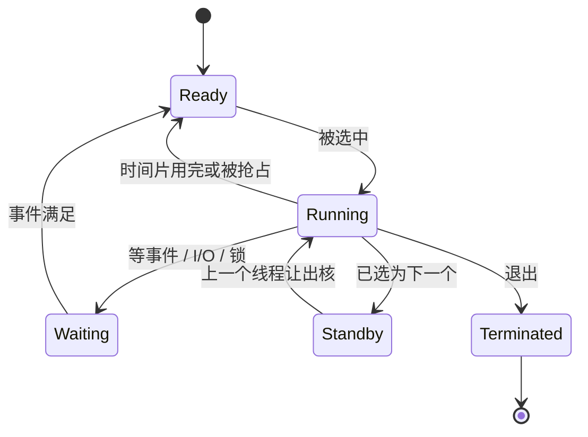

# 03 · 调度：谁下一个拿到 CPU

> 一句话：调度器在每个核上做一道选择题——就绪队列里挑谁跑、跑多久、什么时候把它赶下来；所有「卡顿」「不公平」「优先级没用」的争论，最后都落在这三个动作上。

## 是什么 / 为什么重要

一个核同一时刻只能跑一个线程。就绪线程可能有几百个，于是需要：

| 问题 | 调度器的回答 | 代价 |
|:---:|---|---|
| 谁先跑 | 优先级 / 权重 / 虚拟运行时间 | 选错 → 交互卡顿、实时任务超时 |
| 跑多久 | 时间片（quantum） | 太短 → 切换开销占比高；太长 → 响应慢 |
| 何时抢占 | 时钟中断、更高优先级就绪、主动让出 | 抢占太频繁 → 缓存/TLB 抖动 |

为什么重要：**你写的程序再快，拿不到 CPU 也白搭。** 反过来，一个「CPU 100%」的进程可能只是线程多、量子短，实际吞吐并不高。

## 机制与结构

### 线程状态与调度动作



调度器只在几个时刻做决定：时间片到期、线程阻塞、线程被唤醒、优先级变化、核空闲。**每次决定都要拿运行队列锁**，所以调度本身也是要花钱的。

### Linux CFS：按「虚拟运行时间」追平

CFS 的核心是一个数：**vruntime（虚拟运行时间）**。每个线程记录「我已经按权重折算着跑了多久」，调度器永远挑 vruntime 最小的那个。

```c
/* Linux 内核 CFS 更新逻辑的简化表达（非逐行原文） */
delta_exec = now - se->exec_start;          /* 这次实际跑了多久 */
se->vruntime += delta_exec * NICE_0_LOAD / se->load.weight;
/* 挑下一个：红黑树最左节点 = vruntime 最小 */
```

- 权重来自 nice 值：nice 0 的权重是 1024，nice -20 是 88761，nice 19 是 15（完整的 `prio_to_weight` 表在 Linux 源码里）。
- 权重越大，同样的 `delta_exec` 折算出的 vruntime 越少 → 跑得更久才被追平。
- 红黑树按 vruntime 排序，取最左节点是 O(log n)；`min_vruntime` 单调递增，防止睡眠很久的线程醒来后「欠账」太多或太少。
- 两个可调参数：`sched_latency`（默认 6 ms 量级）和 `sched_min_granularity`（默认 0.75 ms 量级），决定一轮里每个线程至少跑多久。
- **补充**：Linux 6.6 起 CFS 被 EEVDF 取代（引入「资格 / lag」概念），但「按权重分摊、按虚拟时间排队」的主线没变。

| nice | 权重 | 相对 nice 0 的 CPU 份额 |
|:---:|---:|---:|
| -20 | 88761 | 约 86.7 倍 |
| -10 | 9548 | 约 9.3 倍 |
| 0 | 1024 | 1 倍 |
| 10 | 110 | 约 0.107 倍 |
| 19 | 15 | 约 0.015 倍 |

### Windows：32 级优先级 + 动态提升

Windows 不按权重分摊，而是**严格优先级 + 时间片轮转**：

| 概念 | 取值 | 说明 |
|:---:|---|---|
| 优先级类别（进程） | Idle / Below Normal / Normal / Above Normal / High / Real Time | 决定基准优先级 |
| 线程优先级 | 0–31 | 0 保留给零页线程；1–15 普通，16–31 实时 |
| 基准优先级 | Idle=4、Below Normal=6、Normal=8、Above Normal=10、High=13、Real Time=24 | 类别 + 相对调整 |
| 时间片 | 以 clock interval 为单位的配额 | 客户端/服务端、前台/后台不同，精确值用 WinDbg `!thread` 的 `QuantumReset` 看 |
| 抢占 | 就绪线程优先级更高时立即抢占 | 同优先级不抢占，跑完量子 |

三个经常被忽略的动态行为：

1. **I/O 完成提升**：线程等 I/O 醒来会临时提权，让它尽快处理数据（提升幅度与设备类型有关）。
2. **前台窗口提升**：前台进程的线程会获得额外提升，保证界面响应。
3. **饥饿避免**：长时间拿不到 CPU 的线程会被平衡集管理器提升，防止饿死（文档里常说的「约 4 秒」量级）。

### 两套调度对照

| 维度 | Linux CFS/EEVDF | Windows |
|:---:|---|---|
| 排序依据 | vruntime / lag，权重比例 | 优先级 0–31，同级轮转 |
| 用户接口 | `nice`、`sched_setscheduler`、cgroup 权重 | `PriorityClass`、`SetThreadPriority` |
| 实时调度 | `SCHED_FIFO` / `SCHED_RR` | 16–31 + `REALTIME_PRIORITY_CLASS`（需特权） |
| 公平性 | 按权重比例长期公平 | 高优先级优先，低优先级可能长时间不跑 |
| 抢占粒度 | 由 `sched_latency` 决定 | 由量子决定 |
| 典型问题 | 交互延迟、cgroup 份额 | 优先级反转、实时线程饿死系统 |

> **没有一种调度器能同时最优。** 桌面要响应，服务端要吞吐，实时要确定性——三者的「好」互相矛盾。

## 动手验证

### 1. 看进程的优先级类别

```powershell
Get-Process | Select-Object Name,Id,PriorityClass -First 8
```

本机实测（节选）：

```text
Name      Id PriorityClass
----      -- -------------
chrome  9324   AboveNormal
chrome 24248        Normal
chrome 31968        Normal
chrome 39940          Idle
```

一个 Chrome 的多个进程可以有不同类别：负责界面/音频的会提权，后台渲染的降到 Idle。**优先级是进程/线程属性，不是全局的。**

### 2. 改优先级：能读不等于能写

```powershell
$p = Get-Process -Id $PID
$p.PriorityClass = 'High'
```

本机受限会话下实测**失败**：

```text
设置"PriorityClass"时发生异常:"Access is denied"
```

需要相应的权限/令牌（提权或 `SeIncreaseBasePriorityPrivilege`）。等效的 C 写法：

```c
#include <windows.h>
/* 提权到 High；失败时 GetLastError() 通常是 ERROR_ACCESS_DENIED */
if (!SetPriorityClass(GetCurrentProcess(), HIGH_PRIORITY_CLASS)) {
    /* 需要权限，普通受限进程会失败 */
}
```

### 3. 看 CPU 有没有排队

```powershell
(Get-Counter '\Processor(_Total)\% Processor Time','\System\Processor Queue Length' -MaxSamples 1).CounterSamples |
  ForEach-Object { "{0} = {1:N1}" -f $_.Path.Split('\')[-1], $_.CookedValue }
```

本机实测：

```text
% processor time = 42.8
processor queue length = 0.0
```

**42.8% 的 CPU 占用 + 队列长度 0 = 没有排队**，说明 20 个逻辑核里还有余量。反过来，如果 `% Processor Time` 只有 30% 但队列长度长期 > 0，要怀疑有线程被绑死在少数核上。

### 4. 量子与切换开销的比例

[`labs/01-syscall-cost`](../labs/01-syscall-cost/) 实测一次事件往返切换 ≈ **4.3 µs**（摊到单次切换 ≈ 2.1 µs）。假设量子是 30 ms 量级：

```text
切换开销占比 = 2.1 µs / 30 ms ≈ 0.007%
```

**这就是「时间片不能太短」的定量理由**：量子缩到 100 µs，切换开销立刻变成 2%。

### 5. Linux 对照（本机不可执行）

```text
# Linux 示例：本机不可执行，原因见 docs/00 的环境一节
nice -n 10 ./workload          # 以 nice 10 启动
chrt -f 50 ./rt-task           # SCHED_FIFO 优先级 50
cat /proc/<pid>/sched          # 看 nr_switches / vruntime 等
```

## 常见误区

1. **以为把优先级调到 Real Time 就「一定先跑」**。16–31 的实时线程会抢占所有普通线程，如果它死循环，系统会看起来「卡死」（连鼠标都动不了）。这就是为什么 `REALTIME_PRIORITY_CLASS` 需要特权，且微软文档反复警告。
2. **以为 CFS 的「公平」是平均分 CPU**。它按权重比例公平：nice 0 和 nice 10 的线程长期 CPU 时间比约 1024:110 ≈ 9.3:1，不是 1:1。
3. **以为 Windows 有 nice 值**。没有。Windows 用优先级类别 + 线程相对优先级；`nice` 只是 Linux 的概念，两者不能直接换算。
4. **以为时间片是固定常数**。量子随客户端/服务端、前台/后台、电源策略、是否实时线程而变；写死「Windows 时间片 15 ms」的说法是过时的。
5. **以为「CPU 使用率 100%」就一定是瓶颈**。要看就绪队列长度和每线程 CPU 时间；20 核机器上 100% 意味着 20 个核都在忙，但 5% 也可能意味着某个核被单线程打满（单线程程序最多吃 1 个核）。

## 自测

**1. 两个线程 nice 值分别是 0 和 10，长期各能拿到多少 CPU？**

- **考点**：CFS 权重比例
- **应明白**：权重 1024 与 110，比例约 9.3:1，即约 90% 对 10%
- **算会**：能说出「不是平均分，而是按权重分」，并能解释权重从哪来

**2. Windows 上把一个普通线程提到 31 级，会发生什么？**

- **考点**：实时优先级与系统响应
- **应明白**：它会抢占所有普通线程；如果它不主动阻塞，同核上的普通线程（包括输入、界面）可能长时间得不到 CPU
- **算会**：能说出「实时优先级是全局性风险，不是局部优化」

**3. 一台 20 逻辑核机器，`% Processor Time` 是 5%，但程序很卡。可能是什么原因？**

- **考点**：CPU 总量 vs 单核饱和
- **应明白**：单线程程序只能用一个核，5% 总量可能就是「一个核 100%」；也可能是等锁、等 I/O、缺页
- **算会**：能列出至少两个计数器/工具去区分「CPU 饱和」和「阻塞」

## 相关

- 进程与线程对象：[`02 · 进程与线程`](./02-process-and-thread.md)
- 上下文切换成本：[`02 · 进程与线程`](./02-process-and-thread.md)
- 观测工具：[`10 · 内核观测`](./10-kernel-observability.md)
- 实验：[`labs/01-syscall-cost`](../labs/01-syscall-cost/)
