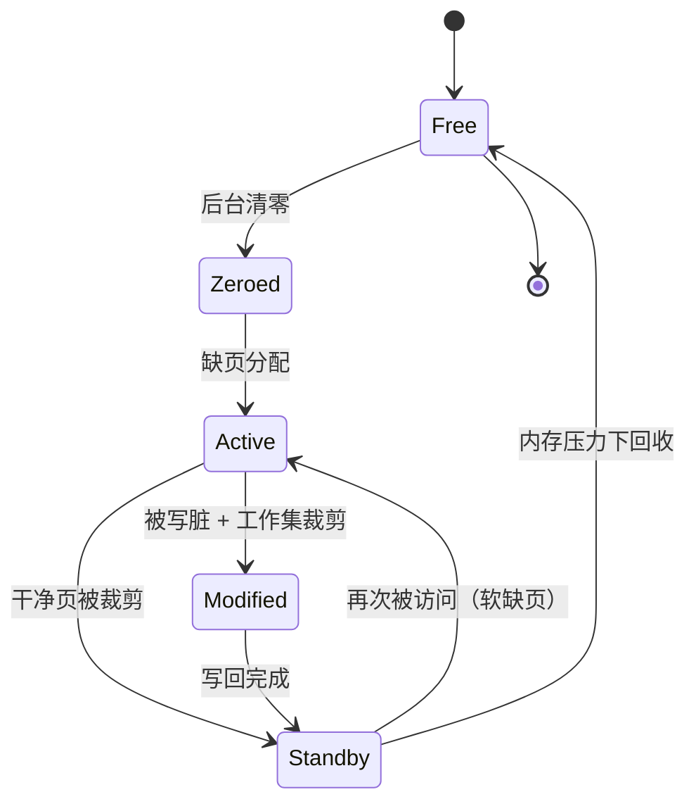

# 05 · 物理内存：页帧、buddy、池与回收

> 一句话：虚拟内存负责「让你以为有」，物理内存负责「真的给你」；两个分配器（页级、字节级）加上一个回收器，就是这一层的全部。

## 是什么 / 为什么重要

物理内存被切成固定大小的**页帧（page frame）**，本机页大小 4096 字节。所有页帧由内核统一记账，分三层管理：

| 层 | 分配单位 | Windows | Linux |
|:---:|---|---|---|
| 页级分配器 | 4 KB 的 2ⁿ 连续块 | 页帧数据库 + 空闲链表 | buddy allocator（`/proc/buddyinfo`） |
| 内核小对象 | 几十字节到几 KB | paged / nonpaged pool、lookaside list | slab / SLUB |
| 用户态分配 | 任意字节 | 堆（NT 堆 / Segment Heap）、`VirtualAlloc` | `malloc`（brk/mmap） |

为什么重要：

- 「内存泄漏」到底是进程堆泄漏、内核池泄漏，还是 page cache 涨了？三层要分开查。
- 「可用内存只剩 2 GB」不等于要崩：Windows 会把冷页放进 standby 列表当缓存用。
- 页回收是有成本的：回收不及时 → 硬缺页；回收太激进 → 缓存失效、I/O 变多。

## 机制与结构

### buddy：把页帧拆开、再合并

空闲页帧按「阶（order）」组织成链表：order 0 = 1 页（4 KB），order 1 = 2 页，…，order 10 = 1024 页（4 MB）。

| 操作 | 行为 |
|:---:|---|
| 分配 order n | 找 order n 链表；空了就向 order n+1 借，把一块拆成两半（buddy），一半返回、一半挂回 n 级 |
| 释放 | 看 buddy 是否也空闲；空闲就合并成 order n+1，递归向上 |
| 碎片 | 外部碎片 = 没有够大的连续块；order 越高越难满足 |

```text
order 2 = 16 KB:  [########________]   拆成两个 order 1
order 1 =  8 KB:  [####____][####____] 前者返回，后者挂回
```

> **伙伴系统只解决「连续页」的问题**，不解决「小对象浪费」。4 KB 页里放一个 32 字节的结构体太浪费，于是才有 pool/slab。

### 字节级分配：pool 与 slab

| 维度 | Windows pool | Linux slab/SLUB |
|:---:|---|---|
| 分页能力 | **paged pool** 可分页；**nonpaged pool** 必须常驻（DISPATCH_LEVEL 可用） | slab 对象通常不可分页；`kmalloc` 走 slab |
| 典型用途 | 驱动对象、`ExAllocatePool` | 内核对象、`kmalloc` |
| 缓存机制 | lookaside list（每 CPU 缓存） | per-CPU slab 缓存 |
| 泄漏排查 | Poolmon（未装）、`!pool` | `slabtop`、`/proc/slabinfo` |

Windows 上还有一个坑：**paged pool 不等于「用户态内存」**，它是内核的；用户态堆是另一套（NT 堆 / Segment Heap），句柄数和 private bytes 才反映它。

### 页帧的状态机

| 状态 | 含义 | 是否可被立刻复用 |
|:---:|---|---|
| `Active` | 属于某个工作集，正在用 | 否 |
| `Standby` | 已从工作集移除，内容仍有效，可当缓存 | 是（优先） |
| `Modified` | 脏页，还没写回页面文件/文件 | 写回后变成 Standby |
| `Free` | 空闲，内容已无意义 | 是 |
| `Zeroed` | 已清零，可直接给新页 | 是 |
| `Bad` | 硬件报错 | 否 |



关键：**Standby 不是「浪费」**，它就是文件缓存。任务管理器里「可用」= Free + Zeroed + Standby，所以「可用内存很多」其实说明缓存还没吃满，不代表性能好。

### 回收：谁来决定裁谁

| 机制 | 触发 | 行为 |
|:---:|---|---|
| 工作集管理器 | 可用内存低于阈值 | 周期性裁剪进程工作集，把页移到 Standby |
| 修改页写回器 | Modified 列表过长 | 异步写回，页变 Standby |
| 页面文件扩展 | commit 接近 limit | 扩大页面文件（受上限约束） |
| 硬缺页 | 访问的页不在内存 | 从页面文件/映射文件读回，代价最高 |

回收策略的目标不是「腾出最多内存」，而是**在缺页成本和缓存收益之间取平衡**。这就是为什么 Windows 不会把 Standby 清空。

## 动手验证

### 1. 一次看清内存的六个面

```powershell
(Get-Counter '\Memory\Available MBytes','\Memory\Committed Bytes','\Memory\Commit Limit',
             '\Memory\Cache Bytes','\Memory\Pool Paged Bytes','\Memory\Pool Nonpaged Bytes',
             '\Memory\Pages/sec','\Memory\Page Faults/sec' -MaxSamples 1).CounterSamples |
  ForEach-Object { "{0} = {1:N0}" -f $_.Path.Split('\')[-1], $_.CookedValue }
```

本机实测（快照，读数随负载变化）：

```text
available mbytes      = 2,466
committed bytes       = 36,975,042,560
commit limit          = 45,878,075,392
cache bytes           = 508,620,800
pool paged bytes      = 1,093,087,232
pool nonpaged bytes   = 1,063,006,208
pages/sec             = 2,825
page faults/sec       = 425,230
```

怎么读这组数：

- `committed / commit limit` ≈ 80%：还有余量，但不算宽裕。
- `pool paged + nonpaged` ≈ 2.1 GB：**内核自己**就吃了 2 GB，这部分用户在任务管理器里是看不到的。
- `pages/sec` 只有 2,825，而 `page faults/sec` 425,230：**绝大多数缺页是软缺页**（页在内存里），不是换页。

### 2. 工作集之和 ≠ 物理内存

```powershell
$sum = (Get-Process | Measure-Object WorkingSet64 -Sum).Sum
"procs={0}  sumWS_MB={1:N0}" -f (Get-Process).Count, ($sum/1MB)
```

本机实测：

```text
procs=57  sumWS_MB=3,401
```

57 个进程工作集加起来 3.4 GB，但机器实际可用只有 2.4 GB——因为**共享页被重复计算**（每个 Chrome 进程都把同一份 DLL 页算进自己的 working set）。想准确比较要用 PSS（proportional set size），Windows 任务管理器不直接显示。

### 3. 页面文件用了多少

```powershell
(Get-Counter '\Paging File(_Total)\% Usage' -MaxSamples 1).CounterSamples[0].CookedValue
```

本机实测：

```text
13.55
```

页面文件用了约 13.6%——不高。如果这个值长期接近 100%，同时 `Pages/sec` 高，才是「内存不够、在换页」的信号。

### 4. 追内核池泄漏（需要额外工具）

```text
# 本机没装 WinDbg / Poolmon，以下只能作概念对照
!vm                 # WinDbg：看 paged/nonpaged pool 总量
!poolused 2         # WinDbg：按 tag 排序，找增长最快的池
poolmon             # Sysinternals：实时看池 tag
```

没有这些工具时，可以用 `Get-Counter '\Memory\Pool Nonpaged Bytes'` 做**趋势**判断：持续单调上涨、且进程工作集没涨，八成是驱动/内核池泄漏。

### 5. Linux 对照（本机不可执行）

```text
# Linux 示例：本机不可执行，原因见 docs/00 的环境一节
free -m
cat /proc/meminfo | grep -E 'MemTotal|MemAvailable|Cached|Slab'
cat /proc/buddyinfo        # 各 order 的空闲块数量
slabtop                    # 内核 slab 占用
```

## 常见误区

1. **以为「空闲内存越多越好」**。Windows 会把暂时不用的页放进 Standby 当缓存，`Available` 高只说明缓存还没吃满。真正该看的是 `Pages/sec`（硬缺页）和 `commit limit` 余量。
2. **以为「所有进程工作集之和」就是物理内存占用**。共享页会被每个进程各算一次；多进程程序（Chrome、Electron）会把这个数放大好几倍。
3. **以为 `paged pool` 是用户态内存**。它是内核的、可分页的内存池；用户态堆是另一套。驱动泄漏会体现在 `Pool Paged Bytes`，而不是任何进程的 private bytes 里。
4. **以为内存不足会立刻崩**。Windows 先回收 Standby、再扩页面文件、再裁剪工作集，最后才分配失败。看到 `OutOfMemoryException` 时，往往已经过了好几轮回收。
5. **以为「内存占用高」等于「泄漏」**。缓存放满、栈/堆按需增长、大页预留都会让数字上涨；泄漏的判据是**长时间单调上涨且不回落**，不是单次读数。

## 自测

**1. `Available MBytes` 还有 2.4 GB，但程序频繁卡顿。可能是内存问题吗？**

- **考点**：可用内存与硬缺页的区别
- **应明白**：可能是 `Pages/sec` 高（硬缺页）、也可能是内存碎片导致大块分配失败，或压根不是内存问题
- **算会**：能说出至少两个计数器来验证，而不是只看 `Available`

**2. 为什么 57 个进程的 working set 之和（3.4 GB）会大于实际可用内存？**

- **考点**：共享页与重复计数
- **应明白**：DLL、映射文件、page cache 的物理页被多个进程同时映射，每个进程的工作集都会把它算进去
- **算会**：能解释 PSS 与 working set 的差别，以及为什么排查内存要用 PSS

**3. `Pool Nonpaged Bytes` 持续上涨，但所有进程的内存都没涨。往哪查？**

- **考点**：内核池与用户态内存的分层
- **应明白**：是非分页池在涨，通常是驱动/内核对象泄漏；用户态工具看不到具体 tag，需要 Poolmon/WinDbg
- **算会**：能说出「先确认是 paged 还是 nonpaged，再按 tag 定位」的排查顺序

## 相关

- 虚拟地址怎么映射到页帧：[`04 · 虚拟内存`](./04-virtual-memory.md)
- 文件缓存与脏页：[`06 · 文件系统`](./06-file-system.md)
- 观测工具：[`10 · 内核观测`](./10-kernel-observability.md)
- 实验：[`labs/01-syscall-cost`](../labs/01-syscall-cost/)
