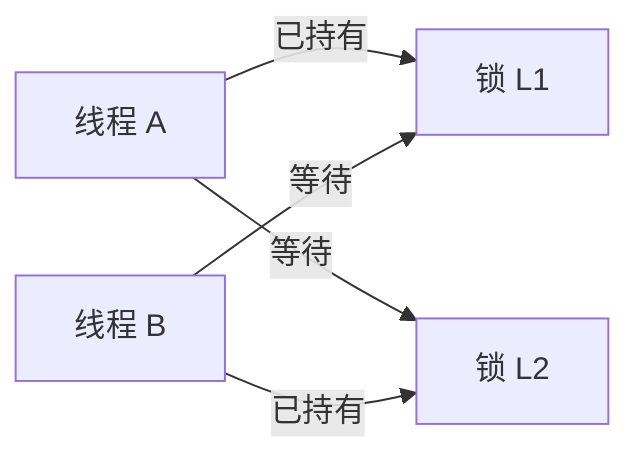

# 07 · 同步与并发：原子、锁与死锁

> 一句话：并发 bug 不会「看起来像并发 bug」——它看起来像偶发崩溃、数据错乱、性能抖动；这一页讲的是把「偶发」变成「可解释」。

## 是什么 / 为什么重要

三个独立的问题经常被混称为「线程安全」：

| 问题 | 一句话 | 反例 |
|:---:|---|---|
| **原子性** | 一个操作要么全做完，要么没做 | `counter++` 是「读-改-写」三步，可被打断 |
| **可见性** | 一个线程的写，另一个线程何时能看到 | 编译器/CPU 把写缓存住，另一核读到旧值 |
| **有序性** | 两条语句的执行顺序是否可被重排 | 先写数据再置标志，可能变成先置标志 |

为什么重要：

- 一次丢失更新可能让计数少 60%，但程序不崩、日志正常——**最难查的那类 bug**。
- 锁选错粒度，会把并发程序变成串行程序；锁选错类型，会把 100 ns 的临界区变成 50 µs。
- 死锁不是「锁太多」造成的，而是**加锁顺序不一致**造成的。

## 机制与结构

### 原子操作：CPU 给的唯一保证

| API（Windows） | x86-64 实际指令 | 语义 |
|:---:|---|---|
| `InterlockedIncrement` | `lock xadd` | 原子加 1，返回新值 |
| `InterlockedCompareExchange` | `lock cmpxchg` | CAS：相等才换，返回旧值 |
| `InterlockedExchange` | `lock xchg` | 原子交换 |
| `MemoryBarrier` | `mfence`（或带 `lock` 的指令） | 全屏障，禁止跨屏障重排 |

`lock` 前缀会把操作变成「总线锁 / 缓存行锁 + 全屏障」。本机实测无竞争时 `InterlockedIncrement` 约 **3.8 ns**——比一次缓存命中贵，但比一次系统调用（70 ns）便宜得多。

### 锁的层级：从用户态到内核态

| 原语 | 层级 | 竞争时行为 | 典型成本（本机） | 适用 |
|:---:|---|---|---:|---|
| `SRWLOCK` | 用户态 | 自旋一小段后进内核等待 | 无竞争 11 ns；2 线程 13.6 ns/op | 读写分离、临界区短 |
| `CRITICAL_SECTION` | 用户态 | 自旋 → 信号量等待 | 无竞争 11.5 ns；2 线程 44.6 ns/op | 通用互斥（可重入） |
| `Interlocked*` | 用户态 | 不阻塞，硬件重试 | 无竞争 3.8 ns；2 线程 14.9 ns/op | 单个计数器/标志 |
| `KSPIN_LOCK` | 内核 | 忙等，**抬高 IRQL 到 DISPATCH_LEVEL** | 几十 ns，但会关抢占 | 极短临界区、DPC |
| `KMUTEX` | 内核 | 阻塞等待 | µs 级 | 可阻塞、可递归 |
| `Semaphore` / `Event` | 内核 | 阻塞等待 | µs 级 | 生产者-消费者 |

`CRITICAL_SECTION` 的内部结构（字段名来自 `winnt.h`，具体布局随版本变）：

```c
typedef struct _RTL_CRITICAL_SECTION {
    PRTL_CRITICAL_SECTION_DEBUG DebugInfo;   /* 调试与链表信息 */
    LONG LockCount;                          /* 递归/等待计数 */
    LONG RecursionCount;                     /* 同一线程重入次数 */
    HANDLE OwningThread;                     /* 当前持有者 */
    HANDLE LockSemaphore;                    /* 竞争时才创建的内核事件 */
    ULONG_PTR SpinCount;                     /* 进内核前自旋次数 */
} RTL_CRITICAL_SECTION;
```

> 注意 `LockSemaphore` 是**惰性创建**的：没有竞争时 `CRITICAL_SECTION` 完全不碰内核，这也是它 11 ns 就能完成的原因。

### 内存序：x86 的「强」是有条件的

x86-64 是 TSO 模型：**读-读、读-写、写-写不会重排，写-读可能重排**（StoreLoad）。所以 `Interlocked*` 和 `MemoryBarrier` 主要防的是「写后读」乱序，以及编译器的重排。ARM64 弱得多，同样的 C 代码在 ARM 上需要显式的 acquire/release。

```c
/* 错误示范：flag 和 data 的可见性没有保证 */
data = 42;
flag = 1;          /* 另一线程可能先看到 flag=1，再看到旧的 data */

/* 正确做法：用 release/acquire（C11）或 Interlocked + MemoryBarrier */
data = 42;
MemoryBarrier();   /* 或 InterlockedExchange(&flag, 1) */
flag = 1;
```

### 死锁：四个条件同时成立才会发生



| 条件 | 含义 | 破坏方法 |
|:---:|---|---|
| 互斥 | 资源一次只能一个持有者 | 用无锁结构/读写锁 |
| 持有并等待 | 拿着 A 等 B | 一次性申请所有锁；失败就全放 |
| 不可剥夺 | 锁不能被强行拿走 | 用带超时的锁（`TryEnterCriticalSection`） |
| 循环等待 | A 等 B、B 等 A | **全局锁顺序**（最实用） |

工程上最有效的是第四条：**给所有锁编号，永远按升序获取**。Windows 驱动还有 Driver Verifier 的死锁检测，Linux 有 lockdep——都是把「运行期偶发」变成「测试期必现」。

## 动手验证

下面这个程序用 MinGW gcc 编译（`gcc -O2 -o sync_demo.exe sync_demo.c`），一次测出三组数字：

```c
#define WIN32_LEAN_AND_MEAN
#include <windows.h>
#include <stdio.h>
#include <stdlib.h>

static double g_tpu;
static double now_us(void) {
    LARGE_INTEGER c; QueryPerformanceCounter(&c); return (double)c.QuadPart / g_tpu;
}
static int cmp(const void *a, const void *b) {
    double x = *(const double *)a, y = *(const double *)b;
    return (x > y) - (x < y);
}
static double best_of(double *s, int n) { qsort(s, (size_t)n, sizeof(double), cmp); return s[0]; }

static CRITICAL_SECTION g_cs;
static SRWLOCK g_srw;
static volatile LONG g_plain, g_inter;
static int g_iters;

static DWORD WINAPI w_plain(LPVOID p) { (void)p; for (int i = 0; i < g_iters; i++) g_plain = g_plain + 1; return 0; }
static DWORD WINAPI w_cs(LPVOID p)    { (void)p; for (int i = 0; i < g_iters; i++) { EnterCriticalSection(&g_cs); g_inter++; LeaveCriticalSection(&g_cs); } return 0; }
static DWORD WINAPI w_srw(LPVOID p)   { (void)p; for (int i = 0; i < g_iters; i++) { AcquireSRWLockExclusive(&g_srw); g_inter++; ReleaseSRWLockExclusive(&g_srw); } return 0; }
static DWORD WINAPI w_inter(LPVOID p) { (void)p; for (int i = 0; i < g_iters; i++) InterlockedIncrement(&g_inter); return 0; }

static double contend(LPTHREAD_START_ROUTINE fn) {
    HANDLE th[2]; g_inter = 0;
    double t0 = now_us();
    for (int i = 0; i < 2; i++) th[i] = CreateThread(NULL, 0, fn, NULL, 0, NULL);
    WaitForMultipleObjects(2, th, TRUE, INFINITE);
    double dt = now_us() - t0;
    for (int i = 0; i < 2; i++) CloseHandle(th[i]);
    return dt * 1000.0 / (2.0 * g_iters);
}

int main(void) {
    LARGE_INTEGER f;
    const int batch = 1000, samples = 200, reps = 3;
    double *s = (double *)malloc(sizeof(double) * (size_t)samples);
    double b_cs = 1e30, b_srw = 1e30, b_inc = 1e30;

    QueryPerformanceFrequency(&f);
    g_tpu = (double)f.QuadPart / 1e6;
    InitializeCriticalSection(&g_cs);
    InitializeSRWLock(&g_srw);

    /* 1) 无竞争：QPC 只有 100 ns 分辨率，必须批量计时 */
    for (int r = 0; r < reps; r++) {
        double v;
        for (int j = 0; j < samples; j++) {
            double t0 = now_us();
            for (int i = 0; i < batch; i++) { EnterCriticalSection(&g_cs); LeaveCriticalSection(&g_cs); }
            s[j] = (now_us() - t0) * 1000.0 / batch;
        }
        v = best_of(s, samples); if (v < b_cs) b_cs = v;

        for (int j = 0; j < samples; j++) {
            double t0 = now_us();
            for (int i = 0; i < batch; i++) { AcquireSRWLockExclusive(&g_srw); ReleaseSRWLockExclusive(&g_srw); }
            s[j] = (now_us() - t0) * 1000.0 / batch;
        }
        v = best_of(s, samples); if (v < b_srw) b_srw = v;

        for (int j = 0; j < samples; j++) {
            double t0 = now_us();
            for (int i = 0; i < batch; i++) InterlockedIncrement(&g_inter);
            s[j] = (now_us() - t0) * 1000.0 / batch;
        }
        v = best_of(s, samples); if (v < b_inc) b_inc = v;
    }
    printf("== uncontended (batched %d ops/sample) ==\n", batch);
    printf("CRITICAL_SECTION enter+leave : %5.1f ns\n", b_cs);
    printf("SRWLock acquire+release     : %5.1f ns\n", b_srw);
    printf("InterlockedIncrement        : %5.1f ns\n", b_inc);

    /* 2) 丢失更新：4 线程各 100 万次裸 ++ */
    {
        HANDLE th[4];
        g_iters = 1000000;
        g_plain = 0;
        for (int i = 0; i < 4; i++) th[i] = CreateThread(NULL, 0, w_plain, NULL, 0, NULL);
        WaitForMultipleObjects(4, th, TRUE, INFINITE);
        for (int i = 0; i < 4; i++) CloseHandle(th[i]);
        printf("\n== lost update ==\n");
        printf("plain ++ x 4 threads x 1,000,000 : %ld (expected 4000000)\n", (long)g_plain);
    }

    /* 3) 有竞争：2 线程各 50 万次 */
    g_iters = 500000;
    printf("\n== contended, 2 threads x 500,000 ==\n");
    printf("CRITICAL_SECTION    : %5.1f ns/op\n", contend(w_cs));
    printf("SRWLock             : %5.1f ns/op\n", contend(w_srw));
    printf("InterlockedIncrement: %5.1f ns/op\n", contend(w_inter));
    printf("final counter       : %ld\n", (long)g_inter);

    free(s);
    DeleteCriticalSection(&g_cs);
    return 0;
}
```

本机实测输出：

```text
== uncontended (batched 1000 ops/sample) ==
CRITICAL_SECTION enter+leave :  11.5 ns
SRWLock acquire+release     :  11.0 ns
InterlockedIncrement        :   3.8 ns

== lost update ==
plain ++ x 4 threads x 1,000,000 : 1453187 (expected 4000000)

== contended, 2 threads x 500,000 ==
CRITICAL_SECTION    :  44.6 ns/op
SRWLock             :  13.6 ns/op
InterlockedIncrement:  14.9 ns/op
final counter       : 1000000
```

三个可以直接用的结论：

1. **400 万次 `++` 只得到 145 万**——丢失更新不是理论问题，是 4 个线程跑 1 秒就能复现的事实。
2. **无竞争时 `Interlocked` 最便宜**（3.8 ns），但**有竞争时它并不比锁快**（14.9 vs SRW 13.6）——CAS 失败会重试，重试就是浪费。
3. **`CRITICAL_SECTION` 竞争时最贵**（44.6 ns）：它带递归语义、进入内核等事件；短临界区用 SRWLock 更划算。

## 常见误区

1. **以为 `volatile` 能代替原子操作**。`volatile` 只保证「不被优化掉、每次都读写内存」，不保证「读-改-写」原子；`counter++` 加了 `volatile` 照样丢更新。
2. **以为锁越少越安全**。死锁的根源是**顺序**不是数量；两把锁按固定顺序获取永远比「只用一把大锁」更并发、也更安全（前提是顺序被遵守）。
3. **以为无锁（lock-free）一定更快**。低竞争时 CAS 很便宜；高竞争时大量线程反复失败重试，吞吐可能比一把互斥锁还低。
4. **以为内存序只在多核才有意义**。单核上编译器重排 + 抢占也能让 `data`/`flag` 的顺序反过来；多核只是让问题更容易复现。
5. **以为死锁只发生在「两把锁」场景**。锁 + 事件、锁 + I/O 回调、驱动里的资源栈都可能死锁；判据永远是那四个条件是否同时成立。

## 自测

**1. 为什么 `volatile int counter; counter++` 在多线程下仍然会丢更新？**

- **考点**：原子性 vs 可见性
- **应明白**：`++` 是读-改-写三步，`volatile` 只保证每步都真读真写内存，不保证三步之间不被打断
- **算会**：能说出要用 `InterlockedIncrement` 或 `std::atomic`，并解释为什么 `volatile` 不够

**2. 两个线程各持一把锁、互相等待，违反了死锁四条件里的哪几条？怎么改？**

- **考点**：死锁条件与破坏
- **应明白**：同时满足「持有并等待」和「循环等待」；最实用的修法是给锁定全局顺序（破坏循环等待）
- **算会**：能写出具体的锁编号规则，并说明为什么「加超时」只是兜底不是根治

**3. 本机无竞争时 `InterlockedIncrement` 是 3.8 ns，有竞争时是 14.9 ns/op。多出来的时间花在哪？**

- **考点**：缓存行与 CAS 重试
- **应明白**：多个核同时改同一缓存行会来回抢所有权（cache line ping-pong），CAS 失败还要重读重试
- **算会**：能提出缓解手段（每线程本地计数再汇总、对齐填充避免伪共享）

## 相关

- 线程与切换成本：[`02 · 进程与线程`](./02-process-and-thread.md)
- 调度与优先级：[`03 · 调度`](./03-scheduling.md)
- 跨进程同步与通信：[`08 · IPC`](./08-ipc.md)
- 实验：[`labs/01-syscall-cost`](../labs/01-syscall-cost/)
