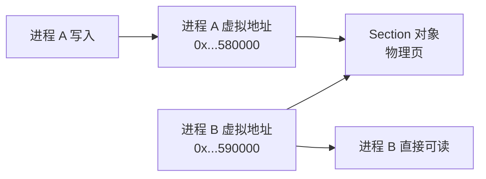

# 08 · IPC：管道、共享内存、socket 与「信号」

> 一句话：进程之间天然隔离，所以「通信」这件事永远要显式建立一条通道——选哪种通道，决定了你要为拷贝、同步和权限付出多少。

## 是什么 / 为什么重要

隔离是虚拟内存给的，通信就得自己搭。按「数据在哪」分三类：

| 模型 | 数据路径 | 拷贝次数（发送方→接收方） | 典型场景 |
|:---:|---|---:|---|
| 消息传递（管道、socket、消息队列） | 内核缓冲区中转 | 2 次（用户→内核→用户） | 请求/响应、流式数据 |
| 共享内存 | 双方映射同一物理页 | 0 次（各自读写） | 大块数据、高频交换 |
| 同步原语（事件、信号量） | 只传「状态」不传数据 | — | 配合前两者做时序 |

为什么重要：**一次 IPC 的延迟可以差 3 个数量级**——共享内存是纳秒级，管道/socket 是微秒级，跨机 socket 是毫秒级。选错模型，后面怎么优化都是错的。

## 机制与结构

### Linux 与 Windows 的 IPC 对照

| 需求 | Linux | Windows |
|:---:|---|---|
| 匿名管道 | `pipe()` / `pipe2()` | `CreatePipe()` |
| 命名管道 | FIFO（`mkfifo`） | `CreateNamedPipe` + `\\.\pipe\名字` |
| 消息队列 | SysV / POSIX mq | 无直接对应（用命名管道/socket/`WM_COPYDATA`） |
| 共享内存 | `shm_open` + `mmap` / SysV `shmget` | `CreateFileMapping` + `MapViewOfFile` |
| 信号量 | `sem_open` / `sem_init` | `CreateSemaphore`（命名对象） |
| 互斥 | pthread mutex（进程间需 `PTHREAD_PROCESS_SHARED`） | `CreateMutex`（命名对象） |
| 网络/本机 socket | `AF_UNIX`、`AF_INET` | `AF_UNIX`（Win10 1803+）、`AF_INET` |
| 异步通知 | 信号（`SIGUSR1` 等） | **没有 POSIX signal**；用事件/APC/控制台事件 |

### 共享内存：两个地址，一块物理页



要点：

1. **两个进程拿到的虚拟地址通常不同**，但指向同一物理页——所以指针不能直接跨进程传，必须传「偏移」。
2. `CreateFileMapping(INVALID_HANDLE_VALUE, ...)` 创建的是**页文件支持**的匿名共享内存；传文件句柄则是文件映射。
3. 名字默认在**会话命名空间**：`Local\名字` 只在本会话可见，`Global\名字` 全机器可见（需要权限）。会话隔离是 Windows 服务与桌面进程互相看不见对方命名对象的常见原因。

### 同步：共享内存必须自己配锁

共享内存只解决「数据放哪」，不解决「谁先写」。跨进程同步用的还是内核对象：

| 对象 | 语义 | 跨进程方式 |
|:---:|---|---|
| `CreateEvent` | 手动/自动复位的事件 | `OpenEvent` 按名字打开 |
| `CreateMutex` | 互斥 + 所有者 | `OpenMutex`；可检测遗弃（`WAIT_ABANDONED`） |
| `CreateSemaphore` | 计数信号量 | `OpenSemaphore` |
| `CreateFileMapping` 里的 `SECURITY_ATTRIBUTES` | 控制谁能打开 | 传 `NULL` 用默认 DACL |

### Windows 没有 POSIX signal

这是 Linux 转 Windows 最容易踩的坑：

| Linux 信号 | Windows 上怎么办 |
|:---:|---|
| `SIGINT`（Ctrl+C） | `SetConsoleCtrlHandler` 注册控制台事件处理 |
| `SIGTERM` | 没有等价物；进程间协商（事件/管道）+ `TerminateProcess` 强杀 |
| `SIGKILL` | `TerminateProcess`（不可捕获、不可忽略） |
| `SIGSEGV` | 结构化异常（SEH）/ 向量化异常处理 |
| `SIGUSR1` | 命名事件、APC、`PostThreadMessage` |

`TerminateProcess` **不是信号**：它直接结束进程，目标没有机会清理（不跑 `atexit`、不 flush 文件）。所以「优雅退出」必须自己设计协议。

## 动手验证

### 1. 共享内存 + 匿名管道 + 命名管道枚举

```c
#define WIN32_LEAN_AND_MEAN
#include <windows.h>
#include <stdio.h>

int main(void) {
    const DWORD size = 4096;
    HANDLE map, map2, r, w;
    int *a, *b;

    /* 页文件支持的共享内存，命名对象 */
    map = CreateFileMappingW(INVALID_HANDLE_VALUE, NULL, PAGE_READWRITE, 0, size,
                             L"Local\\osjournal_shm_demo");
    a = (int *)MapViewOfFile(map, FILE_MAP_ALL_ACCESS, 0, 0, size);

    /* 同进程再打开一次，模拟「另一个进程」的视角 */
    map2 = OpenFileMappingW(FILE_MAP_ALL_ACCESS, FALSE, L"Local\\osjournal_shm_demo");
    b = (int *)MapViewOfFile(map2, FILE_MAP_ALL_ACCESS, 0, 0, size);

    a[0] = 0x11223344;
    a[1] = 7;
    printf("view A            = %p\n", (void *)a);
    printf("view B            = %p\n", (void *)b);
    printf("address delta     = %lld bytes\n", (long long)((char *)b - (char *)a));
    printf("B sees A's writes : b[0]=0x%08x b[1]=%d\n", b[0], b[1]);
    b[1] = 99;
    printf("A sees B's write  : a[1]=%d\n", a[1]);

    /* 匿名管道 */
    if (CreatePipe(&r, &w, NULL, 0)) {
        DWORD written = 0, got = 0;
        char buf[64];
        WriteFile(w, "hello pipe", 10, &written, NULL);
        ReadFile(r, buf, sizeof(buf) - 1, &got, NULL);
        buf[got] = '\0';
        printf("anonymous pipe    : wrote %lu, read %lu, payload \"%s\"\n", written, got, buf);
        CloseHandle(r);
        CloseHandle(w);
    }

    /* 枚举本会话的命名管道 */
    {
        WIN32_FIND_DATAW fd;
        HANDLE h = FindFirstFileW(L"\\\\.\\pipe\\*", &fd);
        int n = 0;
        if (h != INVALID_HANDLE_VALUE) {
            do { n++; } while (FindNextFileW(h, &fd));
            FindClose(h);
        }
        printf("named pipe count  : %d visible in this session\n", n);
    }

    UnmapViewOfFile(a);
    UnmapViewOfFile(b);
    CloseHandle(map2);
    CloseHandle(map);
    return 0;
}
```

编译运行（`gcc -O2 -o ipc_demo.exe ipc_demo.c`），本机实测输出：

```text
view A            = 0000019B85580000
view B            = 0000019B85590000
address delta     = 65536 bytes
B sees A's writes : b[0]=0x11223344 b[1]=7
A sees B's write  : a[1]=99
anonymous pipe    : wrote 10, read 10, payload "hello pipe"
named pipe count  : 552 visible in this session
```

三个观察：

1. 两个视图的地址差 64 KB，**但读写的是同一份数据**——这就是共享内存的本质：地址不同、物理页相同。
2. 匿名管道一次写入 10 字节、读回 10 字节，数据经过内核缓冲区。
3. 本会话有 **552 个命名管道**可见（系统服务、LSASS 等都在用），说明命名管道不是「老技术」，而是 Windows 的主力 IPC。

### 2. 用 PowerShell 看命名管道

```powershell
[System.IO.Directory]::GetFiles('\\.\pipe\') | Select-Object -First 5
```

本机实测：

```text
\\.\pipe\InitShutdown
\\.\pipe\lsass
\\.\pipe\ntsvcs
```

每个名字背后是一个内核对象；能不能打开取决于 DACL。

### 3. 看本机 socket

```powershell
netstat -ano | Select-Object -First 5
```

本机实测（节选）：

```text
  Proto  Local Address          Foreign Address        State           PID
  TCP    0.0.0.0:80             0.0.0.0:0              LISTENING       4
```

PID 4 是 `System`——说明有内核驱动在监听 80 端口。这条命令同时能验证「socket 不只是给网络用的」：本机回环、Unix 域 socket 都走同一套接口。

### 4. Linux 对照（本机不可执行）

```text
# Linux 示例：本机不可执行，原因见 docs/00 的环境一节
ipcs -m                 # 列共享内存段
ipcs -q                 # 列消息队列
ls -l /proc/<pid>/fd    # 看进程打开的管道/socket
```

## 常见误区

1. **以为 Windows 有 signal**。没有 POSIX 信号；`TerminateProcess` 是强杀不是信号，`Ctrl+C` 走的是控制台事件（`SetConsoleCtrlHandler`）。移植代码时这块必须重写，不是「换个函数名」。
2. **以为共享内存自带同步**。共享内存只共享字节，不共享「顺序」；两个进程同时写同一位置，结果和两个线程抢一个变量一样是竞争。
3. **以为匿名管道只能父子进程用**。管道句柄可以被继承或 `DuplicateHandle` 给别的进程；「匿名」指的是没有名字，不是「只能直系亲属」。
4. **以为 socket 只能跨网络**。本机回环、`AF_UNIX` 都是 socket；Windows 的命名管道在实现上也复用类似的连接模型。
5. **以为命名对象全机器可见**。默认在会话命名空间；服务进程和用户进程、不同登录会话之间默认互相看不到，要显式用 `Global\` 前缀（并处理权限）。

## 自测

**1. 两个进程用共享内存交换数据，虚拟地址不同，为什么还能读到同一份内容？**

- **考点**：section 对象与页表映射
- **应明白**：`CreateFileMapping` 创建的是物理页的抽象（section），`MapViewOfFile` 把同一批物理页映射进各自页表，所以 VA 不同、PFN 相同
- **算会**：能解释为什么「传指针」跨进程会崩，而「传偏移」可以

**2. 一个 Linux 程序用 `SIGTERM` 做优雅退出，移植到 Windows 该怎么改？**

- **考点**：信号模型差异
- **应明白**：Windows 没有 `SIGTERM`；要自己定义退出协议（命名事件/管道消息/窗口消息），并保留 `TerminateProcess` 作为最后手段
- **算会**：能说出为什么 `TerminateProcess` 不能用于「优雅」退出（目标没有清理机会）

**3. 共享内存比管道快，为什么不是所有 IPC 都用共享内存？**

- **考点**：零拷贝的代价
- **应明白**：需要自己管同步、生命周期、权限、安全边界；跨机不可用；调试复杂
- **算会**：能按「数据量 × 频率 × 是否跨机 × 安全要求」给出选型理由

## 相关

- 并发与锁：[`07 · 同步与并发`](./07-sync-and-concurrency.md)
- 文件与映射：[`06 · 文件系统`](./06-file-system.md)
- I/O 模型：[`09 · I/O 与多路复用`](./09-io-and-epoll.md)
- 实验：[`labs/01-syscall-cost`](../labs/01-syscall-cost/)
