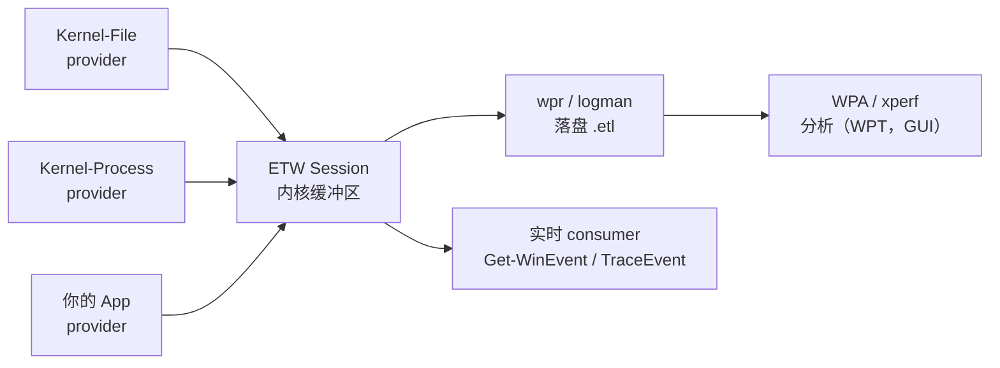

# 10 · 内核观测：ETW、计数器与「四数字」诊断法

> 一句话：观测不是「装个工具看火焰图」，而是先有假设、再选一个能证伪它的计数器——没有假设的采样，只是在制造更多数据。

## 是什么 / 为什么重要

内核不给你源码级断点（除非你有符号和调试器），但会持续吐出三类信号：

| 信号 | 产生者 | 粒度 | 典型用途 |
|:---:|---|---|---|
| **性能计数器** | 内核/驱动注册的 PDH 计数器 | 秒级采样 | 看趋势：CPU、内存、I/O、队列 |
| **ETW 事件** | provider 主动记录 | 微秒级、带时间戳 | 看单次事件：谁在什么时候做了什么 |
| **内核调试器** | 断点/命令 | 指令级 | 看结构体、调用栈、页表 |

为什么重要：**「系统慢」不是一个可验证的命题**。能验证的命题是「硬缺页 3000 次/秒」「就绪队列长度 15」「等锁时间占 60%」。观测的全部工作，就是把前者翻译成后者。

## 机制与结构

### ETW：provider → session → consumer



关键概念：

| 概念 | 说明 |
|:---:|---|
| provider | 事件源，有 GUID 和名字；本机 `logman query providers` 能列出 **981 个** |
| session | 一个录制会话，可同时开多个 provider；有缓冲区，满了会丢事件 |
| keyword / level | 事件过滤条件（如只收 `FileIO` 的 `Verbose`） |
| consumer | 读事件的人：落盘成 `.etl`，或实时消费 |
| `.etl` | ETW 的二进制日志格式，需要 WPA/xperf/perfview 解读 |

本机真实的三个内核 provider：

```text
Microsoft-Windows-Kernel-File            {EDD08927-9CC4-4E65-B970-C2560FB5C289}
Microsoft-Windows-Kernel-Network         {7DD42A49-5329-4832-8DFD-43D979153A88}
Microsoft-Windows-Kernel-Process         {22FB2CD6-0E7B-422B-A0C7-2FAD1FD0E716}
Microsoft-Windows-Kernel-Processor-Power {0F67E49F-FE51-4E9F-B490-6F2948CC6027}
```

### 本机可用 / 不可用（实测）

| 工具 | 状态 | 用法 |
|:---:|---|---|
| `wpr.exe` | ✅ 自带（`10.0.26100`） | `wpr -start CPU -filemode` / `wpr -stop x.etl` |
| `typeperf.exe` | ✅ 自带 | `typeperf "\System\Context Switches/sec" -sc 3` |
| `Get-Counter` | ✅ PowerShell 内置 | 秒级采样，最方便 |
| `logman.exe` | ✅ 自带 | 查 provider、建/删 session |
| `Get-Process` | ✅ | 每进程 CPU 时间、句柄、线程、工作集 |
| `netstat -ano` | ✅ | 连接与监听端口 |
| Procmon / Process Explorer | ❌ 未装 | 需要自行下载 Sysinternals |
| WPA / xperf | ✅ 已装（WPT） | `.etl` 的分析工具 |
| WinDbg | ❌ 未装 | `!process` / `!vm` / `!thread` 都不可用 |
| `Get-CimInstance`（WMI） | ⚠️ 本会话返回「拒绝访问」 | 文档里不把它当作可运行示例 |

### 「四数字」诊断法

拿到一个进程的四个数字，就能先分大类，再去验证：

| 数字 | 怎么拿 | 高值说明 |
|:---:|---|---|
| 用户态时间 | `Get-Process ... UserProcessorTime` | 在算，不是在内核 |
| 内核态时间 | `Get-Process ... PrivilegedProcessorTime` | syscall/缺页/中断/驱动多 |
| 缺页次数 | `\Process(名字)\Page Faults/sec` | 内存在抖，可能是工作集被裁 |
| 上下文切换 | `\System\Context Switches/sec`（全局） | 锁竞争、I/O 等待、线程过多 |

| 组合 | 更像什么 |
|:---:|---|
| 用户态高、其余正常 | CPU 密集，算法/循环问题 |
| 内核态高、缺页高 | 内存抖动、工作集不足、硬缺页 |
| 内核态高、缺页正常、切换高 | 锁竞争或 I/O 等待 |
| 用户态 + 内核态都低，但延迟高 | 在等（锁/IO/网络），或被调度饿死 |
| 切换数高、CPU 不高 | 大量短线程/事件唤醒，检查线程模型 |

> 这张表只能给「方向」，不能给「结论」。方向确定后，必须用 ETW 或计数器拿到具体证据。

## 动手验证

### 1. 列出本机的 ETW provider

```powershell
logman query providers | Select-String -Pattern 'Kernel-File|Kernel-Process|Kernel-Network'
```

本机实测：

```text
Microsoft-Windows-Kernel-File            {EDD08927-9CC4-4E65-B970-C2560FB5C289}
Microsoft-Windows-Kernel-Network         {7DD42A49-5329-4832-8DFD-43D979153A88}
Microsoft-Windows-Kernel-Process         {22FB2CD6-0E7B-422B-A0C7-2FAD1FD0E716}
```

`logman query providers` 在本机能列出 **981** 个 provider。能列出 ≠ 能录：录制通常要管理员权限。

### 2. 确认 ETW 录制器在不在

```powershell
wpr -status
```

本机实测：

```text
Microsoft Windows Performance Recorder Version 10.0.26100 (CoreSystem)
Copyright (c) 2024 Microsoft Corporation. All rights reserved.

WPR is not recording
```

能启动录制，但**录完的 `.etl` 需要 WPA 分析**，本机装了 WPA（WPT），但它是 GUI 工具——所以「录得下来」和「看得懂」是两件事。

### 3. 用 typeperf 做最轻的采样

```powershell
typeperf "\System\Context Switches/sec" -sc 3
```

本机实测：

```text
"(PDH-CSV 4.0)","\\DESKTOP-QE8M0K4\System\Context Switches/sec"
"11/22/2026 23:59:09.734","127600.983926"
"11/22/2026 23:59:10.739","105578.123105"
"11/22/2026 23:59:11.743","129903.577486"
```

CSV 输出可以直接喂给脚本做趋势判断；比 `Get-Counter` 多的好处是**不依赖 PowerShell 进程**。

### 4. 四数字实战

```powershell
$p = Get-Process -Id $PID
"user_s={0:N3} kernel_s={1:N3} ws_MB={2:N1} threads={3}" -f `
  $p.UserProcessorTime.TotalSeconds, $p.PrivilegedProcessorTime.TotalSeconds, `
  ($p.WorkingSet64/1MB), $p.Threads.Count

(Get-Counter '\Process(powershell*)\Page Faults/sec' -MaxSamples 1).CounterSamples |
  ForEach-Object { "{0} = {1:N2}" -f $_.Path.Split('\')[-1], $_.CookedValue }
```

本机实测（`powershell` 进程）：

```text
user_s=0.219 kernel_s=0.422 ws_MB=78.5 threads=29
page faults/sec = 4.97
```

读法：**内核态时间是用户态的近 2 倍**——PowerShell 在启动阶段大量做文件/注册表/进程查询，属于正常现象；如果这是长期稳态，才值得怀疑「syscall 过多」。

再看一眼全机谁在吃 CPU：

```powershell
Get-Process | Sort-Object CPU -Descending | Select-Object -First 5 Name,@{n='CPU_s';e={[math]::Round($_.CPU,2)}},@{n='WS_MB';e={[math]::Round($_.WorkingSet64/1MB,0)}}
```

本机实测：

```text
Name                CPU_s WS_MB
----                ----- -----
GamePP           10476.11    20
DeepSeek Harness  2814.14   425
steamwebhelper    2735.33    29
quark             2561.98   123
steamwebhelper    2270.95    59
```

`CPU` 是**累计** CPU 秒数，不是占用率；判断「现在谁在忙」要用两次采样求差，或者用 `typeperf` 采 `\Process(*)\% Processor Time`。

### 5. Linux 对照（本机不可执行）

```text
# Linux 示例：本机不可执行，原因见 docs/00 的环境一节
strace -c -p <pid>              # 按 syscall 做统计
perf top -p <pid>               # 采样热点函数
perf sched latency              # 调度延迟
cat /proc/<pid>/status          # voluntary_ctxt_switches 等
bpftrace -e '...'               # eBPF 动态追踪
```

## 常见误区

1. **以为「采样越密越准」**。PDH 计数器本身就是秒级聚合；把采样间隔调到 100 ms 只会增加开销，不会让数字更真。要微秒级证据必须上 ETW。
2. **以为 ETW 只记内核事件**。任何程序都能注册 provider 发事件；应用自己的 `TraceLogging` 事件和内核事件在同一个 session 里。
3. **以为 `CPU` 列（任务管理器/PowerShell）是占用率**。`Get-Process.CPU` 是累计秒数；`% Processor Time` 才是速率。两者混用会得出完全相反的结论。
4. **以为观测不改变系统**。ETW 有缓冲区开销，计数器采样要遍历对象，调试器会暂停进程；高频率观测本身就能让问题消失或变形（观察者效应）。
5. **以为有工具就能定位**。没有假设，看到 981 个 provider 也不知道开哪个；先问「我要证伪什么」，再选工具。

## 自测

**1. 一个进程用户态时间 0.2 s、内核态 0.4 s、缺页 5 次/秒、切换数正常。先查什么？**

- **考点**：四数字分类
- **应明白**：内核态占大头、缺页不高 → 更像大量 syscall（文件/注册表/进程查询），而不是换页或锁竞争
- **算会**：能说出用 ETW 的 `Kernel-File`/`Kernel-Process` 去验证，而不是继续猜

**2. ETW 的 session 缓冲区满了会发生什么？这对分析有什么影响？**

- **考点**：ETW 的丢失语义
- **应明白**：会丢事件（并记 lost events 计数）；时间线出现缺口，不能假设「没记录 = 没发生」
- **算会**：能说出加大缓冲区、减少 keyword、缩短录制窗口等缓解手段

**3. 为什么 `Get-CimInstance Win32_OperatingSystem` 在这台机器上会失败，而 `Get-Counter` 可以？**

- **考点**：观测接口的依赖
- **应明白**：WMI 走 CIM/WMI 服务与 DCOM 权限，受限会话可能被拒；PDH 计数器走性能注册表，权限要求不同
- **算会**：能说出「工具失败要换通道，而不是断定系统坏了」

## 相关

- 边界与 syscall：[`01 · 内核边界`](./01-kernel-boundary.md)
- 文件 I/O 事件：[`06 · 文件系统`](./06-file-system.md)
- I/O 模型：[`09 · I/O 与多路复用`](./09-io-and-epoll.md)
- 实验：[`labs/01-syscall-cost`](../labs/01-syscall-cost/)
- 任务清单：[`TASKS.md`](../TASKS.md)
