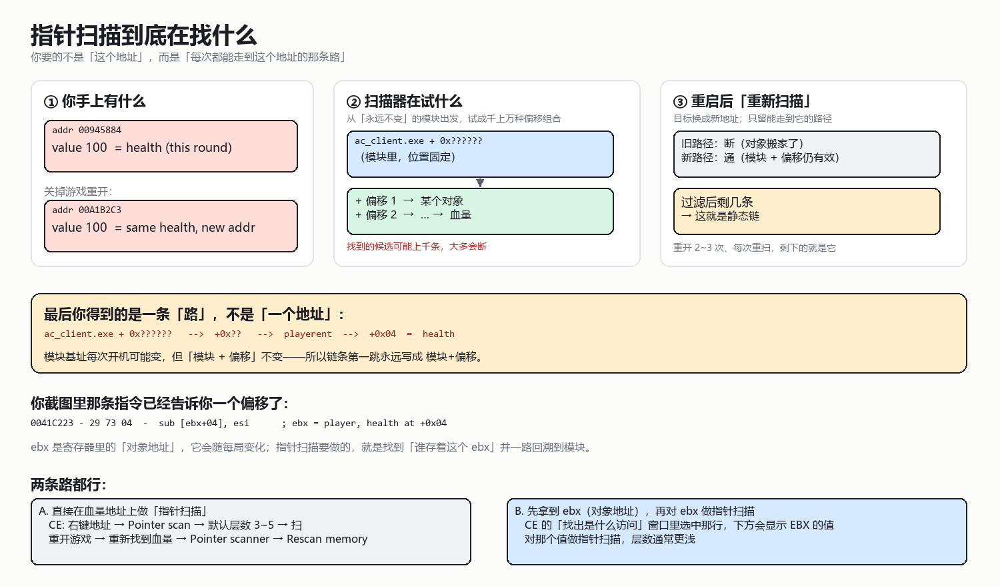
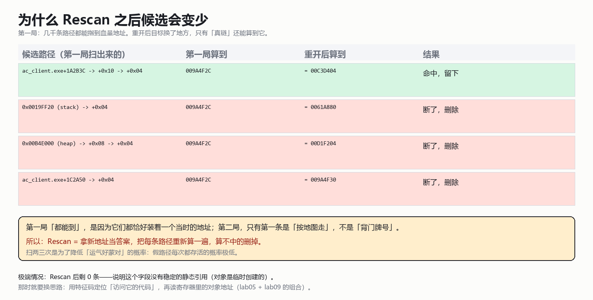

# recon: AssaultCube 1.3.0.2

> 第一份**真实目标**的记录。规则和靶场一样：每个结论都要有能对的数字。
> 模板来自 [TARGETS.md](../TARGETS.md)，字段填不满就写"未验证"，不要猜。

## 0. 目标信息

| 项 | 值 |
|---|---|
| 版本 | 1.3.0.2（2022-04-01，LockdownEdition） |
| 下载 | https://assault.cubers.net/download.html （47–54 MB） |
| 进程名 | `ac_client.exe`（待你核对） |
| 位数 | 32 位（**用任务管理器 → 详细信息 → 平台列确认**） |
| 引擎 | Cube 引擎（自研，不是 Unity/UE） |
| 模式 | 离线 bots / Create Game（不连服务器） |
| 服务端参与 | 离线局：无；联机：有服务端校验，属于另一条线 |

## 1. 阶段一：找到血量（对应 lab02）

CE 操作顺序（写你实际做的）：

1. 进离线局，让 bot 打你一下，记下屏幕上的血量。
2. CE 首次扫描：`4 字节`，输入当前血量 → 让血量变化 → 再扫新值。
3. 收敛到 1~2 个地址后，先**冻结**验证：冻结后血量不再掉 = 找对了。

填这里：

```
第一次扫描的值      :
变化后的值          :
最终剩余地址数      :
地址                : 0x00945884
冻结验证结果        :
值类型              : int32（CE 里扫的「4 字节」，值 100，掉血时整数减少）
```

> 血量在 AC 里很可能是**整数**（不是 float）。这就是为什么"照抄 lab02 的 92.5"会搜不到——
> 先确认类型，再决定用哪个扫描器。

## 2. 阶段二：静态指针链（对应 lab04）

### 2.0 你已经拿到的两个事实（来自"找出是什么访问了这个地址"）

CE 给出的写入指令：

```asm
0041C223 - 29 73 04   -  sub [ebx+04], esi
                                  ↑    ↑
                            血量在这里  这次要扣多少
```

| 事实 | 值 | 怎么确认的 |
|---|---|---|
| 血量地址 | 0x00945884 | 扫描收敛到 1 个，冻结后不再掉 |
| 血量在对象内的偏移 | **+0x04** | 指令写的是 `[ebx+04]` |
| ebx 是什么 | 玩家对象（playerent）的地址 | 每局都变，所以不能写死 |

**`ebx` 每次开局都会变**，这就是为什么还需要"静态链"：找到"谁存着这个 ebx"，一路回溯到模块。



### 2.1 指针扫描怎么做（两条路，选一条）

**路线 A · 直接在血量地址上扫**

1. CE 地址列表里右键 `00945884` → **Pointer scan for this address**（指针扫描）
2. 层数先给 **3~5**，其他保持默认 → 开扫（可能几千条）
3. 关掉游戏重开 → 重新扫到血量（新地址）
4. 打开 Pointer scanner 窗口 → **Rescan memory**，把新地址填进去
5. 反复第 3~4 步 2~3 次，剩下的通常只有几条

**路线 B · 先拿 ebx，再对 ebx 扫**

1. 在"找出是什么访问了这个地址"窗口里**选中那一行指令**，下方信息区会显示寄存器当前值（`EBX=...`）
2. 把那个值当作目标，做同样的指针扫描（层数通常更浅）
3. 同样用"重启 + Rescan"过滤

### 2.1.1 路线 A 的详细点击顺序（CE 中文界面，标签可能略有差异）

**准备**：游戏里正打着，血量在变；CE 已附加到 `ac_client.exe`；地址列表里那个 `00945884` 还在
（扫描结果别清空，后面还要用它）。

| 步 | 操作 | 你应该看到 |
|---|---|---|
| 1 | 地址列表里**选中** `00945884` | 高亮一行 |
| 2 | 右键 → **指针扫描**（Pointer scan for this address） | 弹出"指针扫描"设置窗 |
| 3 | 设置：**最大层级 3**；最大偏移保持默认（0x1000 左右）；勾上"只找静态/模块内的路径"（如果有这项） | — |
| 4 | 点确定 → 等 | 结果列表，通常几千条；每条形如 `ac_client.exe+1A2B3C -> 04 -> 10` |
| 5 | 提示保存时**选是**，存成 `.PTR` 文件 | 文件名记下来 |
| 6 | **关掉游戏，重开一局** | 血量回到初始值 |
| 7 | CE 重新扫到血量（4 字节 → 变化 → 再扫），得到**新地址** | 通常只剩 1 个 |
| 8 | 选中这个新地址 → 指针扫描窗口菜单 **Pointer scanner → Rescan memory**（重新扫描内存） | 结果列表被过滤，剩几十条甚至几条 |
| 9 | 再重复第 6~8 步 1~2 次 | 通常剩 1~5 条 |
| 10 | 双击其中一条 | 地址列表出现 `ac_client.exe+xxxx -> xx -> 04` 形式的指针项，值应等于血量 |
| 11 | 关掉再重开，看这个指针项的值 | **仍等于血量 = 这条链成立** |

**三条常见卡点**

| 现象 | 原因 | 处理 |
|---|---|---|
| 结果 0 条 | 层数太低 | 最大层级改 5 重扫 |
| 结果几万条，Rescan 后还剩几百条 | 目标地址选错，或没真正重开 | 确认第 7 步拿到的是"新一局"的血量 |
| Rescan 要你填地址 | CE 用"当前选中的地址"作为新目标 | 先在地址列表里选中新血量地址，再点 Rescan |

**扫描期间不要做的事**：切换地图、切服务器、让游戏重连——地址一乱，前面白扫。

**扫描前先冻结血量**（勾上地址列表最左边的「激活」）：血量见底时一死就会重生，玩家对象被重建，
之前扫到的路径全部作废。冻结能保证对象一直活着，扫完再取消。

> 实测记录：血量会一路掉到 12 这种低位，所以「值类型 = int32」已确认（不是 float）。
### 2.1.2 为什么 Rescan 之后候选会变少

第一局扫出的几千条路径，**都恰好指向当时的血量地址**；其中大量是巧合。
重开后血量换了地方，Rescan 拿新地址把每条路径重算一遍，算不中的删掉。



- 留下的那条：从 `ac_client.exe` 出发，走固定偏移 → 每次都能算到新地址 = **真链**
- 删掉的：从栈地址、临时堆地址出发 → 只对上一局成立 = 巧合

扫两三次是为了降低"运气好蒙对"的概率。极端情况剩 0 条，说明该字段没有稳定的静态引用，
要改用"特征码定位访问它的代码"这条路（lab05 + lab09）。
### 2.2 结果填这里

```
层数                :
slot（静态偏移）    : 0x______（形如 ac_client.exe+1A2B3C → 填 0x1A2B3C）
第 1 跳偏移         : 0x______
第 2 跳偏移         : 0x______
最后一跳            : 0x04（血量偏移，已确认）
```

> 判据：关掉重开，用这条链能重新算出血量地址，并且和游戏里显示的数字一致。

右键血量地址 → **找出是什么访问了这个地址** → 看指令里的基址/偏移；
然后 Pointer scan（建议 2~3 层），拿到静态链。

```
层数                :
slot（静态偏移）    : 0x______（模块内偏移）
第 1 跳偏移         : 0x______
第 2 跳偏移         : 0x______
（第 3 跳，如果有）
```

## 3. 阶段三：写进配置（对应 lab08）

把上面填进 `labs/08-config-tool/config-ac.txt`：

```ini
process=ac_client.exe
slot=0x<你扫出来的>
ptr_size=4          # 32 位游戏，指针 4 字节
hops=0x<j1>,0x<j2>
type=int32          # 若阶段一确认是整数
stride=0
index=0
```

验证命令：

```bat
cd /d ...\labs\08-config-tool
chaincfg.exe read config-ac.txt
```

```
链解析输出（贴真的一行）：
[1] ... = ...
[2] ... = ...
[3] ... <- 字段地址
[+] 当前值 = ____   ← 必须等于游戏里显示的血量
```

## 4. 阶段四：重启验证（这一条最重要）

关掉 AC，重新开一局，血量和上一局不同。

```
重启后 chaincfg.exe read 的结果 : ____
游戏里显示的血量               : ____
两者一致？                     : 是 / 否
```

**一致才算成功。** 只成功一次是巧合——堆地址每次都会变，链能重算才算真会。

## 5. 阶段五：进阶（可选，按顺序）

| 目标 | 提示 | 记录 |
|---|---|---|
| 弹药 | 开一枪减 1，适合练"精确值扫描" | 地址/偏移： |
| 玩家名字字符串 | 在内存里搜你的昵称，验证字符数组 | 地址： |
| 坐标（x, y, z） | 走动时连续变化，通常是 3 个 float 挨着 | 偏移： |
| 改指令 | 找到"扣血"那条指令，参考 lab09 的五步 | 指令字节： |

## 6. 踩坑记录（真实写，不要美化）

```
（例：按 float 扫血量，扫不到，浪费 20 分钟 —— 实际是 int32）
```

## 7. 结论

- [ ] 重启后仍能读出血量（阶段四通过）
- [ ] 能说清这条链每一跳是什么（World / 实体列表 / 字段）
- [ ] 知道这个游戏是 32 位、指针 4 字节

三条都打勾，这一份 recon 就算完成，可以进下一阶段（叠加层/自瞄的坐标部分）。
